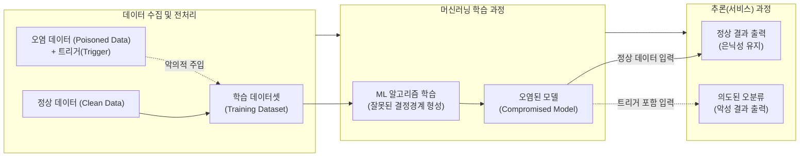

# 머신러닝 학습과정에서의 적대적 공격

---

## I. 모델의 무결성 및 가용성을 훼손하는, 학습과정 적대적 공격의 개요

### 가. 머신러닝 학습과정 적대적 공격의 정의
- 머신러닝 모델의 학습(Training) 단계에서 훈련 데이터셋에 노이즈를 주입하거나 라벨/특징을 조작하여 모델의 결정 경계를 왜곡함으로써 전체 성능 저하(가용성 침해) 또는 특정 트리거 조건에서의 오분류(무결성 침해)를 유발하는 능동적 보안 위협이다.

### 나. 학습과정 적대적 공격의 등장 배경 및 주요 특징

| 구분 | 주요 내용 |
| --- | --- |
| 공급망 취약점 노출 | 오픈소스 사전학습 모델(Pre-trained) 및 외부 크라우드소싱 데이터 의존 심화로 데이터 수집 공급망 오염 |
| 높은 은닉성(Stealth) | 정상 입력에 대해서는 표준 성능을 유지하다가 공격자가 심어둔 특정 트리거 입력 시에만 목표 클래스로 오작동 |
| 영구적 결정 경계 왜곡 | 추론 단계의 일시적 회피(Evasion)와 달리 모델 가중치 자체에 영구적인 백도어(Trojan) 및 편향 주입 |
| 가용성 및 무결성 훼손 | 전체 분류 성능을 마비시키는 무차별 포이즈닝(가용성)과 표적 클래스 오분류를 유도하는 백도어(무결성) 공존 |

---

## II. 학습과정 적대적 공격의 개념도 및 핵심 기술 요소

### 가. 학습과정 적대적 공격의 개념도 및 동작 원리

* 공격자가 학습 데이터에 트리거를 포함한 오염 데이터를 주입하여 모델을 학습시키고, 추론 과정에서 특정 트리거 발현 시에만 오작동하도록 유도함.

### 나. 학습과정 적대적 공격의 핵심 기법 및 방어 기술

| 구분 | 요소기술(키워드) | 세부 설명 |
| --- | --- | --- |
| **무차별 오염(가용성 공격)** | **라벨 반전 (Label Flipping)** | 학습 데이터의 정답 라벨을 무작위로 변경하여 모델의 전반적인 정확도와 신뢰성을 저하시키는 기법 |
| **무차별 오염(가용성 공격)** | **특징 충돌 (Feature Collision)** | 오염 데이터의 특징(Feature) 벡터를 정상 데이터와 유사하게 조작하여 필터링(탐지)을 회피하는 기법 |
| **타겟형 오염(무결성 공격)** | **백도어 공격 (Backdoor Attack)** | 특정 패턴(트리거)이 포함된 입력 데이터에 대해서만 공격자가 의도한 결과로 오분류하도록 모델을 세뇌 |
| **타겟형 오염(무결성 공격)** | **트로이 목마 (Neural Trojan)** | 모델 신경망 내부의 특정 뉴런이 악성 트리거에만 비정상적으로 강하게 활성화되도록 가중치를 조작 |
| **방어 기술(데이터 관점)** | **데이터 정제 (Data Sanitization)** | K-NN, [[이상치]] 탐지(Outlier Detection) 알고리즘을 활용하여 학습 전 데이터셋 내의 이상 패턴이나 노이즈 필터링 |
| **방어 기술([[알고리즘]] 관점)** | **강건한 학습 (Robust Training)** | 적대적 훈련(Adversarial Training) 및 앙상블 기법을 적용하여 일부 오염 데이터에 대한 모델의 민감도 최소화 |
| **방어 기술(감사/분석)** | **기여도 분석 (Influence Function)** | 특정 학습 데이터가 모델의 최종 출력 결과에 미친 영향력을 수학적으로 역산하여 악의적인 학습 데이터 색출 |
| **방어 기술(보안 [[프레임워크]])** | **MLSecOps 적용** | 머신러닝 파이프라인 전체(데이터 수집-학습-배포)에 걸친 데이터 무결성 검증 및 모델 [[형상 관리]] 체계(MIA 방어 등) 구축 |

---

## III. 머신러닝 공격 유형 비교 및 향후 전망

### 가. 머신러닝 학습과정(Training) vs 추론과정(Inference) 공격 비교

| 비교 항목 | 학습과정 공격 (Training Phase) | 추론과정 공격 (Inference Phase) |
| --- | --- | --- |
| **공격 대상** | 학습 데이터셋, 훈련 알고리즘, 사전학습 모델 | 기 학습이 완료된 배포 모델, 입력 데이터 |
| **주요 공격 기법** | **Data Poisoning**, **Backdoor (Trojan)** | **Evasion (회피)**, **Inversion (역전)** |
| **공격의 목적** | 모델 자체를 손상시켜 결정 경계를 근본적으로 왜곡 | 모델의 취약점을 찾아내어 현재 입력에 대한 오분류 유도 |
| **요구 권한/환경** | 데이터 파이프라인 접근, MLaaS 인프라 침투 등 (White/Gray Box) | 모델의 입출력 API 등 서비스 인터페이스 접근 (Black Box) |
| **대응 및 방어** | 데이터 출처 검증, 정제(Sanitization), 연합학습 | 입력값 전처리, 노이즈 필터링, 적대적 예제 훈련 |

### 나. 향후 전망 및 산업적 대응 방향
- **AI 공급망 공격(Supply Chain Attack) 대응 강화**: 오픈소스 허브에서 다운로드받는 사전학습 모델의 가중치 변조 및 신경망 백도어를 검출하기 위해 MITRE ATLAS 기반 모델 감사 및 암호학적 서명(Provenance) 체계 필수화
- **생성형 AI SFT/RLHF 데이터 거버넌스**: 거대 언어 모델(LLM) 정렬 시 소수의 악의적 지시문-응답 쌍으로 탈옥(Jailbreak)을 유발하는 프롬프트 포이즈닝에 대응하기 위해 AI 레드팀(Red Teaming) 및 입출력 가드레일 의무화
- **MLSecOps 파이프라인 내재화**: 데이터 수집, 어노테이션, 전처리, 학습, 배포 전 과정에서 영향 함수(Influence Function) 기반 오염 데이터 이상 탐지와 자동 롤백 기능을 지원하는 보안 자동화 정착

---

### 🔗 연관 토픽

- **소속 도메인**: [[00_인공지능_MOC|🤖 인공지능]]
- **세부 분류**: `2. 머신러닝 기초 & 핵심 알고리즘`
- **핵심 연관 토픽**:
  - [[강화학습]]
  - [[형상 관리]]
  - [[초거대 언어 모델|초거대 언어 모델(Large Language Model)]]
  - [[이상치]]
  - [[지도학습]]
