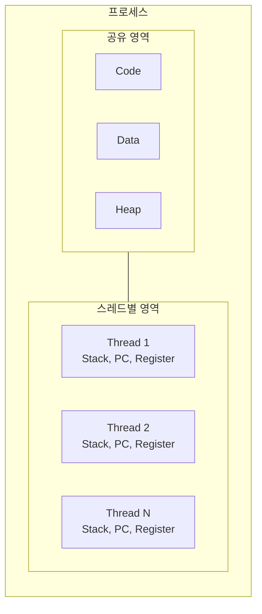

# 멀티 스레드 (Multi-Thread)

---

## I. 한 프로세스 안의 여러 실행 흐름, 멀티 스레드의 개요

### 가. 정의

- 하나의 [[프로세스]] 안에서 **코드·데이터·힙을 공유하고 스택·레지스터는 따로 가진 여러 스레드**가 동시에 실행되는 구조

### 나. 특징

| 구분 | 내용 |
| --- | --- |
| 자원 효율 | 주소 공간을 공유하므로 생성·전환 비용이 프로세스보다 작음 |
| 빠른 [[문맥 교환]] | 같은 주소 공간 안의 전환이라 페이지 테이블 교체·TLB 플러시 불필요 |
| 응답성 | 한 스레드가 블로킹돼도 다른 스레드가 계속 실행 |
| 병렬성 | 멀티코어에서 스레드를 여러 코어에 분산 실행 |
| 동기화 부담 | 공유 데이터 접근 시 경쟁 조건·[[교착상태]] 위험 |

---

## II. 구조 및 구성요소

### 가. 멀티 스레드 프로세스 구조

- 스레드끼리는 공유 메모리로 바로 통신하고, 각자의 스택과 PC로 독립된 실행 흐름 유지

### 나. 구성요소

| 구분 | 요소 | 설명 |
| --- | --- | --- |
| 메모리 | 공유 영역 (Code, Data, Heap) | 전역 변수·동적 할당 메모리를 모든 스레드가 공유 |
| | 독립 영역 (Stack, PC, Register) | 함수 호출 상태와 실행 위치를 스레드별로 보존 |
| 자원 관리 | 스레드 풀 (Thread Pool) | 미리 만든 스레드를 재사용해 생성·소멸 비용 절감 |
| 동기화 | 뮤텍스 (Mutex) | 임계 구역에 한 스레드만 진입하도록 잠금 |
| | [[세마포어]] (Semaphore) | 카운터로 동시 진입 가능한 스레드 수 제어 |
| | [[모니터 동기화\|모니터]] | 상호배제와 조건 변수를 언어 차원에서 제공 |
| 스레드 모델 | 1:1 | 사용자 스레드 1개 = [[커널]] 스레드 1개 (Linux, Windows) |
| | N:1 | 여러 사용자 스레드를 커널 스레드 1개에 매핑, 하나가 블로킹되면 전체 정지 |
| | M:N | 사용자 스레드 M개를 커널 스레드 N개에 매핑 (Go 런타임) |

---

## III. 비교 및 동향

### 가. 멀티 스레드 vs 멀티 프로세스

| 비교 항목 | 멀티 스레드 | 멀티 프로세스 |
| --- | --- | --- |
| 메모리 | Code·Data·Heap 공유 | 프로세스별 독립 주소 공간 |
| 문맥 교환 | 비용 작음 (주소 공간 유지) | 비용 큼 (페이지 테이블 교체, TLB 무효화) |
| 통신 | 공유 메모리 직접 접근 | [[프로세스간 통신\|IPC]] (파이프, 소켓, 공유 메모리) |
| 장애 영향 | 한 스레드 오류가 프로세스 전체 종료 유발 | 다른 프로세스에 영향 적음 |
| 적용 예 | 웹 서버 요청 처리, GUI 앱 | Chrome 탭·렌더러 분리, PostgreSQL 백엔드 |

### 나. 동향

- **경량 스레드**: Java 21 가상 스레드(Project Loom), Go 고루틴, Kotlin 코루틴으로 수십만 개 동시 작업을 적은 커널 스레드로 처리
- **비동기 I/O 결합**: 이벤트 루프·async/await, Linux io_uring과 결합해 스레드당 요청(Thread-per-request) 모델의 한계 보완
- **Python free-threading**: Python 3.13부터 GIL을 끈 실험 빌드 제공, 멀티 스레드 병렬 실행 가능

---

### 🔗 연관 토픽

- **소속 도메인**: [[00_운영체제_MOC|⚙️ 운영체제]]
- **세부 분류**: `1. 프로세스 & 스레드 관리`
- **핵심 연관 토픽**:
  - [[쓰레드]]
  - [[프로세스와 스레드 비교|프로세스(Process)와 스레드(Thread) 비교]]
  - [[문맥 교환|문맥 교환 (Context Switching)]]
  - [[세마포어]]
  - [[교착상태|교착상태 (Deadlock)]]
