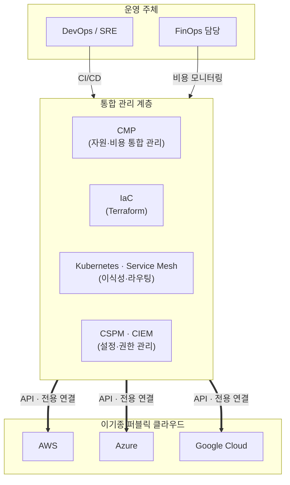

# 멀티클라우드 (Multi-Cloud)

---

## I. 벤더 종속 회피, 멀티클라우드의 개요

### 가. 정의

- AWS·Azure·GCP 등 **2개 이상의 퍼블릭 [[CSP]] 서비스를 조합**하여 워크로드별로 배치·운영하는 클라우드 전략

### 나. 필요성

| 구분 | 내용 |
| --- | --- |
| Lock-in 회피 | 특정 CSP의 장애·가격 정책 변경 리스크 분산 |
| Best-of-Breed | 워크로드 특성에 맞는 CSP 서비스 선택 (예: AI/ML은 GCP, MS 연계 업무는 Azure) |
| 가용성 | CSP 리전 장애 시 다른 CSP로 이중화 |
| 규제 대응 | 국가·산업별 데이터 위치(Data Residency) 요건에 맞춘 자원 배치 |

---

## II. 구조 및 요소 기술

### 가. 개념도

- CMP와 IaC로 이기종 CSP를 추상화하고, [[쿠버네티스]] 기반 [[컨테이너]]로 CSP 간 애플리케이션 이식성 확보

### 나. 요소 기술

| 구분 | 요소 | 설명 |
| --- | --- | --- |
| 관리 | CMP (Cloud Management Platform) | 여러 클라우드의 자원·성능·비용·권한을 단일 콘솔에서 가시화·통제 |
| | IaC | Terraform, Crossplane으로 이기종 인프라를 선언적 코드로 [[프로비저닝]] |
| 이식성 | Kubernetes · Container | 인프라에 무관하게 애플리케이션 구동·이동 |
| 네트워크 | Service Mesh (Istio) | 분산 서비스 간 트래픽 라우팅·mTLS [[암호화]]·관측을 프록시로 제어 |
| | MCN (Multi-Cloud Networking) | [[SD-WAN (Software-Defined Wide Area Network)\|SD-WAN]], Cloud Exchange 전용선으로 CSP 간 연결 |
| 보안 | CSPM | 설정 오류·컴플라이언스 위반 자동 탐지 |
| | CIEM | 과도한 권한 분석, 최소 권한 원칙 적용 |
| 비용 | FinOps | 사용량·비용 분석으로 유휴 자원 제거, 약정 할인 최적화 |

---

## III. 비교 및 동향

### 가. 멀티클라우드 vs 하이브리드 클라우드

| 비교 항목 | 멀티클라우드 | 하이브리드 클라우드 |
| --- | --- | --- |
| 구성 | 퍼블릭 CSP 2개 이상 조합 | 퍼블릭 + 프라이빗(온프레미스) 연동 |
| 목적 | Lock-in 회피, 서비스별 강점 활용 | 기밀 데이터 보호, Cloud Bursting |
| 초점 | CSP 간 상호운용성·이식성 | 내부망-외부망 연동·보안 |
| 관리 복잡도 | 매우 높음 (CSP별 콘솔·API·과금 체계) | 높음 (레거시와 클라우드 통합) |
| 주요 기술 | CMP, Terraform, Crossplane, MCN | Azure Stack, AWS Outposts, Google Distributed Cloud |

- 두 방식은 배타적이지 않으며, 온프레미스 + 복수 CSP를 함께 쓰는 형태가 일반적 ([[클라우드 컴퓨팅의 배치 모델 유형]])

### 나. 동향

- **플랫폼 추상화**: Snowflake·Databricks처럼 여러 CSP 위에서 동일하게 동작하는 데이터·[[PaaS]] 서비스 확산 (Supercloud 개념)
- **FinOps 고도화**: FOCUS(FinOps Open Cost and Usage Specification)로 CSP별 청구 데이터 형식 표준화, AI 기반 비용 [[Anomaly(이상현상)\|이상]] 탐지
- **소버린 클라우드**: 데이터 주권 요구로 국내 CSP와 글로벌 CSP를 병행하는 구성 증가

---

### 🔗 연관 토픽

- **소속 도메인**: [[00_디지털서비스_MOC|🚀 디지털서비스]]
- **세부 분류**: `1. 클라우드 컴퓨팅 & 가상화 인프라`
- **핵심 연관 토픽**:
  - [[CSP|CSP (Cloud Service Provider)]]
  - [[클라우드 컴퓨팅의 배치 모델 유형]]
  - [[쿠버네티스|쿠버네티스(Kubernates)]]
  - [[컨테이너|컨테이너 (Container)]]
  - [[PaaS|PaaS (Platform as a Service)]]
