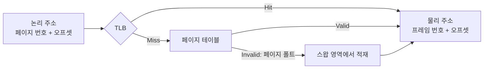

# 메모리 관리 (Memory Management)

---

## I. 한정된 주기억장치의 효율적 공유, 메모리 관리의 개요

### 가. 정의

- 여러 [[프로세스]]가 주기억장치를 **효율적이고 안전하게 쓰도록 할당·회수·주소 변환·보호를 수행하는 운영체제 기능**

### 나. 필요성 및 특징

| 구분 | 내용 |
| --- | --- |
| 다중 프로그래밍 | 여러 프로세스를 동시에 적재해 [[CPU]] 이용률 향상 |
| [[단편화]] 관리 | 할당·해제 반복으로 생기는 내부·외부 단편화 감소 |
| 주소 분리 | [[논리 주소]]와 [[물리 주소]]를 분리해 재배치·[[가상 메모리]] 지원 |
| 보호 | 프로세스 간, 사용자·커널 간 메모리 침범 방지 |

---

## II. 구조 및 구성요소

### 가. 주소 변환 흐름

- MMU가 TLB·페이지 테이블로 주소를 변환하고, 페이지가 없으면 OS가 디스크에서 적재

### 나. 구성요소

| 구분 | 요소 | 설명 |
| --- | --- | --- |
| 할당 기법 | 연속 할당 | 고정·가변 분할, First/Best/Worst-fit 배치 |
| | 페이징 | 고정 크기 페이지·프레임, 외부 단편화 없음 |
| | [[세그멘테이션]] | 코드·데이터·[[Stack]] 등 논리 단위 가변 분할 |
| 하드웨어 | [[MMU(Memory Management Unit)\|MMU]] | 주소 변환과 권한 검사 |
| | TLB | 최근 주소 변환 캐시 |
| 운영 | [[페이지 교체 알고리즘]] | 빈 프레임이 없을 때 희생 페이지 선택 ([[LRU]], [[LFU]], [[OPT]], Clock) |
| | 워킹 셋 모델 | 최근 참조 페이지 집합을 상주시켜 스래싱 방지 |
| [[커널]] 할당자 | 버디 시스템 | 2의 거듭제곱 크기로 분할·병합, 외부 단편화 완화 |
| | 슬랩 할당자 | 자주 쓰는 커널 객체를 미리 만들어 둔 객체 캐시로 할당 비용 감소 |

---

## III. 비교 및 동향

### 가. 페이징 vs 세그멘테이션

| 비교 항목 | 페이징 | 세그멘테이션 |
| --- | --- | --- |
| 분할 | 고정 크기 | 논리 단위 가변 크기 |
| 단편화 | 내부 단편화 | 외부 단편화 |
| 주소 | 페이지 번호 p + 오프셋 d | 세그먼트 번호 s + 오프셋 d |
| 보호·공유 | 페이지 단위라 상대적으로 복잡 | 논리 단위라 유리 |
| 적용 | 현대 [[OS(운영체제)\|운영체제]] (Linux, Windows) | x86 초기, 일부 임베디드 |

### 나. 동향

- **메모리 분리·풀링**: [[CXL]]로 서버 간 메모리를 풀로 묶어 필요한 만큼 할당 (Memory Disaggregation)
- **계층형 메모리**: [[HBM]]·DDR5·CXL 메모리를 계층화하고 OS가 핫·콜드 페이지를 자동 이동
- **AI 워크로드**: vLLM PagedAttention처럼 페이징 기법을 GPU 메모리의 KV 캐시 관리에 적용

---

### 🔗 연관 토픽

- **소속 도메인**: [[00_컴퓨터구조_MOC|💻 컴퓨터구조]]
- **세부 분류**: `2. 캐시 & 메모리 계층 구조 · 스토리지`
- **핵심 연관 토픽**:
  - [[가상 메모리]]
  - [[가상 메모리 관리 정책]]
  - [[페이지 교체 알고리즘|페이지 교체 알고리즘 (Paging Replacement Algorithm)]]
  - [[세그멘테이션|세그멘테이션 (Segmentation, 가변분할)]]
  - [[MMU(Memory Management Unit)]]
