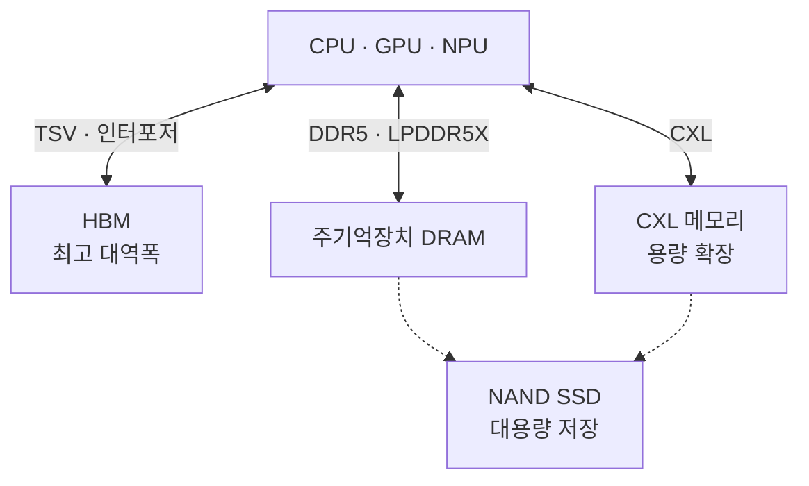

# 메모리 반도체 (Memory Semiconductor)

---

## I. 데이터를 저장하는 반도체, 메모리 반도체의 개요

### 가. 정의

- 전하 충방전이나 물질 상태 변화로 **데이터를 저장·유지하는 반도체**로, 휘발성(DRAM·SRAM)과 비휘발성(NAND·NOR 플래시 등)으로 구분

### 나. 특징

| 구분 | 내용 |
| --- | --- |
| 소품종 대량 생산 | 표준 제품 중심, 미세공정·원가 경쟁력이 핵심 |
| 산업 구조 | IDM(삼성전자, SK hynix, Micron 등) 중심 |
| 경기 민감 | 수급에 따라 가격 변동이 큼 |
| AI 수요 | AI 가속기의 대역폭 요구로 [[HBM]] 등 고부가 제품 비중 확대 |

---

## II. 구조 및 구성요소

### 가. AI 시스템의 메모리 계층

- 위로 갈수록 빠르고 비싸며, 아래로 갈수록 용량이 크고 저렴

### 나. 구성요소

| 구분 | 요소 | 설명 |
| --- | --- | --- |
| 휘발성 | DRAM | 커패시터 1개 + 트랜지스터 1개 셀, 주기적 리프레시 필요 |
| | SRAM | 트랜지스터 6개 래치 셀, 빠르지만 면적 큼 (캐시) |
| 비휘발성 | NAND 플래시 | 직렬 셀 연결로 고집적, SSD·저장용 ([[Flash Memory(NOR, NAND)\|Flash Memory]]) |
| | 3D NAND | 셀을 수직 적층 (300단 안팎), 전하 트랩(CTF) 방식 |
| 고대역폭 | [[HBM\|HBM (High Bandwidth Memory)]] | DRAM 다이를 TSV로 적층, 1024~2048비트 인터페이스 |
| 표준 | DDR5 / LPDDR5X | 서버·PC용 / 모바일용 DRAM 표준 |
| 공정 | EUV 노광 | 10nm급(1a·1b·1c) DRAM의 미세 패턴 형성 |
| 확장 | [[CXL\|CXL (Compute Express Link)]] | PCIe 기반 메모리 확장·풀링 |
| 연산 융합 | [[PIM]] | 메모리 내부에 연산기([[MAC 배열\|MAC]]) 배치 |
| 차세대 | MRAM / ReRAM / PRAM | 자기저항·저항변화·상변화를 이용한 비휘발성 신소자 |

---

## III. 비교 및 동향

### 가. HBM vs PIM vs CXL 메모리

| 비교 항목 | HBM | PIM | CXL 메모리 |
| --- | --- | --- | --- |
| 해결 목적 | 대역폭 부족 | 데이터 이동·전력 | 용량 부족 |
| 구조 | TSV 수직 적층, 프로세서 옆 배치 | 뱅크 옆에 연산기 | PCIe 기반 확장 모듈·풀 |
| 위치 | 가속기 패키지 내부 | 메모리 다이 내부 | 서버·랙 단위 |
| 적합 워크로드 | [[초거대 언어 모델\|LLM]] 학습·추론 | 메모리 집약 연산 (LLM 디코딩 GEMV 등) | 인메모리 [[데이터베이스]], 대용량 서버 |
| 성숙도 | 양산 (HBM3E, HBM4) | 양산 초기·시제품 | 양산 초기 |

### 나. 동향

- **HBM 경쟁**: HBM3E 12단에 이어 HBM4(2048비트, 로직 베이스 다이 파운드리 공정) 양산, 맞춤형(Custom) HBM 확대
- **메모리 중심 컴퓨팅**: PIM·CXL·[[칩렛]] 패키징으로 프로세서와 메모리 경계가 흐려지는 구조로 이동

---

### 🔗 연관 토픽

- **소속 도메인**: [[00_컴퓨터구조_MOC|💻 컴퓨터구조]]
- **세부 분류**: `2. 캐시 & 메모리 계층 구조 · 스토리지`
- **핵심 연관 토픽**:
  - [[HBM|HBM (High Bandwidth Memory)]]
  - [[PIM|PIM(Processing-In-Memory)]]
  - [[Flash Memory(NOR, NAND)]]
  - [[비메모리 반도체|비메모리 반도체 (Non-Memory Chip System Semiconductor)]]
  - [[CXL|CXL (Compute Express Link)]]
