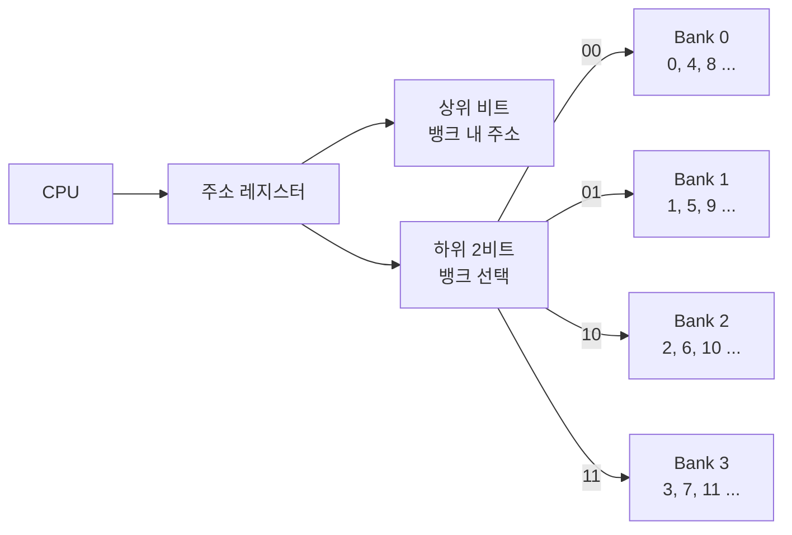

# 메모리 인터리빙 (Memory Interleaving)

---

## I. 뱅크 병렬 접근으로 대역폭 확장, 메모리 인터리빙의 개요

### 가. 정의

- 주기억장치를 독립 동작하는 **여러 모듈(Bank)로 나누고 연속 주소를 모듈마다 번갈아 배치**하여, 접근 사이클을 중첩함으로써 대역폭을 높이는 기법

### 나. 필요성 및 특징

| 구분 | 내용 |
| --- | --- |
| 필요성 | [[CPU]] 속도와 메모리 접근 속도의 격차(Memory Wall) 완화 |
| 접근 중첩 | 한 뱅크가 접근 중일 때 다음 뱅크 접근 시작, 메모리 사이클 은닉 |
| 공간 [[지역성]] 활용 | 명령어·배열처럼 연속 주소를 읽을 때 효과 큼 |

---

## II. 구조 및 구성요소

### 가. 개념도 (하위 오더, 4-way)

- 연속 주소 0, 1, 2, 3이 서로 다른 뱅크에 있으므로 네 접근을 겹쳐 수행, 이상적으로 메모리 사이클 T 동안 4워드 전송

### 나. 구성요소

| 구분 | 요소 | 설명 |
| --- | --- | --- |
| 구조 | 메모리 모듈 (Bank) | 자체 주소·데이터 레지스터를 가져 독립적으로 읽기·쓰기 가능한 단위 |
| | 인터리빙 차수 (Way) | 동시에 접근 가능한 모듈 수 (2·4·8-way), 이상적 대역폭이 차수에 비례 |
| 주소 배치 | 하위 오더 (Low-order) | 하위 비트로 모듈 선택, 연속 주소가 모듈에 분산 → 병렬 접근 |
| | 상위 오더 (High-order) | 상위 비트로 모듈 선택, 연속 주소가 한 모듈에 집중 → 확장·결함 격리 용이 |
| | 혼합 (Mixed) | 상위 비트로 그룹, 그룹 내 하위 비트로 인터리빙 |
| 제약 | 뱅크 충돌 (Bank Conflict) | 같은 뱅크에 연속 접근하면 병렬성 상실 (예: 보폭이 차수의 배수인 배열 접근) |

---

## III. 비교 및 동향

### 가. 하위 오더 vs 상위 오더

| 비교 항목 | 하위 오더 | 상위 오더 |
| --- | --- | --- |
| 모듈 선택 | 주소 하위 비트 | 주소 상위 비트 |
| 연속 주소 배치 | 여러 모듈에 분산 | 한 모듈에 집중 |
| 병렬성 | 높음 | 낮음 |
| 장점 | 대역폭 향상 | 모듈 추가 쉬움, 프로세스별 모듈 분리 |
| 단점 | 모듈 하나 고장 시 전체 주소 공간 영향 | 순차 접근 시 대역폭 이득 없음 |
| 적용 | 주기억장치, [[캐시 메모리]] 뱅크 | 메모리 확장, 결함 격리 |

### 나. 동향

- **DRAM 내부 뱅크 그룹**: DDR5는 뱅크 그룹 8개 × 4뱅크(16Gb 기준 32뱅크)로 뱅크 간 접근을 중첩, 컨트롤러가 채널·랭크·뱅크 단위로 주소를 인터리빙
- **[[CXL]] 메모리 인터리빙**: CXL HDM 디코더가 여러 CXL 메모리 장치에 주소를 2·4·8-way 등으로 분산해 확장 메모리의 대역폭 확보

---

### 🔗 연관 토픽

- **소속 도메인**: [[00_컴퓨터구조_MOC|💻 컴퓨터구조]]
- **세부 분류**: `1. CPU 프로세서 & 마이크로아키텍처`
- **핵심 연관 토픽**:
  - [[캐시 메모리]]
  - [[CXL|CXL (Compute Express Link)]]
  - [[HBM|HBM (High Bandwidth Memory)]]
  - [[메모리 반도체|메모리 반도체 (Memory Semiconductor)]]
  - [[CPU]]
