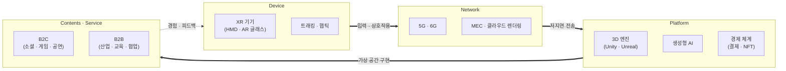

# 메타버스 (Metaverse)

---

## I. 현실과 가상이 연결된 3차원 공간, 메타버스의 개요

### 가. 정의

- XR·3D 그래픽·네트워크 기술로 구현된 **가상 공간에서 아바타를 통해 사회·경제·문화 활동이 이루어지고 현실과 연결되는 세계** (Meta + Universe, 1992년 소설 『Snow Crash』에서 유래)

### 나. 특징

| 구분 | 내용 |
| --- | --- |
| 등장 배경 | XR 기기·공간 컴퓨팅 발전, 비대면 확산, [[디지털 전환]] |
| 지속성 | 접속 여부와 무관하게 세계가 계속 존재 |
| 동시성 | 다수 사용자가 실시간으로 같은 공간 공유 |
| 경제 체계 | 가상 자산 생산·거래 ([[NFT (Non Fungible Token)\|NFT]], 플랫폼 재화) |
| 상호운용성 | 플랫폼 간 아바타·자산 이동 (현재는 제한적) |

---

## II. 구조 및 기술요소

### 가. C-P-N-D 구조

- 사용자는 XR 기기로 접속하고, [[Mobile Edge Computing|MEC]]·5G를 거쳐 3D 엔진·AI로 구현된 플랫폼에서 서비스 이용

### 나. 기술요소

| 구분 | 요소 | 설명 |
| --- | --- | --- |
| 디바이스 | [[XR 유형\|XR]] (VR·AR·MR) | HMD·글래스로 몰입·중첩 시각화 |
| | 공간 컴퓨팅 | 현실 공간을 인식해 3D 객체를 배치·조작 (Apple Vision Pro) |
| | 트래킹 · 햅틱 | 시선·손·표정 추적, 촉각 피드백 |
| 네트워크 | MEC · 클라우드 렌더링 | 단말 근처 서버에서 렌더링해 지연·단말 부담 감소 |
| 플랫폼 | 3D 엔진 | 실시간 렌더링·물리 시뮬레이션·저작 도구 |
| | 생성형 AI | Text-to-3D 에셋 생성, AI NPC·디지털 휴먼 |
| | [[디지털 트윈]] | 현실 객체를 가상 공간에 동기화 |
| 경제 · 신원 | Web3 · 결제 | NFT 소유권, 플랫폼 내 재화·결제 |
| | 아바타 | 사용자 모션을 반영한 가상 분신 |
| 표준 | OpenUSD · glTF | 3D 장면·에셋 교환 표준 (Metaverse Standards Forum) |

---

## III. 비교 및 동향

### 가. 메타버스 4대 유형 (ASF, 2007)

| 비교 항목 | 증강현실 | 라이프로깅 | 거울세계 | 가상세계 |
| --- | --- | --- | --- | --- |
| 기술 축 | 증강 (현실 기반) | 증강 (현실 기반) | 시뮬레이션 (가상 기반) | 시뮬레이션 (가상 기반) |
| 대상 | 외부 환경 | 개인 (내적) | 외부 환경 | 개인 (내적) |
| 특징 | 현실에 가상 객체 중첩 | 일상·경험을 기록·공유 | 현실을 가상에 사실적으로 복제 | 현실과 다른 대안 세계 |
| 사례 | 포켓몬 GO, 차량 HUD | SNS, 스마트워치 | 구글 어스, 지도 앱, 디지털 트윈 | 로블록스, 제페토, 마인크래프트 |

### 나. 동향

- **B2B 중심 이동**: 소셜·게임 중심 열기가 식은 뒤 산업용 메타버스(디지털 트윈·원격 협업·교육 훈련)로 가치 창출 이동
- **제도**: 국내 「가상융합산업 진흥법」(2024 제정) 시행, 가상융합기술(XR) 산업 지원 근거 마련
- **AI 결합**: 생성형 AI로 3D 콘텐츠 제작 비용을 낮추고 사용자 제작 콘텐츠(UGC) 확대

---

### 🔗 연관 토픽

- **소속 도메인**: [[00_디지털서비스_MOC|🚀 디지털서비스]]
- **세부 분류**: `3. 사물인터넷 (IoT) & 스마트 플랫폼 · 메타버스`
- **핵심 연관 토픽**:
  - [[XR 유형|XR(eXtended Reality) 유형]]
  - [[디지털 트윈|디지털 트윈 (Digital Twin)]]
  - [[NFT (Non Fungible Token)]]
  - [[Web 3.0]]
  - [[Mobile Edge Computing|MEC]]
