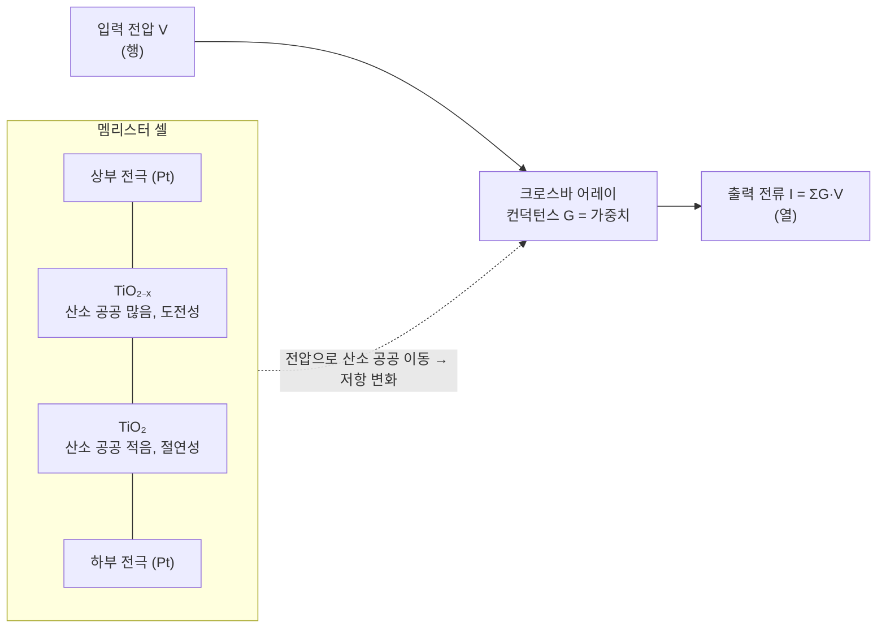

# 멤리스터 (Memristor)

---

## I. 저항이 기억을 갖는 소자, 멤리스터의 개요

### 가. 정의

- 메모리(Memory)와 저항(Resistor)의 합성어로, **통과한 전하량에 따라 저항이 바뀌고 전원이 꺼져도 그 저항을 유지**하는 제4의 수동 소자 (L. Chua 1971 이론 제시, HP Labs 2008 TiO₂ 소자 구현)

### 나. 특징

| 구분 | 내용 |
| --- | --- |
| 비휘발성 | 전원 없이 저항 상태 유지 |
| 아날로그 저항 | 여러 단계 저항으로 시냅스 가중치 표현 |
| 고집적 | 2단자 소자로 크로스바 어레이 구성, BEOL 공정에 적층 가능 |
| 인메모리 연산 | 옴·키르히호프 법칙으로 행렬-벡터 곱을 아날로그로 수행 |

---

## II. 구조 및 구성요소

### 가. 구조와 크로스바 연산

- 각 셀 전류 I = G × V(옴 법칙), 열 방향 전류의 합(키르히호프 법칙)이 곧 곱-누산([[MAC 배열|MAC]]) 결과

### 나. 구성요소

| 구분 | 요소 | 설명 |
| --- | --- | --- |
| 소재 | 전이금속 산화물 | TiO₂, HfO₂, TaOx 등 저항 변화 매질 |
| 저항 상태 | LRS / HRS | 도전 경로(필라멘트) 형성 시 저저항, 끊기면 고저항 |
| 연산 구조 | 크로스바 어레이 | 행·열 전극 교차점에 셀 배치, 행렬-벡터 곱(MVM) 병렬 수행 |
| 학습 | STDP 모사 | 전·후 스파이크 시간차로 저항(가중치) 점진 변화 ([[뉴로모픽 칩]]) |
| 신뢰성 | 1T1R / 1S1R | 트랜지스터 또는 선택 소자(Selector)로 누설 경로(Sneak Path) 차단 |
| 주변 회로 | DAC / ADC | 디지털 입력을 전압으로, 출력 전류를 디지털 값으로 변환 |
| 응용 | ReRAM | 저항 변화를 이용한 비휘발성 메모리 |

---

## III. 비교 및 동향

### 가. ReRAM vs SRAM vs NAND

| 비교 항목 | ReRAM | SRAM | NAND 플래시 |
| --- | --- | --- | --- |
| 저장 원리 | 저항 변화 | 6T 래치 | 전하 저장 (플로팅 게이트·전하 트랩) |
| 속도 (예) | 수십 ns | 1ns 내외 | 읽기 수십 μs, 쓰기 수백 μs |
| 휘발성 | 비휘발 | 휘발 | 비휘발 |
| 집적도 | 높음 | 낮음 | 매우 높음 (3D 적층) |
| 활용 | 임베디드 메모리, [[PIM]]·뉴로모픽 | [[캐시 메모리]] | SSD 저장 |

### 나. 동향

- **아날로그 인메모리 컴퓨팅**: 가중치를 셀에 저장하고 그 자리에서 곱셈해 AI 추론의 데이터 이동 감소 (IBM 등 연구 칩 공개)
- **해결 과제**: 셀 간 저항 산포, 내구성·유지 특성, ADC 면적·전력, Sneak Path가 상용화 걸림돌
- **임베디드 ReRAM**: MCU·IoT 칩의 내장 비휘발 메모리로 파운드리(TSMC 등) 공정 제공

---

### 🔗 연관 토픽

- **소속 도메인**: [[00_컴퓨터구조_MOC|💻 컴퓨터구조]]
- **세부 분류**: `2. 캐시 & 메모리 계층 구조 · 스토리지`
- **핵심 연관 토픽**:
  - [[뉴로모픽 칩|뉴로모픽 칩 (Neuromorphic Chip)]]
  - [[PIM|PIM(Processing-In-Memory)]]
  - [[MAC 배열]]
  - [[메모리 반도체|메모리 반도체 (Memory Semiconductor)]]
  - [[지능형 반도체]]
