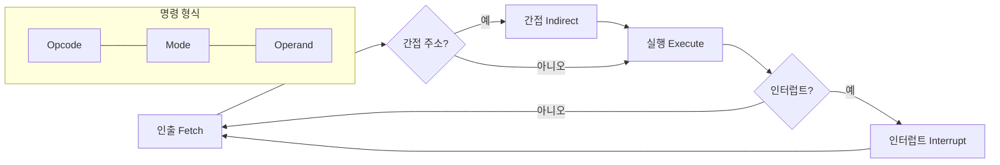

# 명령문 (Instruction)

---

## I. CPU 동작의 최소 단위, 명령문의 개요

### 가. 정의

- [[CPU]]가 수행할 **연산과 그 대상을 지정하는 기계어 단위**로, 연산 코드(Opcode)와 피연산자(Operand)로 구성 (명령어와 같은 뜻)

### 나. 특징

| 구분 | 내용 |
| --- | --- |
| 구성 | Opcode + 주소지정방식(Mode) + Operand |
| 길이 | 고정 길이(RISC) 또는 가변 길이(CISC) |
| 실행 | 인출 → (간접) → 실행 → (인터럽트) 사이클 반복 |
| 주소지정 | 즉시·직접·간접·레지스터·변위 등으로 유효 주소 결정 |

---

## II. 형식 및 실행 사이클

### 가. 명령 형식과 명령어 사이클

- PC가 가리키는 명령을 IR로 인출, 제어장치가 Opcode를 해독하고 피연산자를 가져와 ALU에서 실행

### 나. 구성요소

| 구분 | 요소 | 설명 |
| --- | --- | --- |
| 형식 | Opcode | ADD·LOAD·JUMP 등 수행할 연산의 종류 |
| | Operand | 데이터(즉시값) 또는 데이터가 있는 레지스터·메모리 주소 |
| | Addressing Mode | Operand를 해석해 유효 주소(EA) 결정 |
| 레지스터 | PC | 다음에 인출할 명령 주소 |
| | IR | 현재 실행 중인 명령 |
| | MAR / MBR | 메모리 주소 / 메모리와 주고받는 데이터 |
| 사이클 | 인출 (Fetch) | PC→MAR, M[MAR]→MBR, PC+1, MBR→IR |
| | 실행 (Execute) | 연산 수행 후 결과를 레지스터·메모리에 저장 |
| 제어 | 마이크로 연산 | 한 명령을 이루는 레지스터 전송 수준의 기본 동작 |

---

## III. 비교 및 동향

### 가. CISC vs RISC

| 비교 항목 | CISC | RISC |
| --- | --- | --- |
| 설계 철학 | 강력한 명령으로 프로그램 길이 단축 | 단순 명령으로 하드웨어·파이프라인 단순화 |
| 명령 길이 | 가변 | 고정 (대부분) |
| 메모리 접근 | 다양한 연산이 메모리 직접 접근 | Load/Store만 메모리 접근 |
| 제어 방식 | 마이크로프로그램 중심 | 하드와이어드 중심 |
| 파이프라인 | 구현 복잡 (내부적으로 마이크로 연산 분해) | 구현 용이 |
| 사례 | x86 | ARM, MIPS, RISC-V |

### 나. 동향

- **RISC-V 확산**: 라이선스가 없는 개방형 ISA로 임베디드부터 서버·AI 가속기까지 채택 확대
- **행렬·벡터 확장 명령**: Intel AMX, ARM SVE2·SME 등 행렬 곱([[MAC 배열|MAC]]) 전용 명령을 CPU에 추가해 AI 추론 가속

---

### 🔗 연관 토픽

- **소속 도메인**: [[00_컴퓨터구조_MOC|💻 컴퓨터구조]]
- **세부 분류**: `1. CPU 프로세서 & 마이크로아키텍처`
- **핵심 연관 토픽**:
  - [[CPU|중앙처리장치 (CPU Central Processing Unit)]]
  - [[CPU 처리과정]]
  - [[Pipeline Hazard]]
  - [[DMA(Direct Memory Access)]]
  - [[TPU (Tensor Processing Unit)]]
