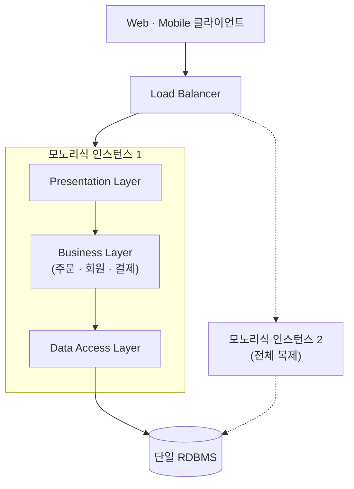

# 모노리식 아키텍처 (Monolithic Architecture)

---

## I. 하나의 단위로 빌드·배포, 모노리식 아키텍처의 개요

### 가. 정의

- UI·비즈니스 로직·데이터 접근 계층 등 **애플리케이션의 모든 기능이 하나의 코드베이스와 배포 단위로 묶여 단일 프로세스로 실행**되는 아키텍처

### 나. 특징

| 구분 | 내용 |
| --- | --- |
| 단순성 | 단일 패키지(JAR·WAR) 빌드·배포, 개발·테스트·디버깅 용이 |
| 일관성 | 단일 DB의 로컬 [[트랜잭션]](ACID)으로 정합성 확보 |
| 성능 | 모듈 간 호출이 프로세스 내 함수 호출, 네트워크 지연 없음 |
| [[결합도]] 증가 | 규모가 커지면 경계가 무너져 Big Ball of Mud, 빌드·배포 시간 증가 |
| 확장 비효율 | 일부 기능에 부하가 몰려도 전체를 복제해야 함 |

---

## II. 구조 및 구성요소

### 가. 구조

- 요청은 하나의 인스턴스 안에서 계층을 차례로 거쳐 단일 DB에서 처리되며, 확장 시 애플리케이션 전체를 복제

### 나. 구성요소

| 구분 | 요소 | 설명 |
| --- | --- | --- |
| 구조 | 계층형 (Layered) | 프레젠테이션 → 비즈니스 → 영속성 계층의 수직 호출 |
| 배포 | 단일 패키징 | 전체 코드를 하나의 아카이브로 빌드·배포 |
| 데이터 | 공유 DB | 모든 모듈이 하나의 [[데이터베이스]] 스키마 공유 |
| 트랜잭션 | 로컬 트랜잭션 | 분산 트랜잭션(2PC, Saga) 불필요 |
| 확장 | X축 확장 (복제) | Scale Cube의 X축, 동일 인스턴스를 로드밸런서 뒤에 복제 |
| 기술 스택 | 단일 스택 | 언어·[[프레임워크]] 선택이 전체에 고정 |

---

## III. 비교 및 동향

### 가. 모노리식 vs 모듈러 모노리스 vs MSA

| 비교 항목 | 모노리식 | 모듈러 모노리스 | [[MSA (Micro Service Architecture)\|MSA]] |
| --- | --- | --- | --- |
| 배포 단위 | 단일 | 단일 | 서비스별 독립 |
| 내부 경계 | 약함 | 모듈 경계 명확 (DDD 바운디드 컨텍스트) | 네트워크로 분리 |
| 확장 | 전체 복제 | 전체 복제 | 서비스별 개별 확장 |
| 장애 영향 | 전체로 확산 가능 | 전체로 확산 가능 | 서비스 격리 (전파 차단 설계 필요) |
| 데이터 | 단일 DB, ACID | 단일 DB, 모듈별 스키마 분리 | 서비스별 DB, 결과적 일관성·Saga |
| 운영 복잡도 | 낮음 | 낮음 | 높음 (게이트웨이·서비스 메시·관측성) |

### 나. 동향

- **MSA 과잉 재검토**: 분산 시스템의 네트워크 지연·정합성·운영 비용 부담으로 소규모 조직은 모노리스로 시작하는 전략(Monolith First) 재조명
- **모듈러 모노리스**: 내부 모듈 경계를 명확히 하고 단일 배포를 유지하다가 필요한 모듈만 서비스로 분리 (Spring Modulith, Shopify 사례)
- **사례**: Amazon Prime Video 모니터링 서비스가 서버리스 분산 구조를 단일 프로세스로 통합해 인프라 비용 90% 절감 보고(2023)

---

### 🔗 연관 토픽

- **소속 도메인**: [[00_디지털서비스_MOC|🚀 디지털서비스]]
- **세부 분류**: `4. 데이터 플랫폼 & 개방형 API 생태계`
- **핵심 연관 토픽**:
  - [[MSA (Micro Service Architecture)]]
  - [[클라우드 네이티브]]
  - [[결합도]]
  - [[트랜잭션]]
  - [[REST RESTful API 설계 6원칙]]
