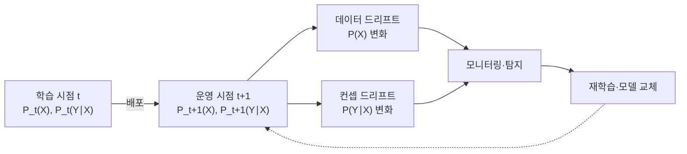

# 모델 드리프트 (데이터 드리프트 & 컨셉 드리프트)

---

## I. 배포 후 성능이 떨어지는 이유, 모델 드리프트의 개요

### 가. 정의

- 학습 시점과 운영 시점의 **데이터 분포나 입력-정답 관계가 달라져 배포된 모델의 예측 성능이 시간에 따라 저하**되는 현상

### 나. 원인 및 특징

| 구분 | 내용 |
| --- | --- |
| 데이터 드리프트 | 입력 분포 $P(X)$ 변화 (공변량 변화, Covariate Shift) |
| 컨셉 드리프트 | 입력-정답 관계 $P(Y \mid X)$ 변화 |
| 레이블 드리프트 | 정답 분포 $P(Y)$ 변화 (Prior Shift) |
| 변화 양상 | 급격(Sudden), 점진(Gradual), 증분(Incremental), 반복(Recurring) |
| 대응 체계 | [[MLOps]] 모니터링과 성능 임계치 기반 재학습(Continuous Training) 필요 |

---

## II. 발생 구조 및 탐지·대응 기술

### 가. 개념도

- 운영 데이터를 학습 데이터와 계속 비교해 분포·관계 변화를 탐지하고, 기준을 넘으면 재학습

### 나. 탐지·대응 기술

| 구분 | 요소 | 설명 |
| --- | --- | --- |
| 분포 비교 | PSI (Population Stability Index) | 구간별 분포 차이 지표, 통상 0.1 미만 안정·0.25 이상 큰 변화 |
| | KS 검정·KL Divergence | 누적분포 최대 차이 검정, 분포 간 정보량 차이 (KL은 비대칭이라 거리 아님) |
| 오류율 감시 | DDM·EDDM | 스트리밍 예측 오류율이 통계적 경고·변화 수준을 넘으면 컨셉 드리프트로 판단 |
| | ADWIN | 가변 윈도우 두 구간의 평균 차이로 변화 시점 탐지 |
| 대응 | 윈도우 재학습 | 최근 N주·N개월 데이터로 주기 재학습 |
| | 온라인 학습 | 데이터 유입마다 증분 업데이트 |
| | 피처 재설계 | 드리프트가 큰 피처 제거·대체, 신규 외부 변수 추가 |
| 운영 | CT 파이프라인 | 피처 스토어·모니터링 알람과 연동한 자동 재학습·검증·배포 |

---

## III. 비교 및 동향

### 가. 데이터 드리프트 vs 컨셉 드리프트

| 비교 항목 | 데이터 드리프트 | 컨셉 드리프트 |
| --- | --- | --- |
| 변화 대상 | $P_{train}(X) \neq P_{prod}(X)$ | $P_{train}(Y \mid X) \neq P_{prod}(Y \mid X)$ |
| 원인 | 사용자층 변화, 센서 교체, 계절성 | 시장·행동 변화, 규제 변경, 공격 패턴 변화 |
| 예시 | 여름 데이터로 학습한 모델에 겨울 데이터 유입 | 과거 정상 거래 패턴이 사기 수법으로 바뀜 |
| 탐지 | 정답 없이 입력 분포만으로 탐지 가능 | 정답(레이블) 확보 후 성능·오류율로 탐지 |
| 대응 | 재가중·재학습, [[이상치]] 점검 | 최신 레이블 재수집 후 재학습·모델 재설계 |

### 나. 동향

- **안전한 교체**: 재학습 모델을 Shadow·Canary 배포로 기존 모델과 병행 검증한 뒤 전환
- **LLM 드리프트 모니터링**: 프롬프트·응답의 임베딩 분포 변화와 품질 지표를 추적하는 도구(Arize Phoenix, Evidently 등) 활용 ([[LLMOps]])

---

### 🔗 연관 토픽

- **소속 도메인**: [[00_인공지능_MOC|🤖 인공지능]]
- **세부 분류**: `1. 수학 · 통계학 & 데이터 전처리`
- **핵심 연관 토픽**:
  - [[MLOps]]
  - [[LLMOps]]
  - [[기술 통계|기술 통계(Descriptive statistics)]]
  - [[이상 감지]]
  - [[이상치]]
