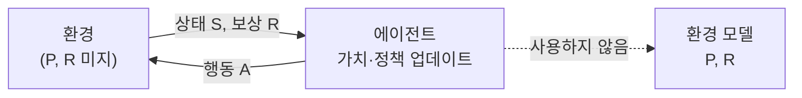

# 모델 프리 (Model-free)

---

## I. 환경 모델 없이 경험으로 배우는, 모델 프리 강화학습의 개요

### 가. 정의

- MDP의 **상태 전이 확률 $P$와 보상 함수 $R$을 모르거나 학습하지 않고, 환경과의 상호작용 경험만으로 가치 함수·정책을 직접 학습**하는 [[강화학습]] 방식

### 나. 특징

| 구분 | 내용 |
| --- | --- |
| 배경 | 현실 환경의 동역학을 정확히 모델링하기 어려운 문제에 적용 |
| 학습 방식 | 시행착오로 얻은 $(S_t, A_t, R_{t+1}, S_{t+1})$ 샘플만 사용 |
| 장점 | 모델 오차(Model Bias)가 없어 충분히 학습하면 최종 성능이 높음, 구현이 단순 |
| 단점 | 샘플 효율이 낮아 많은 상호작용 필요 |

---

## II. 동작 원리 및 핵심 알고리즘

### 가. 개념도

- 환경 모델을 만들지 않고 경험 샘플로 가치(Value)나 정책(Policy)을 직접 갱신

### 나. 핵심 요소

| 구분 | 요소 | 설명 |
| --- | --- | --- |
| 가치 추정 | 몬테카를로 (MC) | 에피소드 종료 후 실제 누적 보상(Return)으로 갱신, 편향 없고 분산 큼 |
| | 시간차 학습 (TD) | 다음 상태의 추정 가치로 즉시 갱신(부트스트래핑), 분산 작음 |
| 가치 기반 | [[Q러닝]] | $\max_a Q(s',a)$로 갱신하는 Off-policy TD 제어 |
| | SARSA | 실제 선택한 다음 행동 $Q(s',a')$로 갱신하는 On-policy TD 제어 |
| 정책 기반 | REINFORCE | 리턴으로 가중한 정책 경사로 정책을 직접 최적화 |
| 심층 강화학습 | DQN | Q러닝 + 심층 신경망 + 경험 재생 + 타깃 네트워크 |
| | PPO | 정책 비율을 클리핑해 갱신 폭을 제한하는 On-policy Actor-Critic |
| | SAC | 보상과 정책 엔트로피를 함께 최대화하는 Off-policy Actor-Critic |

---

## III. 비교 및 동향

### 가. Model-free vs Model-based

| 비교 항목 | Model-free | Model-based |
| --- | --- | --- |
| 학습 흐름 | 경험 → 가치·정책 | 경험 → 모델 학습 → 계획(Planning) → 가치·정책 |
| 환경 모델 | 불필요 | 주어지거나 학습 |
| 샘플 효율 | 낮음 | 높음 (모델 내 가상 경험 활용) |
| 오차 원인 | 추정 분산 | 모델 오차 누적 (Model Bias) |
| 대표 알고리즘 | Q러닝, SARSA, DQN, PPO, A3C, SAC | Dyna-Q, AlphaZero(MCTS), MuZero, Dreamer |

### 나. 동향

- **오프라인 강화학습**: 추가 상호작용 없이 수집된 데이터셋만으로 정책 학습 (CQL, IQL), 로봇·의료처럼 시행착오 비용이 큰 분야에 적용
- **LLM 정렬**: RLHF에서 PPO, 이후 GRPO 등 모델 프리 정책 경사 기법이 언어 모델 미세조정에 활용
- **하이브리드**: 학습된 세계 모델로 상상 경험을 만들어 모델 프리 학습을 보조 (DreamerV3, MuZero)

---

### 🔗 연관 토픽

- **소속 도메인**: [[00_인공지능_MOC|🤖 인공지능]]
- **세부 분류**: `1. 수학 · 통계학 & 데이터 전처리`
- **핵심 연관 토픽**:
  - [[강화학습]]
  - [[Q러닝]]
  - [[마르코프 결정 프로세스]]
  - [[심화강화학습]]
  - [[모방 강화학습]]
