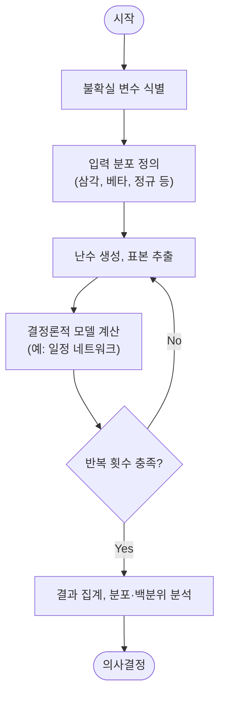

# 몬테카를로 시뮬레이션 (Monte Carlo Simulation)

---

## I. 난수 반복으로 불확실성을 수치화, 몬테카를로 시뮬레이션의 개요

### 가. 정의

- 입력 변수의 **확률 분포에서 무작위 표본을 반복 추출**해 모델을 수천~수만 번 계산하고, 결과를 **확률 분포로 얻는** 확률론적 시뮬레이션 기법 (1940년대 Ulam·von Neumann)

### 나. 필요성 및 특징

| 구분 | 내용 |
| --- | --- |
| 해석해 곤란 | 변수가 많거나 닫힌 해를 구하기 어려운 문제의 근사해 |
| 대수의 법칙 | 반복 횟수가 늘수록 추정치가 기댓값에 수렴, 오차는 1/√N 비율로 감소 |
| 범위·확률 제공 | 단일값 대신 결과 분포, 백분위(P50·P80) 제공 |
| PM 적용 | PMBOK 정량적 위험 분석의 대표 기법, 일정·원가 달성 확률 산출 |

---

## II. 수행 절차와 구성요소

### 가. 개념도

- 분포에서 뽑은 입력값으로 모델을 반복 계산하고, 결과를 모아 확률 분포·신뢰 구간으로 해석

### 나. 구성요소

| 구분 | 요소 | 설명 |
| --- | --- | --- |
| 이론 | 대수의 법칙 | 표본 수가 커지면 표본 평균이 기댓값에 수렴 |
| | [[중심극한정리]] | 독립 확률변수 합의 분포가 정규분포에 근사 |
| 입력 | 확률 분포 | 활동 기간·원가에 삼각·베타(PERT)·[[정규분포]] 등 적용 ([[3점 산정]]) |
| | 상관관계 | 입력 변수 간 상관을 반영하지 않으면 위험을 과소평가 |
| 수행 | 난수 생성 | 의사난수 생성기(PRNG) |
| | 반복 계산 | 일정 네트워크·원가 모델 계산을 수천 회 이상 반복 |
| 효율화 | 분산 감소 기법 | 층화 추출, 라틴 하이퍼큐브, 대조변수로 적은 반복에 정확도 향상 |
| 결과 | S-곡선, 히스토그램 | 완료일·원가별 누적 확률, P80 일정 등 |
| | 민감도 분석 | 토네이도 다이어그램, 핵심 지표(Criticality Index)로 영향 큰 변수·활동 식별 |

---

## III. 비교 및 동향

### 가. 결정론적 vs 몬테카를로

| 비교 항목 | 결정론적 분석 (CPM 등) | 몬테카를로 시뮬레이션 |
| --- | --- | --- |
| 입력 | 단일 값 | 확률 분포 |
| 출력 | 점 추정 | 결과 분포, 달성 확률 |
| 불확실성 | 반영 불가 | 정량적 반영 |
| 경로 합류 편향 | 무시 (낙관적 일정) | 여러 경로 합류에 따른 지연 반영 |
| 연산 | 적음 | 많음 (병렬 처리 활용) |

### 나. 동향

- **AI 융합**: 몬테카를로 트리 탐색(MCTS)이 AlphaGo 등 게임·계획 AI의 핵심 탐색 기법으로 활용
- **양자 가속 연구**: 양자 진폭 추정(QAE)으로 표본 수를 제곱근 수준으로 줄이는 연구가 금융 위험 분석 중심으로 진행
- **애자일 예측**: 과거 처리량(Throughput) 데이터를 재표본 추출해 완료 시점을 확률로 예측

---

### 🔗 연관 토픽

- **소속 도메인**: [[00_프로젝트관리_MOC|📋 프로젝트관리]]
- **세부 분류**: `5. 애자일 프로젝트 관리 & 개발 운영 (Agile PM)`
- **핵심 연관 토픽**:
  - [[3점 산정]]
  - [[정량적 위험 분석]]
  - [[프로젝트 위험관리]]
  - [[중심극한정리|중심극한정리 (Central Limit Theorem)]]
  - [[정규분포|정규분포(Normal Distribution)]]
