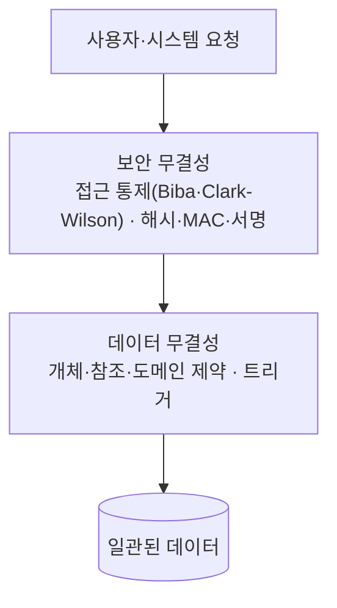

# 무결성 (Integrity)

---

## I. 데이터가 올바르고 변조되지 않은 상태, 무결성의 개요

### 가. 정의

- 데이터가 **정확·일관·유효하며 인가되지 않은 방법으로 변경되지 않은 상태를 보장하는 성질**로, DB 관점(제약조건)과 보안 관점(위변조 방지)을 모두 포함

### 나. 특징

| 구분 | 내용 |
| --- | --- |
| 보안 3요소 | CIA([[기밀성]]·무결성·가용성)의 한 축 |
| DB 관점 | 제약조건으로 잘못된 값과 [[Anomaly(이상현상)\|이상현상]] 방지 ([[데이터베이스 무결성]]) |
| 보안 관점 | 해시·[[MAC]]·전자서명으로 위변조 탐지 |
| 다계층 보장 | 저장장치, DBMS, 네트워크, 애플리케이션 계층에서 함께 보장 |

---

## II. 보장 구조 및 요소

### 가. 계층별 무결성 보장

- 보안 계층이 인가되지 않은 변경을 막고, DBMS 계층이 인가된 변경의 의미적 오류를 막음

### 나. 구성요소

| 구분 | 요소 | 설명 |
| --- | --- | --- |
| 데이터 무결성 | 개체 무결성 | 기본키 NULL·중복 불가 |
| | 참조 무결성 | 외래키는 참조 키 값과 일치하거나 NULL |
| | 도메인 무결성 | 타입·길이·범위(CHECK) 준수 |
| | 사용자 정의 무결성 | 업무 규칙 기반 제약 (트리거 등) |
| 보안 무결성 | 해시 함수 | SHA-256 등으로 변경 여부 탐지 (해시는 암호화가 아닌 단방향 요약) |
| | MAC·전자서명 | 키 기반 무결성 + 출처 인증, 전자서명은 부인 방지까지 제공 |
| 보안 모델 | Biba | No Read Down, No Write Up으로 낮은 등급 정보의 오염 방지 |
| | Clark-Wilson | 정형 트랜잭션(Well-formed Transaction)과 직무 분리 |

---

## III. 비교 및 동향

### 가. 선언적 vs 절차적 무결성

| 비교 항목 | 선언적 무결성 | 절차적 무결성 |
| --- | --- | --- |
| 정의 위치 | [[DDL]] 제약조건 | 트리거, [[프로시저]], 애플리케이션 |
| 예 | PK, FK, UNIQUE, CHECK | 트리거, 업무 로직 |
| 장점 | 명확, DBMS 최적화 | 복잡한 규칙 표현 |
| 단점 | 복잡한 규칙 표현 한계 | 유지보수 부담, 성능 저하 우려 |

### 나. 동향

- **분산 환경**: Saga·이벤트 소싱으로 최종 일관성 기반 무결성 확보 ([[MSA (Micro Service Architecture)|MSA]])
- **위변조 방지 원장**: [[01_IT Tech/블록체인|블록체인]], 불변 저장(WORM)으로 이력 무결성 보장
- **검증 가능한 계산**: [[영지식증명|ZKP]]로 원본 공개 없이 데이터·연산의 무결성 증명

---

### 🔗 연관 토픽

- **소속 도메인**: [[00_데이터베이스_MOC|🗄️ 데이터베이스]]
- **세부 분류**: `2. 트랜잭션 & 동시성 제어 (Concurrency)`
- **핵심 연관 토픽**:
  - [[데이터베이스 무결성]]
  - [[트랜잭션]]
  - [[Anomaly(이상현상)]]
  - [[기밀성]]
  - [[스키마]]
