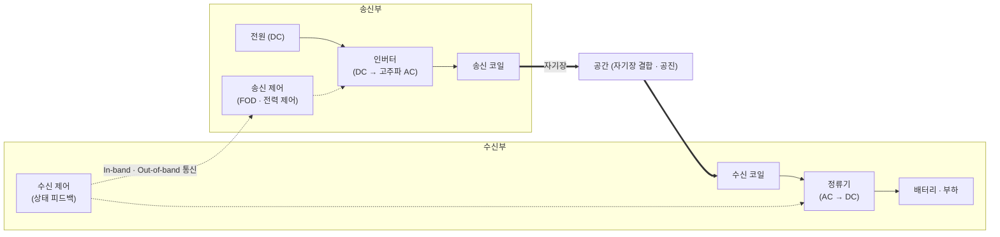

# 무선 충전 기술 (Wireless Charging Technology)

---

## I. 선 없이 전력을 보내는, 무선 충전 기술의 개요

### 가. 정의

- **전자기 유도, 자기 공명, 전자기파(RF)를 이용해 케이블·접점 없이 송신부에서 수신부로 전력을 전달**해 배터리를 충전하는 기술 (WPT, Wireless Power Transfer)

### 나. 특징

| 구분 | 내용 |
| --- | --- |
| 편의성 | 커넥터 없이 올려두기만 하면 충전 |
| 내구성 | 단자 노출이 없어 방수·방진 설계 용이, 단자 마모 없음 |
| 적용 확대 | 스마트폰·웨어러블에서 전기차, [[드론]], 이식형 의료기기, 주방 가전으로 확장 |
| 방식 | 자기 유도(근거리), 자기 공명(중거리), RF(원거리) |
| 과제 | 거리·정렬에 따른 효율 저하, 발열, 전자파 인체 노출 |

---

## II. 구조 및 구성요소

### 가. 송수신 구조

- 송신 코일의 교류 자기장이 수신 코일에 유도 기전력을 만들고, 수신부는 정류해 충전하며 상태를 송신부에 피드백

### 나. 구성요소

| 구분 | 요소 | 설명 |
| --- | --- | --- |
| 전송 방식 | 자기 유도 (Inductive) | 밀착 코일 간 전자기 유도, 고효율·짧은 거리 (Qi) |
| | 자기 공명 (Resonant) | 같은 공진 주파수로 결합, 위치 자유도·다중 기기 충전 (AirFuel Resonant, 6.78MHz) |
| | RF · 마이크로파 | 안테나로 전파 방사, 원거리이나 효율 낮음 (AirFuel RF) |
| 정렬 | MPP (Magnetic Power Profile) | 자석으로 코일 위치를 맞춰 손실·발열 감소 (Qi2) |
| 제어 | 전력·주파수 제어 | 수신 요구 전력에 맞춰 주파수·듀티 조정 |
| 안전 | FOD (이물질 검출) | 금속 이물질 감지 시 전력 차단해 발열 방지 |
| | 인체 노출 기준 | 전자파 노출 한도(SAR·EMF) 준수 |
| [[프로토콜]] | In-band / Out-of-band | 전력 신호에 통신을 싣거나 BLE 등 별도 채널 사용 |

---

## III. 비교 및 동향

### 가. 3대 방식 비교

| 비교 항목 | 자기 유도 | 자기 공명 | RF (전자기파) |
| --- | --- | --- | --- |
| 원리 | 전자기 유도 (패러데이 법칙) | 공진 결합 | 전파 방사·수신(렉테나) |
| 거리 | 수 mm ~ 수 cm | 수 cm ~ 수 m | 수 m 이상 |
| 효율 | 높음 | 중간 (거리·정렬에 따라 변동) | 낮음 |
| 주파수 예 | 약 100~200kHz대 (Qi) | 6.78MHz (ISM) | 900MHz, 2.4·5.8GHz |
| 활용 | 스마트폰, 웨어러블 | 다중 기기, 전기차 패드 | 저전력 IoT 센서 |

### 나. 동향

- **Qi2 표준**: 2023년 WPC가 MPP 기반 Qi2(15W)를 발표, 이후 Qi2.2에서 25W로 확대
- **전기차 무선 충전**: SAE J2954로 주차 시 플러그 없는 충전 표준화
- **주방 가전**: WPC Ki Cordless Kitchen 표준으로 최대 2.2kW급 무선 전력 공급
- **무전원 IoT**: RF 에너지 하베스팅과 후방 산란 통신을 결합한 배터리 없는 센서 ([[Passive WiFi]])

---

### 🔗 연관 토픽

- **소속 도메인**: [[00_네트워크_MOC|🌐 네트워크]]
- **세부 분류**: `3. 전송 계층 & 트래픽 / 혼잡 제어 (L4)`
- **핵심 연관 토픽**:
  - [[NFC]]
  - [[RFID]]
  - [[Passive WiFi]]
  - [[드론|드론 (Drone; 무인기)]]
  - [[프로토콜]]
