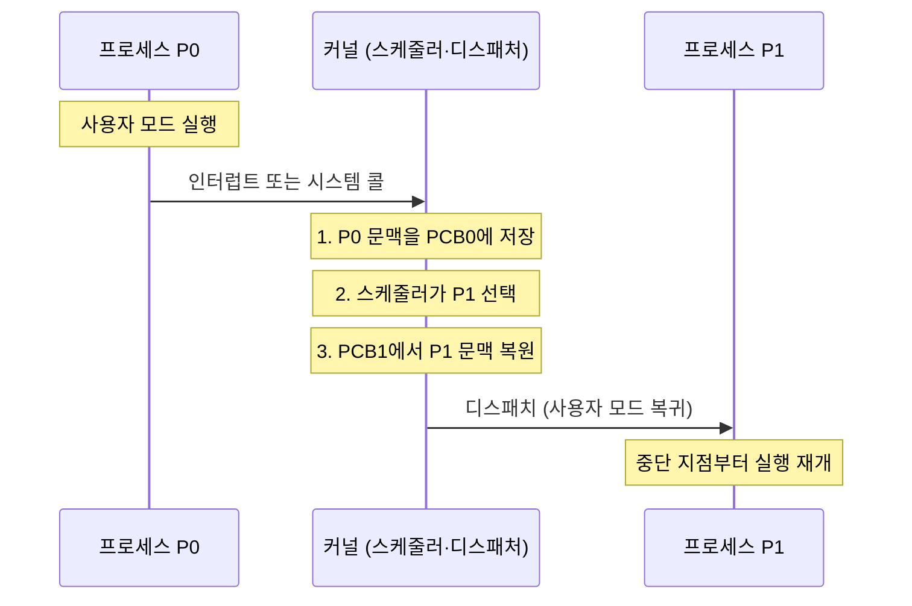

# 문맥 교환 (Context Switching)

---

## I. 멀티태스킹의 비용, 문맥 교환의 개요

### 가. 정의

- 실행 중인 프로세스·스레드의 **CPU 상태(문맥)를 저장하고 다음 실행 대상의 문맥을 복원해 CPU를 넘기는 과정**

### 나. 특징

| 구분 | 내용 |
| --- | --- |
| 필요성 | 시분할 멀티태스킹, I/O 대기 중 CPU를 다른 작업에 할당해 [[처리량]] 향상 |
| 발생 계기 | 타이머 [[인터럽트]](시간 할당량 만료), I/O 요청·완료, 시스템 콜에 의한 블로킹, 고우선순위 작업 도착 |
| 오버헤드 | 레지스터 저장·복원, 주소 공간 전환, 이후 TLB·캐시 미스 증가 → 이 시간 동안 유용한 작업 없음 |
| 모드 전환과 구분 | 시스템 콜만으로는 모드 전환(User ↔ Kernel)만 일어나며, 문맥 교환은 실행 대상이 바뀔 때 발생 |

---

## II. 동작 구조 및 구성요소

### 가. 문맥 교환 절차

- 커널 모드로 들어가 문맥을 PCB에 저장·복원한 뒤 사용자 모드로 돌아가며 새 프로세스 실행

### 나. 구성요소

| 구분 | 요소 | 설명 |
| --- | --- | --- |
| 제어 블록 | [[PCB(Process Control Block)\|PCB]] | 프로세스 상태, PC, 레지스터, 메모리 정보, 열린 파일 등 저장 |
| | TCB | 스레드 ID, PC, SP, 레지스터, 스케줄링 정보 저장 |
| 제어 모듈 | [[스케줄링\|스케줄러]] | 준비 큐에서 다음 실행 대상 선정 |
| | [[디스패치\|디스패처]] | 문맥 복원과 사용자 모드 전환 수행 |
| 저장 대상 | PC·SP·범용 레지스터 | 재개 위치와 스택 상태 보존 |
| | 페이지 테이블 기준 레지스터 | 프로세스 전환 시 교체 (x86 CR3) |
| 메모리 | [[MMU(Memory Management Unit)\|MMU]]·TLB | 주소 공간이 바뀌면 TLB 항목 무효화 필요 |

---

## III. 비교 및 동향

### 가. 프로세스 vs 스레드 문맥 교환

| 비교 항목 | 프로세스 문맥 교환 | 같은 프로세스 내 스레드 문맥 교환 |
| --- | --- | --- |
| 주소 공간 | 전환 (페이지 테이블 교체) | 유지 |
| 저장 단위 | PCB | TCB (PC, SP, 레지스터) |
| TLB | 무효화 필요 (ASID·PCID로 완화) | 유지 |
| 오버헤드 | 큼 | 작음 |

### 나. 동향

- **TLB 태깅**: ARM ASID, x86 PCID로 TLB 항목에 주소 공간 ID를 붙여 전환 시 전체 플러시 회피
- **사용자 수준 전환**: Java 21 가상 스레드, Go 고루틴이 런타임 안에서 전환해 커널 문맥 교환 횟수 축소
- **FPU 문맥 처리**: 첫 사용 시점까지 FPU 저장을 미루던 Lazy FPU는 LazyFP 취약점(CVE-2018-3665) 이후 Linux 등에서 즉시 저장(Eager) 방식으로 전환

---

### 🔗 연관 토픽

- **소속 도메인**: [[00_운영체제_MOC|⚙️ 운영체제]]
- **세부 분류**: `1. 프로세스 & 스레드 관리`
- **핵심 연관 토픽**:
  - [[PCB(Process Control Block)]]
  - [[디스패치]]
  - [[프로세스와 스레드 비교|프로세스(Process)와 스레드(Thread) 비교]]
  - [[스케줄링]]
  - [[인터럽트|인터럽트 (Interrupt)]]
