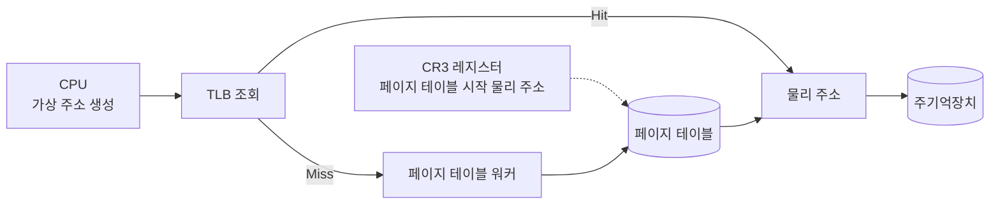

# 물리 주소 (Physical Address)

---

## I. 메모리 하드웨어의 실제 위치, 물리 주소의 개요

### 가. 정의

- 주소 버스를 통해 **주기억장치(RAM)나 메모리 맵 I/O 장치의 실제 위치를 가리키는 하드웨어 주소**, MMU가 [[논리 주소]]를 변환해 생성

### 나. 특징

| 구분 | 내용 |
| --- | --- |
| 유일성 | 시스템 전체에서 하나의 물리 주소 공간 공유 |
| 하드웨어 종속 | 공간 크기는 CPU 물리 주소 비트 수와 실제 장착 메모리로 결정 |
| 비가시성 | 사용자 프로그램은 직접 볼 수 없고 커널·드라이버가 관리 |
| 장치 접근 | DMA 장치는 물리 주소(또는 IOMMU가 변환한 주소)로 메모리 직접 접근 |

---

## II. 변환 구조 및 구성요소

### 가. 물리 주소 생성 과정

- TLB에 없으면 CR3가 가리키는 페이지 테이블을 하드웨어가 탐색(Page Table Walk)해 물리 주소를 얻고 TLB에 저장

### 나. 구성요소

| 구분 | 요소 | 설명 |
| --- | --- | --- |
| 변환 하드웨어 | [[MMU(Memory Management Unit)\|MMU]] | 가상 → 물리 주소 변환, 접근 권한(R/W/X) 검사 |
| | TLB | 최근 변환 결과 캐시 |
| | IOMMU | 장치의 DMA 주소를 물리 주소로 변환, 장치 격리 (Intel VT-d, AMD-Vi) |
| 레지스터 | CR3 (x86) | 현재 프로세스의 최상위 페이지 테이블 물리 주소 보관 |
| 자료 구조 | 페이지 테이블 | 페이지 번호 → 프레임 번호 매핑 |
| [[가상화]] | EPT·NPT | 게스트 물리 주소(GPA) → 호스트 물리 주소(HPA) 하드웨어 2단계 변환, [[그림자페이지 기법\|섀도 페이징]]을 대체 |
| 성능 | Huge Page | 2MB·1GB 프레임으로 TLB 미스 감소 |

---

## III. 비교 및 동향

### 가. 논리 주소 vs 물리 주소

| 비교 항목 | [[논리 주소]] (가상 주소) | 물리 주소 |
| --- | --- | --- |
| 생성 주체 | CPU (실행 중인 프로그램) | MMU |
| 주소 공간 | 프로세스별 독립 | 시스템 전체 단일 공간 |
| 크기 결정 | 가상 주소 비트 수 (예: x86-64 48비트) | 물리 주소 비트 수, 장착 메모리 용량 |
| 가시성 | 사용자 프로그램 | [[커널]]·하드웨어 |

### 나. 동향

- **[[CXL]] 메모리 확장**: PCIe 5.0 기반 CXL로 장착한 메모리를 물리 주소 공간의 NUMA 노드로 추가, 계층화(Tiering)·풀링 상용화
- **GPUDirect Storage**: 스토리지에서 GPU 메모리로 CPU 바운스 버퍼 없이 DMA 전송해 AI 학습 데이터 적재 병목 완화
- **기밀 컴퓨팅**: AMD SEV-SNP, Intel TDX가 물리 메모리를 VM별로 암호화하고 하이퍼바이저의 물리 페이지 재매핑을 검증

---

### 🔗 연관 토픽

- **소속 도메인**: [[00_운영체제_MOC|⚙️ 운영체제]]
- **세부 분류**: `1. 프로세스 & 스레드 관리`
- **핵심 연관 토픽**:
  - [[논리 주소]]
  - [[MMU(Memory Management Unit)]]
  - [[가상 메모리]]
  - [[그림자페이지 기법]]
  - [[DMA(Direct Memory Access)]]
