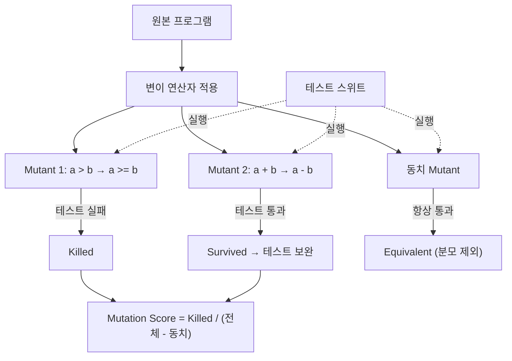

# 뮤테이션 테스트 (Mutation Test)

---

## I. 테스트를 테스트하는 기법, 뮤테이션 테스트의 개요

### 가. 정의

- 소스 코드에 **인위적인 작은 결함(Mutant)을 주입하고, 기존 테스트 스위트가 이를 검출(Kill)하는 비율로 테스트의 결함 검출력을 평가**하는 결함 기반(Fault-based) 테스트 기법

### 나. 필요성 및 특징

| 구분 | 내용 |
| --- | --- |
| 커버리지 한계 보완 | 100% 구문·분기 [[코드 커버리지]]도 단언(Assertion)이 부실하면 결함을 못 찾음 |
| 정량 평가 | 뮤테이션 점수로 테스트 스위트 품질을 수치화 |
| 기본 가정 | 유능한 프로그래머 가설(실제 결함은 작은 실수), 결합 효과(단순 결함을 잡으면 복합 결함도 잡음) |
| 한계 | 변이체 수만큼 반복 실행하는 높은 비용, 동치 변이체 판별 곤란 |

---

## II. 동작 구조 및 구성요소

### 가. 동작 구조

- 변이 연산자로 다수의 변이체를 만들고 테스트를 실행해 Killed·Survived를 판정, 생존 변이체를 근거로 테스트 케이스를 보강

### 나. 구성요소

| 구분 | 요소 | 설명 |
| --- | --- | --- |
| 변이 생성 | 변이 연산자 | 코드를 바꾸는 규칙 (AOR 산술 연산자 대체, ROR 관계 연산자 대체, LCR 논리 연산자 대체 등) |
| | 변이체 (Mutant) | 변이 연산자가 적용된 결함 버전 |
| 판정 | Killed | 테스트가 실패해 변이를 검출한 상태 |
| | Survived | 테스트가 통과해 변이를 놓친 상태 (테스트 부족) |
| | 동치 변이체 | 문법은 다르나 의미가 원본과 같아 검출 불가능한 변이체 |
| 평가 지표 | 뮤테이션 점수 | Killed / (전체 변이체 − 동치 변이체) × 100 |
| 비용 절감 | 바이트코드 변이 | 컴파일된 코드를 직접 변이해 재컴파일 생략 (PITest) |
| | 약한 변이 (Weak Mutation) | 프로그램 출력 대신 변이 지점 직후 내부 상태만 비교 |
| | 선택적 변이 | 효과가 큰 일부 연산자만 적용 |
| 도구 | 자동화 도구 | PITest(Java), Stryker(JS·C#), mutmut(Python) |

---

## III. 비교 및 동향

### 가. 코드 커버리지 vs 뮤테이션 점수

| 비교 항목 | [[코드 커버리지]] | 뮤테이션 점수 |
| --- | --- | --- |
| 측정 대상 | 테스트가 실행한 코드 비율 | 테스트가 검출한 주입 결함 비율 |
| 단언 품질 반영 | 반영 안 됨 | 반영됨 |
| 비용 | 낮음 (1회 실행) | 높음 (변이체 수만큼 실행) |
| 용도 | 미실행 코드 식별 | 테스트 검출력 평가 |

### 나. 동향

- PR 변경 코드(Diff) 주변만 변이하는 증분 뮤테이션으로 CI 적용 비용 축소
- LLM으로 동치 변이체를 식별·제거하고, 생존 변이체를 죽이는 테스트 케이스 자동 생성
- 실제 결함과 유사한 변이를 학습 기반으로 생성하는 연구 진행

---

### 🔗 연관 토픽

- **소속 도메인**: [[00_소프트웨어공학_MOC|🏗️ 소프트웨어공학]]
- **세부 분류**: `2. 애자일(Agile) & 지속적 통합/배포(CI/CD)`
- **핵심 연관 토픽**:
  - [[코드 커버리지|코드 커버리지(Code Coverage)]]
  - [[단위 테스트]]
  - [[TDD|TDD (Test Driven Development)]]
  - [[테스트 오라클]]
  - [[퍼징 테스트]]
