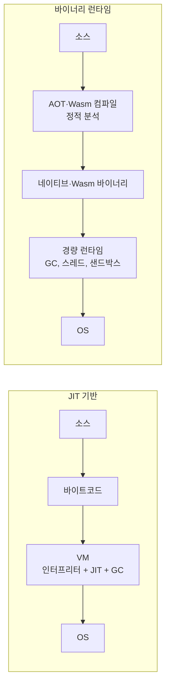

# 바이너리 런타임

---

## I. 미리 컴파일해 바로 실행하는, 바이너리 런타임의 개요

### 가. 정의

- 실행 중 JIT 컴파일 없이 **빌드 시점에 기계어(AOT)나 WebAssembly(Wasm) 바이너리로 만든 프로그램을 최소한의 런타임으로 실행**하는 환경

### 나. 특징

| 구분 | 내용 |
| --- | --- |
| 빠른 기동 | 초기화 상태를 빌드 시 미리 만들어 두어 서버리스 콜드 스타트 감소 |
| 작은 메모리 | JIT 컴파일러·클래스 메타데이터가 상주하지 않음 |
| 격리 | Wasm은 샌드박스 메모리와 명시적 권한(WASI)으로 호스트 자원 접근 통제 |
| 제약 | 리플렉션·동적 클래스 로딩은 빌드 시 설정 필요, 최고 성능은 JIT보다 낮을 수 있음 |

---

## II. 구조 및 구성요소

### 가. JIT 런타임과 바이너리 런타임 실행 경로

- 바이트코드를 실행 중 번역하는 대신 빌드 단계에서 도달 가능한 코드만 골라 바이너리로 만들어 바로 실행

### 나. 구성요소

| 구분 | 요소 | 설명 |
| --- | --- | --- |
| 빌드 | AOT 컴파일 | 실행 전 기계어로 변환 (GraalVM Native Image) |
| | 도달성 분석 | 정적 분석으로 쓰이지 않는 코드 제거, 바이너리 축소 |
| | 이미지 힙 (Image Heap) | 빌드 시 초기화한 객체를 바이너리에 포함해 기동 시간 단축 |
| | PGO | 실행 프로파일을 반영해 AOT 최적화 보완 |
| 런타임 | Substrate VM | Native Image에 포함되는 GC·스레드 관리 등 최소 런타임 |
| | Wasm 런타임 | Wasmtime·WasmEdge·Wasmer, 선형 메모리 샌드박스에서 실행 |
| 인터페이스 | WASI | Wasm 모듈이 파일·네트워크 등에 접근하는 표준 시스템 인터페이스 |
| | 컴포넌트 모델 | Wasm 모듈 간 타입 있는 인터페이스로 조합 |

---

## III. 비교 및 동향

### 가. JIT 런타임 vs 바이너리 런타임

| 비교 항목 | JIT 런타임 | 바이너리 런타임 |
| --- | --- | --- |
| 최적화 시점 | 실행 중 프로파일 기반 | 빌드 시 정적 분석 (PGO로 보완) |
| 기동 시간 | 느림 (워밍업 필요) | 빠름 |
| 메모리 | 큼 | 작음 |
| 최고 성능 | 장시간 실행 시 높음 | JIT보다 낮을 수 있음 |
| 동적 기능 | 리플렉션·동적 로딩 자유 | 빌드 시 메타데이터 등록 필요 |
| 적합 워크로드 | 장기 실행 서버 | 서버리스, CLI, [[EDGE\|엣지]]·IoT |
| 예 | HotSpot JVM, V8, .NET CLR | GraalVM Native Image, .NET Native AOT, Wasmtime |

### 나. 동향

- **서버 측 Wasm**: containerd runwasi·SpinKube로 [[쿠버네티스]]에서 Wasm 워크로드를 [[컨테이너]]처럼 스케줄링
- **WASI 0.2**: 컴포넌트 모델 기반 표준 인터페이스가 확정되어 언어 간 모듈 재사용 확대
- **프레임워크 지원**: Spring Boot·Quarkus·Micronaut가 Native Image 빌드를 공식 지원

---

### 🔗 연관 토픽

- **소속 도메인**: [[00_운영체제_MOC|⚙️ 운영체제]]
- **세부 분류**: `6. 커널 아키텍처 & 입출력 시스템`
- **핵심 연관 토픽**:
  - [[컨테이너|컨테이너 (Container)]]
  - [[도커|도커 (Docker)]]
  - [[샌드박스]]
  - [[EDGE|edge]]
  - [[커널|커널(Kernel)]]
