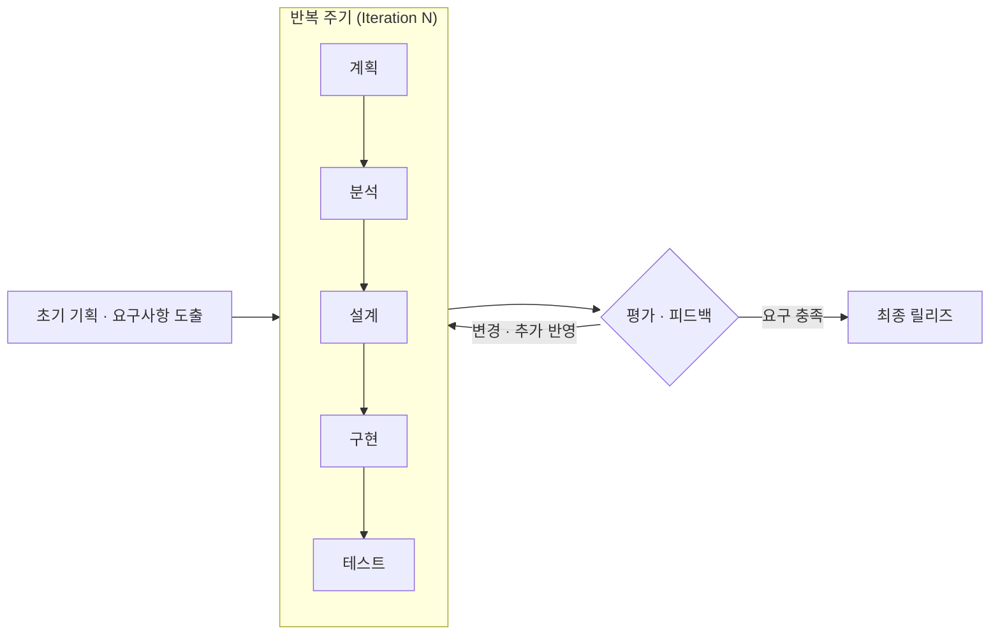

# 반복적 개발 모델 (Iterative Model)

---

## I. 스케치 후 덧칠하는 개발, 반복적 개발 모델의 개요

### 가. 정의

- 전체 시스템을 **짧은 주기(Iteration)마다 분석·설계·구현·테스트를 반복하며 완성도를 점진적으로 높여 가는** [[SDLC]] 모델

### 나. 특징

| 구분 | 내용 |
| --- | --- |
| 등장 배경 | [[워터폴\|폭포수]] 모델의 요구 변경 수용 곤란, 후반부 리스크 집중 해소 |
| 조기 가시성 | 초기부터 동작하는 골격(Skeleton)을 제공해 요구사항 오해 방지 |
| 위험 분산 | 주기마다 검증해 기술·사업 리스크를 조기 식별 |
| 애자일 기반 | [[SCRUM\|스크럼]], XP 등 [[Agile]] 방법론의 프로세스 근간 |

---

## II. 수행 절차 및 구성요소

### 가. 수행 절차

- 2~4주 타임박스 안에서 미니 프로젝트를 반복하고, 주기마다 실행 가능한 버전을 사용자 평가에 올려 다음 주기 백로그에 반영

### 나. 구성요소

| 구분 | 요소 | 설명 |
| --- | --- | --- |
| 주기 관리 | 타임박싱 | 주기 기간을 고정해 일정 예측성 확보 |
| 요구 관리 | 백로그 | 요구사항을 우선순위로 정렬해 주기별 할당 |
| 개발 기법 | [[프로토타이핑 모델\|프로토타이핑]] | UI·핵심 로직을 빠르게 구현해 피드백 수집 |
| 품질 | [[소프트웨어 리팩토링\|리팩토링]] | 반복 개발로 쌓이는 기술 부채 제거 |
| | [[CI, CD (Continuous Integration, Continuous Delivery)\|CI/CD]] | 빈번한 병합·자동 빌드·테스트로 결함 조기 발견 |
| 위험 관리 | 위험 우선 해결 | 아키텍처 등 불확실성이 큰 요소를 초기 주기에 처리 |
| 피드백 | 리뷰 · 회고 | 주기 종료 시 시연하고 프로세스 개선점 도출 |

---

## III. 비교 및 동향

### 가. 반복적 vs 점증적 vs 폭포수

| 비교 항목 | 반복적 (Iterative) | [[증분형 개발 모델\|점증적 (Incremental)]] | [[워터폴\|폭포수 (Waterfall)]] |
| --- | --- | --- | --- |
| 개념 | 전체 골격을 만들고 **깊이**를 더함 | 완성된 기능 단위를 추가해 **범위**를 넓힘 | 단계를 순차 수행해 한 번에 완성 |
| 요구 변경 | 진행 중 수용 용이 | 다음 증분에서 수용 | 초기 확정 후 곤란 |
| 초기 릴리즈 | 기능은 부족하나 전체 흐름 동작 | 일부 기능만 완전 동작 | 최종 단계에서만 가능 |
| 적합 프로젝트 | 요구 불명확, 신규 서비스 | 요구 비교적 명확, 모듈 분할 용이 | 요구 명확, 변경 적은 대형 시스템 |

### 나. 동향

- 반복과 점증을 결합한 IID(Iterative and Incremental Development)가 애자일의 표준 형태로 정착
- 짧은 주기를 CI/CD와 결합해 주기 단위가 아닌 커밋 단위 배포로 확장

---

### 🔗 연관 토픽

- **소속 도메인**: [[00_소프트웨어공학_MOC|🏗️ 소프트웨어공학]]
- **세부 분류**: `1. 소프트웨어 개발 생명주기(SDLC) & 방법론`
- **핵심 연관 토픽**:
  - [[Agile]]
  - [[SDLC]]
  - [[증분형 개발 모델]]
  - [[진화형 개발 모델]]
  - [[SCRUM]]
