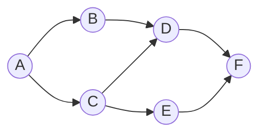

# 방향성 비순환 그래프 (DAG)

---

## I. 순환 없는 의존성 표현, DAG의 개요

### 가. 정의

- 간선에 **방향이 있고 어떤 정점에서 출발해도 자기 자신으로 돌아오는 경로(Cycle)가 없는** 그래프

### 나. 특징

| 구분 | 내용 |
| --- | --- |
| 선후 관계 표현 | 간선 u→v는 "u가 v보다 먼저"를 의미, 작업 의존성 모델링 |
| 위상 정렬 가능 | 모든 정점을 간선 방향을 지키며 일렬로 나열할 수 있음 (DAG ⇔ 위상 정렬 존재) |
| 병렬성 식별 | 서로 의존하지 않는 정점은 동시에 실행 가능 |
| 무한 대기 없음 | 순환이 없어 의존 관계로 인한 무한 대기가 생기지 않음 |

---

## II. 구조 및 구성요소

### 가. 개념도

- 위상 정렬 결과 예: A → (B, C 병렬) → (D, E 병렬) → F

### 나. 구성요소

| 구분 | 요소 | 설명 |
| --- | --- | --- |
| 구성 | 정점 (Vertex) | 작업·데이터·트랜잭션 |
| | 간선 (Edge) | 방향 있는 의존 관계 |
| | 진입·진출 차수 | 들어오는·나가는 간선 수, 진입 차수 0인 정점이 시작점 |
| [[알고리즘]] | 위상 정렬 | Kahn(진입 차수 0인 정점부터 제거, BFS) 또는 DFS 후위 순서 역순, O(V+E) |
| | 사이클 탐지 | DFS 중 역방향 간선(Back Edge)이 있으면 DAG 아님 |
| | 임계 경로 (Critical Path) | 가중치 합이 가장 긴 경로, 전체 완료 시간 결정 |
| | 최단·최장 경로 | 위상 정렬 순서로 완화하면 O(V+E)에 계산 |

---

## III. 비교 및 동향

### 가. 일반 그래프 vs 트리 vs DAG

| 비교 항목 | 일반 그래프 | 트리 | DAG |
| --- | --- | --- | --- |
| 방향 | 방향·무방향 | 부모→자식 | 방향 있음 |
| 순환 | 허용 | 없음 | 없음 |
| 부모 수 | 제한 없음 | 1개 (루트 제외) | 여러 개 가능 |
| 두 정점 간 경로 | 여러 개 | 유일 | 여러 개 가능 |
| 활용 | 네트워크, SNS | 디렉터리, DOM | 작업 스케줄링, 빌드, 데이터 파이프라인 |

### 나. 동향

- **워크플로 엔진**: Apache Airflow·dbt·Kubeflow Pipelines가 작업을 DAG로 정의, Apache Spark는 연산 계보를 DAG로 만들어 지연 평가·스테이지 분할
- **분산 원장**: IOTA(Tangle), Hedera(Hashgraph), Sui(Narwhal·Mysticeti 계열) 등 DAG 기반 원장·합의로 처리량 확대
- **버전 관리**: Git 커밋 이력도 DAG (병합 커밋은 부모가 2개)

---

### 🔗 연관 토픽

- **소속 도메인**: [[00_컴퓨터구조_MOC|💻 컴퓨터구조]]
- **세부 분류**: `1. CPU 프로세서 & 마이크로아키텍처`
- **핵심 연관 토픽**:
  - [[그래프 순회|그래프 순회 (Graph Traversal)]]
  - [[스케줄링]]
  - [[트리 순회|트리 순회 (Tree Traversal)]]
  - [[선형 자료구조와 비선형 자료구조]]
  - [[알고리즘]]
