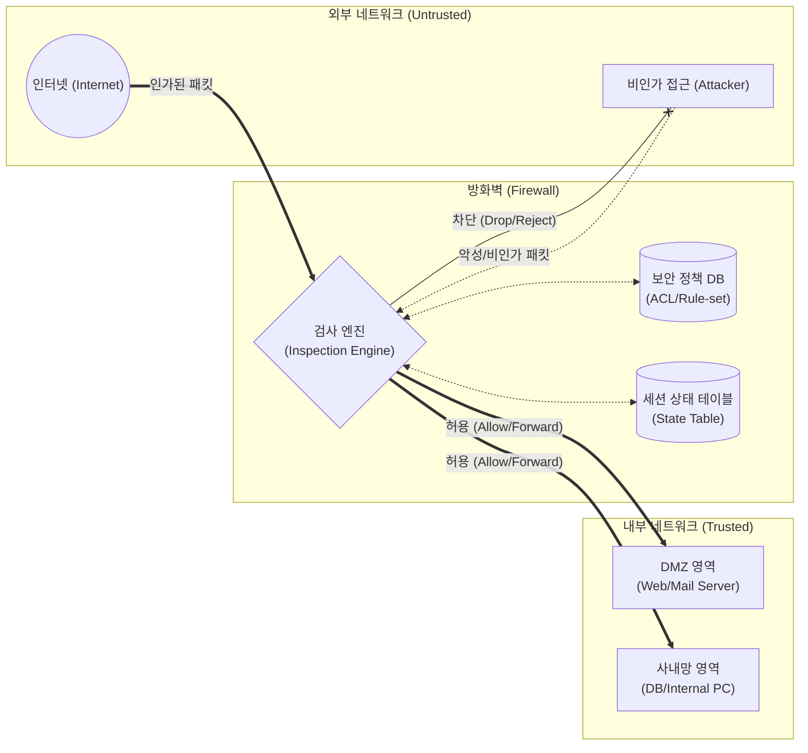

# 방화벽 (Firewall)

---

## I. 네트워크 접근 통제의 1차 방어선, 방화벽의 개요

방화벽(Firewall)은 신뢰할 수 없는 외부 네트워크(인터넷)와 신뢰할 수 있는 내부 사내망(인트라넷) 사이의 유일한 경계 접점에 위치하여, 사전에 정의된 보안 규칙(Rule-set)에 따라 패킷과 세션의 허용·차단을 제어하는 네트워크 1차 방어 보안 시스템이다.

| 구분 | 내용 |
| :--- | :--- |
| **정의** | 내·외부 네트워크 경계에서 사전 정의된 정책에 따라 트래픽을 선별 차단·허용하는 접근통제 시스템 |
| **핵심 역할** | 단일 방어 접점(Choke Point) 형성, 네트워크 영역 분리(DMZ/내부망), 비인가 침입 원천 차단 |
| **진화 양상** | 1세대 패킷 필터링 $\rightarrow$ 2세대 상태 기반(Stateful) $\rightarrow$ 3세대 앱 프록시 $\rightarrow$ 차세대 방화벽(NGFW/FWaaS) |

---

## II. 방화벽의 개념도 및 핵심 기술 요소

### 가. 방화벽의 개념도 및 동작 원리

* 외부에서 유입되는 인바운드 패킷을 검사 엔진이 보안 정책(ACL)과 세션 상태(State Table)를 대조하여 검사함
* 규칙에 부합하는 정상 트래픽은 내부 네트워크(DMZ/사내망)로 전달(Forward)하고, 위배되는 트래픽은 즉시 폐기(Drop/Reject)함

### 나. 방화벽의 핵심 기술 요소

| 구분 | 요소기술(키워드) | 세부 설명 |
| --- | --- | --- |
| **기본 통제** | 패킷 필터링 (Packet Filtering) | L3(Network), L4(Transport) 계층의 헤더 정보(IP, Port, Protocol)를 검사하여 트래픽 허용/차단 |
| **상태 관리** | 상태 기반 감시 (Stateful Inspection) | 활성화된 연결([[Session Layer\|Session]])의 상태 정보를 메모리에 저장하여, 컨텍스트 기반으로 동적 패킷 제어 |
| **심층 검사** | 애플리케이션 프록시 (App Proxy) | L7 계층에서 클라이언트-서버 간 연결을 중계하며 방화벽이 대리 통신하여 페이로드 심층 검사 |
| **심층 검사** | DPI (Deep Packet Inspection) | 패킷의 헤더뿐만 아니라 데이터(Payload) 영역까지 분석하여 애플리케이션 식별 및 악성코드 탐지 |
| **네트워크** | NAT (Network Address Translation) | 사설 IP와 공인 IP를 상호 변환하여 내부 네트워크 구조를 은닉하고 IP 자원 고갈 문제 해결 |
| **보안 통신** | [[VPN]] 지원 ([[IP Sec\|IPsec]] / SSL) | 공중망을 통해 원격지 접속자나 지사와 안전하게 통신할 수 있는 [[암호화]] 터널링 기능 제공 |
| **정책 관리** | ACL (Access Control List) | 방화벽 검사 엔진이 참조하는 트래픽 제어 룰셋으로, 순차적(Top-Down)으로 적용되는 접근 제어 목록 |
| **가시성** | 로깅 및 감사 (Logging & Auditing) | 인가 및 차단된 모든 접속 시도와 트래픽 내역을 기록하여 향후 보안 사고 추적 및 포렌식에 활용 |

---

## III. 전통적 방화벽과 차세대 방화벽(NGFW) 비교 및 최신 동향

### 가. 전통적 방화벽(Legacy)과 차세대 방화벽(NGFW) 비교

| 비교 항목 | 전통적 방화벽 (Legacy Firewall) | 차세대 방화벽 (NGFW) |
| --- | --- | --- |
| **주요 방어 계층** | L3 (네트워크), L4 (전송) 계층 | L7 (애플리케이션) 계층 포함 전 계층 |
| **검사 방식** | 헤더 정보 확인, 상태 기반 감시(Stateful) | DPI(심층 패킷 분석) 기반 페이로드 검사 |
| **식별 및 통제 대상** | IP 주소, 포트(Port), 프로토콜 | 애플리케이션, 사용자(User-ID), 콘텐츠(Content-ID) |
| **기능 통합 여부** | 단일 접근 통제 중심 | IPS, Anti-Virus, [[샌드박스]], URL 필터링 통합 |
| **위협 대응 능력** | 알려진 단순 포트 기반 위협 차단 | 지능형 지속 위협(APT) 및 우회 공격 방어 |

### 나. 방화벽 기술의 최신 동향 및 전망
- **[[클라우드 네이티브]] 전환 및 FWaaS 도입**: 물리적 온프레미스 어플라이언스 한계를 극복하고, [[SASE(Secure Access Service Edge)|SASE]] 아키텍처와 통합된 클라우드 기반 서비스형 방화벽(FWaaS) 확산.
- **[[제로 트러스트 보안모델|제로 트러스트]] 결합 및 마이크로 세그멘테이션**: 내부망 신뢰 가정을 배제하고, 워크로드/컨테이너 단위로 트래픽을 동적 격리·통제하는 마이크로 세그멘테이션(Micro-segmentation) 구현.
- **AI/ML 기반 정책 최적화 및 이상 트래픽 자율 차단**: 수만 개로 비대해진 방화벽 ACL의 중복·충돌 정책을 AI로 자동 정비하고, 비정상 트래픽 패턴을 실시간 학습하여 차단 룰을 능동 생성.

---

### 🔗 연관 토픽

- **소속 도메인**: [[00_보안_MOC|🛡️ 보안]]
- **세부 분류**: `3. 네트워크 & 엔드포인트 · 인프라 보안`
- **핵심 연관 토픽**:
  - [[SASE(Secure Access Service Edge)]]
  - [[클라우드 컴퓨팅 취약점 및 대응기술]]
  - [[샌드박스|샌드박스 (Sandbox)]]
  - [[SecaaS (Security as a Service)]]
  - [[VPN|VPN(Virtual Private Network)]]
