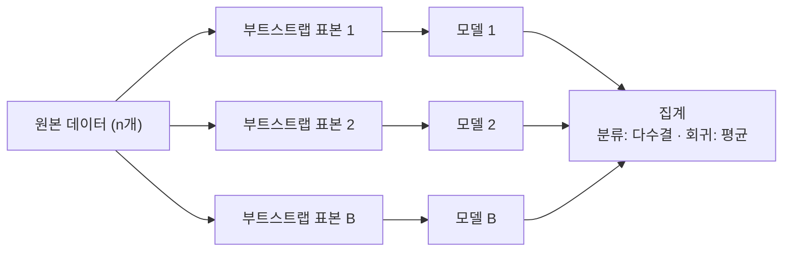

# 배깅 (Bagging, Bootstrap Aggregating)

---

## I. 여러 모델의 평균으로 분산 줄이기, 배깅의 개요

### 가. 정의

- 원본 데이터에서 **복원 추출(부트스트랩)한 여러 표본으로 모델을 각각 독립 학습하고, 투표·평균으로 결합해 예측 분산을 줄이는 앙상블 기법** (Breiman, 1996)

### 나. 특징

| 구분 | 내용 |
| --- | --- |
| 분산 감소 | 불안정한(고분산) 모델의 예측 변동을 평균으로 완화 |
| 병렬 학습 | 모델 간 의존성이 없어 동시 학습 가능 |
| OOB 검증 | 각 표본에 뽑히지 않은 약 36.8% 데이터로 별도 검증셋 없이 평가 |
| 대표 기법 | [[랜덤 포레스트]] (배깅 + 특성 무작위 선택) |

---

## II. 동작 원리 및 구성요소

### 가. 배깅 절차

- 각 표본은 원본과 같은 크기로 복원 추출하며, 서로 다른 표본으로 학습한 모델의 오차가 상쇄됨

### 나. 구성요소

| 구분 | 요소 | 설명 |
| --- | --- | --- |
| 표본 추출 | 부트스트랩 | n개에서 n개를 복원 추출, 표본마다 약 63.2%의 고유 데이터 포함 |
| 기본 모델 | 고분산 학습기 | 깊은 [[의사결정나무]]처럼 편향은 낮고 분산이 큰 모델이 효과적 |
| 학습 | 병렬 독립 학습 | 모델 간 상호 의존 없음 |
| 집계 | 하드·소프트 보팅 | 다수결 또는 확률 평균 (분류) |
| | 평균 | 예측값 평균 (회귀) |
| 검증 | OOB Error | 선택되지 않은 데이터로 성능 추정 |
| 확장 | 특성 배깅 | 분할마다 일부 특성만 후보로 사용해 트리 간 상관 감소 (랜덤 포레스트) |

---

## III. 비교 및 동향

### 가. 배깅 vs 부스팅

| 비교 항목 | 배깅 | [[부스팅\|부스팅 (Boosting)]] |
| --- | --- | --- |
| 목적 | 분산 감소 | [[편향]] 감소 |
| 학습 | 병렬·독립 | 순차·이전 오차 보완 |
| 데이터 | 균등 복원 추출 | 오분류 가중치 조정 또는 잔차 학습 |
| 기본 모델 | 복잡한 고분산 모델 | 단순한 약한 학습기 |
| 과적합 | 상대적으로 강함 | 반복이 많으면 과적합 위험 |
| 예 | 랜덤 포레스트, Bagging Classifier | AdaBoost, XGBoost, LightGBM |

### 나. 동향

- **딥 앙상블**: 초기값·데이터 표본을 달리한 신경망 앙상블로 예측 불확실성 추정
- **불균형 데이터**: Balanced Bagging·Balanced Random Forest로 사기·침입 탐지 성능 향상

---

### 🔗 연관 토픽

- **소속 도메인**: [[00_데이터베이스_MOC|🗄️ 데이터베이스]]
- **세부 분류**: `5. 분산 데이터베이스 & NoSQL & 대용량`
- **핵심 연관 토픽**:
  - [[부스팅|부스팅 (Boosting)]]
  - [[랜덤 포레스트|랜덤 포레스트 (Random Forest)]]
  - [[의사결정나무]]
  - [[일반화]]
  - [[분류화]]
