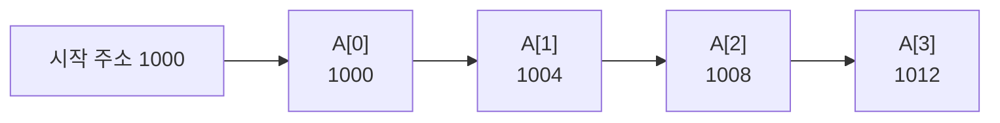

# 배열 (Array)

---

## I. 연속 메모리에 같은 타입을 나열한, 배열의 개요

### 가. 정의

- **같은 자료형의 원소를 연속된 메모리 공간에 순서대로 저장하고 인덱스로 접근**하는 가장 기본적인 선형 자료구조

### 나. 특징

| 구분 | 내용 |
| --- | --- |
| 임의 접근 | 주소 = 시작 주소 + 인덱스 × 원소 크기, O(1) 접근 |
| 연속 저장 | 공간 [[지역성]]이 좋아 [[캐시 메모리]] 효율 높음 |
| 고정 크기 | 정적 배열은 선언 시 크기 고정, 동적 배열은 재할당으로 확장 |
| 삽입·삭제 비용 | 중간 위치 삽입·삭제 시 원소 이동 O(n) |

---

## II. 구조 및 구성요소

### 가. 메모리 배치와 주소 계산

- 4바이트 int 배열에서 A[i]의 주소 = 1000 + 4i, 2차원 배열은 행 우선(C) 또는 열 우선(Fortran) 순서로 일렬 배치

### 나. 구성요소

| 구분 | 요소 | 설명 |
| --- | --- | --- |
| 기본 요소 | 인덱스 | 0부터 시작(C·Java·Python), 범위를 벗어나면 오류 또는 미정의 동작 |
| | 원소 크기 | 자료형이 결정, 주소 계산의 단위 |
| 다차원 | 행 우선 (Row-major) | A[i][j] 주소 = 시작 + (i × 열 수 + j) × 크기 (C) |
| | 열 우선 (Column-major) | A[i][j] 주소 = 시작 + (j × 행 수 + i) × 크기 (Fortran, MATLAB) |
| 종류 | 정적 배열 | 컴파일 시 크기 고정 (스택·데이터 영역) |
| | 동적 배열 | 가득 차면 보통 2배 크기로 재할당·복사, 끝 삽입 상각 O(1) (C++ vector, Java ArrayList, Python list) |
| 연산 | 접근·수정 | O(1) |
| | 탐색 | 정렬 안 됨 O(n), 정렬됨 이진 탐색 O(log n) |
| | 중간 삽입·삭제 | O(n) (원소 이동) |
| 응용 | 다른 자료구조 기반 | [[Stack]], [[Queue]](원형 큐), [[힙]], [[해시 테이블]]의 버킷 |

---

## III. 비교 및 동향

### 가. 배열 vs 연결 리스트

| 비교 항목 | 배열 | [[링크드 리스트\|연결 리스트]] |
| --- | --- | --- |
| 메모리 | 연속 | 비연속, 포인터 연결 |
| 접근 | O(1) 임의 접근 | O(n) 순차 접근 |
| 중간 삽입·삭제 | O(n) | O(1) (위치를 알 때) |
| 추가 공간 | 없음 | 노드마다 포인터 |
| 캐시 효율 | 높음 | 낮음 |

### 나. 동향

- **캐시·SIMD 친화 배치**: 구조체 배열(AoS) 대신 배열의 구조체(SoA)로 바꿔 SIMD·[[GPU]] 연산 효율 향상
- **다차원 배열·텐서**: NumPy ndarray, PyTorch 텐서 등 연속 메모리 다차원 배열이 과학 계산·AI 연산의 기본 자료구조
- **경계 검사**: 배열 범위 초과로 인한 버퍼 오버플로우 대응으로 Rust·Java 등의 런타임 경계 검사, C++ std::span 활용

---

### 🔗 연관 토픽

- **소속 도메인**: [[00_컴퓨터구조_MOC|💻 컴퓨터구조]]
- **세부 분류**: `4. 기본 자료구조 (Data Structures)`
- **핵심 연관 토픽**:
  - [[링크드 리스트|링크드 리스트(Linked List)]]
  - [[선형 자료구조와 비선형 자료구조]]
  - [[Queue]]
  - [[이진 탐색 트리|이진 탐색 트리(Binary Search Tree)]]
  - [[병합 정렬|병합 정렬 (Merge Sort)]]
