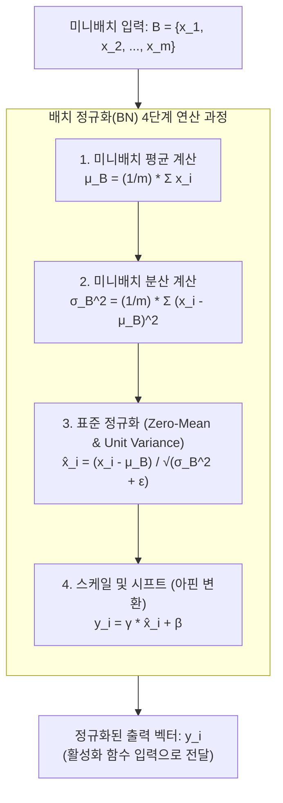

# 배치 정규화 (Batch Normalization)

---

## I. 내부 공변량 변화 완화와 학습 가속, 배치 정규화의 개요

### 가. 배치 정규화(Batch Normalization)의 정의
- 딥러닝 심층 신경망의 각 은닉층에서 미니배치(Mini-batch) 단위로 활성화 입력값의 평균과 분산을 정규화한 후, 학습 가능한 스케일($\gamma$)과 시프트($\beta$) 변환을 적용하여 기울기 소실 및 폭주를 방지하고 학습 속도를 가속화하는 최적화 기법이다.

### 나. 배치 정규화의 등장 배경 및 주요 특징

| 구분 | 주요 내용 |
| --- | --- |
| 내부 공변량 변화 완화 | 이전 레이어 가중치 갱신에 따라 다음 레이어의 입력 데이터 분포가 매번 뒤흔들리는 현상(ICS)을 억제 |
| 높은 학습률 적용 가능 | 기울기(Gradient)의 스케일을 안정적으로 유지하여 손실 함수의 발산 없이 큰 학습률(Learning Rate) 사용 가능 |
| 초기화 민감도 경감 | 가중치 초기화(Weight Initialization) 상태에 지나치게 종속되지 않고 안정적인 손실 수렴 보장 |
| 자체 규제 효과 (Regularization) | 각 미니배치 샘플링 과정에서 발생하는 통계적 노이즈가 약한 규제 효과를 유발하여 과적합 완화에 기여 |

---

## II. 배치 정규화의 개념도 및 핵심 기술 요소

### 가. 배치 정규화의 연산 흐름도

* 정규화로 인한 신경망의 비선형 표현력 상실을 방지하기 위해 학습 가능한 파라미터인 스케일($\gamma$)과 시프트($\beta$)를 통해 원래의 활성화 분포를 복원할 수 있는 자유도를 부여함

### 나. 배치 정규화의 핵심 기술 요소

| 구분 | 요소기술(키워드) | 세부 설명 |
| --- | --- | --- |
| **통계량 산출** | **미니배치 통계량 (Mini-batch Mean & Var)** | 현재 순전파(Forward) 단계에 입력된 미니배치 $m$개 샘플의 차원별 평균($\mu_B$)과 분산($\sigma_B^2$) 계산 |
| **표준화 연산** | **안정화 상수 ($\epsilon$)** | 분산이 0에 수렴하여 0으로 나누기 오류가 발생하는 것을 방지하기 위해 분모에 추가하는 극소 상수($10^{-5}$) |
| **표현력 복원** | **스케일 파라미터 ($\gamma$)** | 표준화된 값의 크기를 학습을 통해 재조정하는 역전파 학습 가능 파라미터 |
| **표현력 복원** | **시프트 파라미터 ($\beta$)** | 표준화된 값의 편향(Bias)을 학습을 통해 이동시키는 역전파 학습 가능 파라미터 |
| **추론 대응** | **이동 평균 (Moving/Running Average)** | 단일 샘플 단위로 추론하는 Inference 단계 적용을 위해 훈련 전 과정에 걸쳐 지수 이동 평균(EMA)으로 누적 저장한 전역 통계량 |
| **역전파 최적화** | **기울기 흐름 안정화** | 정규화 수식이 역전파 시 연쇄 법칙(Chain Rule)을 거치며 기울기 폭주 및 소실 문제를 효과적으로 완충 |
| **배치 결합** | **동기화 BN (SyncBN)** | 분산 학습 환경에서 GPU별 로컬 배치가 작을 때 전체 GPU의 배치를 동기화하여 통계량 왜곡을 방지하는 분산 기법 |

---

## III. 신경망 정규화 기법 비교 및 향후 기술 동향

### 가. 주요 신경망 정규화(Normalization) 기법 비교

| 비교 항목 | 배치 정규화 (Batch Norm) | 레이어 정규화 (Layer Norm) | 인스턴스 정규화 (Instance Norm) | 그룹 정규화 (Group Norm) |
| --- | --- | --- | --- | --- |
| **정규화 기준 축** | 배치 축 ($N$) 기준 계산 | 채널 및 특징 축 ($C, H, W$) 기준 | 공간 축 ($H, W$) 단일 샘플/채널 | 채널을 그룹화한 축 ($G, H, W$) |
| **배치 크기 의존성** | **매우 높음** (배치 작으면 성능 저하) | **전혀 없음** ($N=1$에서도 동작) | **전혀 없음** (단일 이미지 기반) | **전혀 없음** (미니배치 무관) |
| **주요 적용 도메인** | 합성곱 신경망([[CNN]]), 컴퓨터 비전 | 자연어 처리([[RNN (Recurrent Neural Network)\|RNN]]), [[트랜스포머]], [[초거대 언어 모델\|LLM]] | 이미지 스타일 전이, GAN 화풍 변환 | 소형 배치 객체 탐지, 비전 트랜스포머 |
| **추론 시 동작** | 누적된 이동 평균($\hat{\mu}, \hat{\sigma}^2$) 사용 | 입력 데이터 자체 통계량 즉시 계산 | 입력 데이터 자체 통계량 즉시 계산 | 입력 데이터 자체 통계량 즉시 계산 |

### 나. 배치 정규화의 최신 동향 및 엔지니어링 전망
- **LLM과 Transformer 아키텍처에서의 LN/RMSNorm 정착**: 시퀀스 길이가 가변적이고 미니배치가 작은 초거대 언어 모델에서는 배치 축 통계량의 불확실성으로 인해 LayerNorm 및 연산량을 줄인 RMSNorm이 사실상 표준으로 자리매김.
- **BN 폴딩(Batch Normalization Folding)을 통한 추론 가속**: 에지 및 모바일 NPU 가속기 추론 최적화 시, 학습 완료된 BN의 $\gamma, \beta, \hat{\mu}, \hat{\sigma}$ 상수를 앞선 합성곱(Conv) 레이어의 가중치와 편향에 흡수(Folding)시켜 추론 지연 시간과 메모리 대역폭을 절감.
- **Micro-Batch 환경의 대안 아키텍처 확산**: 고해상도 3D 의료 영상이나 대규모 자율주행 모델 등 GPU VRAM 한계로 배치 크기를 1~2 수준으로 설정해야 하는 워크로드에서는 SyncBN 또는 GroupNorm 기반 하이브리드 정규화 기법 적용 확대.

---

### 🔗 연관 토픽

- **소속 도메인**: [[00_인공지능_MOC|🤖 인공지능]]
- **세부 분류**: `3. 딥러닝 핵심 아키텍처 & 신경망`
- **핵심 연관 토픽**:
  - [[기울기 소실과 기울기 폭주]]
  - [[경사하강법]]
  - [[딥러닝]]
  - [[모델 구조]]
  - [[CNN]]
