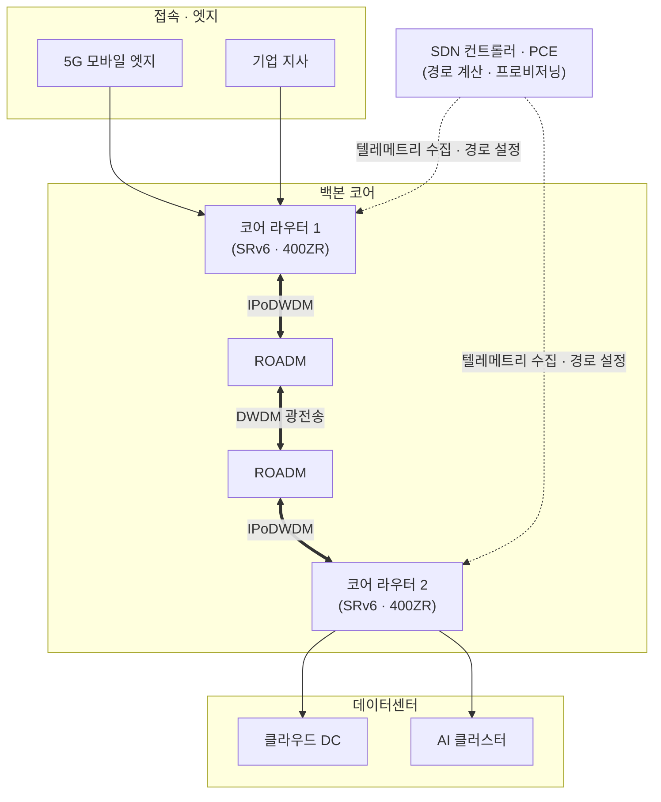

# 백본망 (Backbone Network)

---

## I. 망과 망을 잇는 대동맥, 백본망의 개요

### 가. 정의

- 접속망·지역망·데이터센터를 상호 연결해 **대용량 트래픽을 고속으로 집선·전달하는 최상위 기간(Core) 네트워크**

### 나. 특징 및 등장 배경

| 구분 | 내용 |
| --- | --- |
| 대용량 | 수십~수백 Tbps급 트래픽 집선, 100G·400G 이상 링크 |
| 고가용성 | 메시 구조, 다중 경로, 빠른 장애 복구 |
| 트래픽 변화 | 클라우드·AI·영상 증가로 데이터센터 간(DCI) 트래픽 급증 |
| 프로그래밍 | SRv6·SDN으로 서비스별 경로·슬라이스 제어 |
| 계층 통합 | IP 계층과 광 전송 계층을 통합하는 IPoDWDM으로 비용·전력 절감 |

---

## II. 구조 및 구성요소

### 가. IP-광 융합 백본 구조

- 코어 라우터에 장착한 코히어런트 광 모듈이 별도 트랜스폰더 없이 ROADM에 직접 파장을 넣고, 컨트롤러가 SRv6 경로를 지정

### 나. 구성요소

| 구분 | 요소 | 설명 |
| --- | --- | --- |
| 경로 제어 | SRv6 | [[IPv6]] 확장 헤더(SRH)에 경로를 담아 중간 노드 상태 없이 트래픽 엔지니어링 |
| | SDN · PCE | 중앙에서 경로 계산·배포 |
| 가시성 | 스트리밍 텔레메트리 · INT | 장비·패킷 단위 지연·혼잡 실시간 수집 |
| 광 전송 | DWDM · ROADM | 파장 다중화, 전기 변환 없이 파장 단위 Add/Drop·경로 재구성 |
| IP-광 융합 | IPoDWDM · 400ZR/800ZR | 라우터 포트에 꽂는 코히어런트 플러그형 모듈 (OIF 규격) |
| 인터페이스 | 400G · 800G 이더넷 | PAM4 기반 고속 포트 |
| 슬라이싱 | FlexE | 물리 포트를 하드 격리 채널로 분할 ([[네트워크 슬라이싱]]) |
| [[신뢰성]] | BFD · TI-LFA · 멀티호밍 | 밀리초 단위 장애 감지, 50ms 내 로컬 우회 |

---

## III. 비교 및 동향

### 가. MPLS 백본 vs SRv6 백본

| 비교 항목 | MPLS 기반 | SRv6 기반 |
| --- | --- | --- |
| 경로 제어 | LDP, RSVP-TE 시그널링 | IPv6 주소·SRH 소스 라우팅 |
| 상태 정보 | RSVP-TE는 경로 상 라우터가 터널 상태 유지 | 출발 노드만 경로 보유 |
| 프로토콜 수 | IGP + LDP/RSVP + BGP | IGP + BGP로 단순화 |
| IP·광 구조 | 라우터와 트랜스폰더 분리 | IPoDWDM 통합 가능 |
| 적용 | 기업 [[VPN]], 기존 통신사 코어 | 5G 전송망, DCI, 서비스 체이닝 |

### 나. 동향

- **고속화·저전력**: 800G 보급, 1.6T 이더넷 표준화(IEEE 802.3dj), 플러그형 코히어런트 모듈로 전력·장비 수 절감
- **AI 데이터센터 연결**: 분산 학습용 DCI 대역 증가로 백본·광 용량 증설
- **위성 연계**: [[저궤도 위성]]망을 지상 백본의 보조·우회 경로로 활용 ([[비지상네트워크]])

---

### 🔗 연관 토픽

- **소속 도메인**: [[00_네트워크_MOC|🌐 네트워크]]
- **세부 분류**: `2. 네트워크 계층 & 라우팅 프로토콜 (L3)`
- **핵심 연관 토픽**:
  - [[백홀 트래픽]]
  - [[라우터]]
  - [[SDN(Software Defined Network)]]
  - [[다중화]]
  - [[QoS|QoS (Quality of Service)]]
