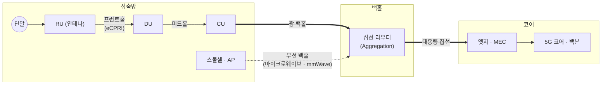

# 백홀 트래픽 (Backhaul Traffic)

---

## I. 기지국과 코어를 잇는, 백홀의 개요

### 가. 정의

- 기지국·AP 등 **접속망에서 모은 트래픽을 코어망으로(또는 반대로) 전달하는 구간(백홀)과 그 집선 트래픽**

### 나. 특징

| 구분 | 내용 |
| --- | --- |
| 집선 | 다수 기지국·스몰셀 트래픽을 대용량 링크로 통합 |
| 이기종 매체 | 광(유선)과 마이크로웨이브·밀리미터파·위성(무선)을 혼합 구성 |
| 품질 요구 | 5G URLLC·실시간 서비스로 낮은 지연·지터, 정밀 동기 필요 |
| 병목 위험 | 무선 구간 속도 향상에 비해 백홀 용량이 부족하면 체감 품질 저하 |
| 5G 세분화 | 프런트홀(RU–DU), 미드홀(DU–CU), 백홀(CU–코어)로 구분 |

---

## II. 구조 및 구성요소

### 가. 5G 전송 구간 구조

- 기지국 구간에서 나온 트래픽을 유·무선 백홀로 집선 라우터에 모아 엣지·코어로 전달

### 나. 구성요소

| 구분 | 요소 | 설명 |
| --- | --- | --- |
| 유선 | 광 (DWDM · PON) | 대용량·저지연, 도심 핵심 구간 |
| 무선 | 마이크로웨이브 · E-band | 광 포설이 어려운 구간, 가시선(LoS) 링크 |
| | IAB (Integrated Access and Backhaul) | 5G 기지국이 접속과 백홀을 같은 무선 자원으로 처리 (3GPP Rel-16) |
| | 위성 백홀 | 도서·해상·재난 지역 ([[저궤도 위성]]) |
| 전송 기술 | 패킷 백홀 (IP/MPLS · SR) | 이더넷·IP 기반 집선, 트래픽 엔지니어링 |
| 동기 | PTP (IEEE 1588) · SyncE | 5G TDD 운용을 위한 정밀 시간·주파수 동기 |
| 품질 | [[QoS]] · [[네트워크 슬라이싱]] | 서비스별 우선순위, 슬라이스별 전송 자원 분리 |
| 운영 | [[SDN(Software Defined Network)\|SDN]] · AI 운영 | 중앙 경로 제어, 트래픽 예측·자가 치유 |

---

## III. 비교 및 동향

### 가. 프런트홀 vs 미드홀 vs 백홀 vs 백본

| 비교 항목 | 프런트홀 | 미드홀 | 백홀 | 백본 |
| --- | --- | --- | --- | --- |
| 구간 | RU–DU | DU–CU | CU(기지국)–코어 | 코어 내부·지역 간 |
| 지연 요구 | 매우 엄격 (수백 μs 수준) | 엄격 | 수 ms 수준 | 상대적으로 완화 |
| 대역 | 매우 큼 (무선 신호 수준) | 큼 | 집선 트래픽 | Tbps급 |
| 매체 | 광 위주 | 광 | 광·무선 혼합 | 광·해저 케이블 |

### 나. 동향

- **고용량 무선 백홀**: E-band(70/80GHz)·D-band 링크, 6G 테라헤르츠 백홀 연구
- **개방형 전송**: [[O-RAN]] 분리 구조에 맞춘 프런트홀·미드홀 표준 인터페이스, 멀티벤더 운영
- **위성 연계**: 저궤도 위성을 커버리지 밖 기지국의 백홀로 활용 ([[비지상네트워크]])

---

### 🔗 연관 토픽

- **소속 도메인**: [[00_네트워크_MOC|🌐 네트워크]]
- **세부 분류**: `3. 전송 계층 & 트래픽 / 혼잡 제어 (L4)`
- **핵심 연관 토픽**:
  - [[백본망]]
  - [[C-RAN(Centralized Cloud RAN)]]
  - [[O-RAN]]
  - [[Mobile Edge Computing|Mobile Edge Computing (MEC)]]
  - [[네트워크 슬라이싱]]
