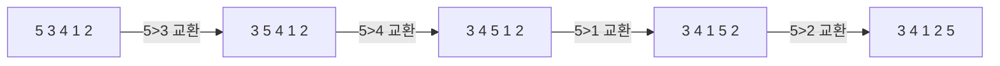

# 버블 정렬 (Bubble Sort)

---

## I. 인접한 두 원소를 바꿔가며 정렬하는, 버블 정렬의 개요

### 가. 정의

- **인접한 두 원소를 비교해 순서가 틀리면 교환하는 과정을 반복**하여, 한 회전마다 가장 큰 값을 맨 뒤로 보내는 정렬 [[알고리즘]]

### 나. 특징

| 구분 | 내용 |
| --- | --- |
| 단순 | 이중 반복문과 교환만으로 구현 |
| 제자리 정렬 | 추가 메모리 O(1) |
| 안정 정렬 | 같은 값은 교환하지 않아 순서 유지 |
| 느림 | 평균·최악 O(n²), 교환 횟수가 많음 |

---

## II. 동작 및 구성요소

### 가. 1회전 동작 ([5, 3, 4, 1, 2])

- 1회전이 끝나면 최댓값 5가 맨 뒤에 고정, 다음 회전은 비교 범위가 1씩 줄어듦

### 나. 구성요소

| 구분 | 요소 | 설명 |
| --- | --- | --- |
| 제어 | 이중 반복 | 바깥 루프 최대 n-1회전, 안쪽 루프 인접 쌍 비교 |
| 연산 | 비교·교환 | A[j] > A[j+1]이면 교환 (같으면 교환 안 함 → 안정) |
| 최적화 | 교환 플래그 | 한 회전 동안 교환이 없으면 정렬 완료로 보고 종료 |
| | 마지막 교환 위치 기억 | 이후 구간은 이미 정렬, 다음 회전 범위 축소 |
| 복잡도 | 최악·평균 | O(n²), 비교 약 n²/2회 |
| | 최선 | O(n) (정렬된 입력 + 플래그) |
| | 공간 | O(1) |
| 변형 | 칵테일 셰이커 정렬 | 양방향으로 번갈아 진행, 뒤쪽의 작은 값(거북이)이 느리게 이동하는 문제 완화 |
| | 콤 정렬 | 간격을 두고 비교·교환하며 간격을 줄여 거북이 문제 해결 |

---

## III. 비교 및 동향

### 가. 버블 vs 선택 vs 삽입 정렬

| 비교 항목 | 버블 정렬 | 선택 정렬 | [[삽입 정렬\|삽입 정렬 (Insertion Sort)]] |
| --- | --- | --- | --- |
| 방식 | 인접 원소 비교·교환 | 최솟값을 찾아 앞으로 교환 | 정렬된 부분에 삽입 |
| 안정성 | 안정 | 불안정 | 안정 |
| 최선 | O(n) (플래그) | O(n²) | O(n) |
| 교환·이동 | 역순 쌍 수만큼 교환 (많음) | 최대 n-1회 교환 (적음) | 역순 쌍 수만큼 이동 |
| 실제 성능 | 가장 느린 편 | 쓰기가 비쌀 때 유리 | 셋 중 가장 빠른 편 |

### 나. 동향

- **교육·소규모용**: 실무 대용량 정렬은 [[퀵 정렬]]·Timsort·Introsort가 담당, 버블 정렬은 원리 학습과 거의 정렬된 아주 작은 데이터에 한정
- **병렬 변형**: 홀짝 전치 정렬(Odd-Even Transposition Sort)은 인접 비교를 병렬로 수행할 수 있어 정렬 네트워크·하드웨어 정렬기에 활용

---

### 🔗 연관 토픽

- **소속 도메인**: [[00_컴퓨터구조_MOC|💻 컴퓨터구조]]
- **세부 분류**: `4. 기본 자료구조 (Data Structures)`
- **핵심 연관 토픽**:
  - [[삽입 정렬|삽입 정렬 (Insertion Sort)]]
  - [[퀵 정렬|퀵 정렬 (Quick Sort)]]
  - [[병합 정렬|병합 정렬 (Merge Sort)]]
  - [[O-Notation (O-표기법)]]
  - [[배열]]
