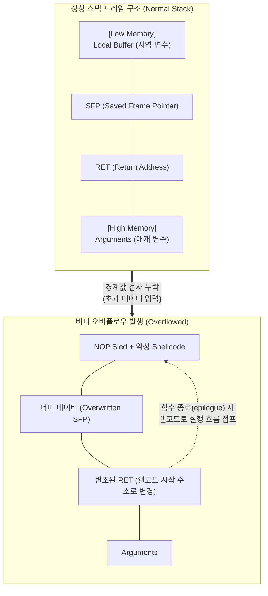

# 버퍼 오버플로우 (Buffer Overflow)

---

## I. 메모리 경계 침범을 통한 제어권 탈취, 버퍼 오버플로우의 개요

버퍼 오버플로우(Buffer Overflow)는 프로그램이 메모리 상에 할당된 버퍼(스택 또는 힙)의 물리적 한계를 넘어 데이터를 연속 기록함으로써 인접한 제어 블록(SFP, RET, 함수 포인터)을 덮어써 실행 제어 흐름을 임의로 하이재킹하는 전통적 시스템 소프트웨어 취약점이다.

| 구분 | 내용 |
| :--- | :--- |
| **정의** | 할당된 메모리 경계를 초과해 인접 영역을 덮어써 프로그램 실행 흐름을 제어하는 취약점 및 공격 |
| **발생 원인** | C/C++ 등에서 메모리 경계값 검사(Bounds Checking)가 결여된 표준 함수(`strcpy`, `gets` 등) 사용 |
| **위협 영향** | 리턴 주소(RET) 변조를 통한 임의 쉘코드 실행, 관리자 권한 획득, 시스템 크래시 및 DoS |

---

## II. 버퍼 오버플로우의 개념도 및 핵심 기술 요소

### 가. 버퍼 오버플로우의 개념도 및 동작 원리

* 공격자가 버퍼 크기를 초과하는 악성 코드(쉘코드)와 조작된 복귀 주소(RET)를 주입하여, 함수 종료 시 정상 흐름을 가로채어 악성 코드를 실행함

### 나. 버퍼 오버플로우 공격 및 방어 핵심 기술 요소

| 구분 | 요소기술(키워드) | 세부 설명 |
| --- | --- | --- |
| **공격 기법** | [[Stack]] Smashing | 지역 변수 버퍼를 넘치게 하여 스택의 SFP와 RET를 덮어쓰는 전통적 공격 방식 |
| **공격 기법** | NOP Sled | 메모리 주소 오차를 극복하기 위해 No Operation(0x90) 명령을 연속 배치하여 쉘코드로 유도 |
| **공격 기법** | ROP (Return-Oriented) | 실행 권한 제한(DEP) 우회를 위해, 메모리 내 기존 공유 라이브러리의 기계어 조각(Gadget)들을 연결하여 공격 |
| **방어 기법 (컴파일)** | Stack Canary (SSP) | 버퍼와 제어 데이터(RET 등) 사이에 검증용 난수(Canary)를 삽입하여 오버플로우 발생 시 변조 탐지 |
| **방어 기법 (OS)** | ASLR | 실행 시마다 스택, 힙, 라이브러리 등 메모리 영역의 로드 주소를 난수화하여 주소 예측 차단 |
| **방어 기법 (OS)** | DEP / NX Bit | 스택, 힙 등 데이터 영역에 실행 권한(Executable)을 제거하여 주입된 쉘코드의 실행을 원천 차단 |
| **방어 기법 (HW)** | Shadow Stack (CET) | 인텔 CET 등 하드웨어 레벨에서 별도의 격리된 스택에 RET를 백업하고, 실제 스택의 RET와 비교/검증 |
| **방어 기법 (시큐어 코딩)** | Safe Function | `strcpy` 대신 `strncpy` 사용 등 메모리 경계값을 명시적으로 제한하는 안전한 함수 사용 및 코드 인스펙션 |

---

## III. 버퍼 오버플로우 발생 영역 비교 및 최신 동향

### 가. 스택 기반 vs 힙 기반 오버플로우 비교

| 비교 항목 | 스택(Stack) 오버플로우 | 힙(Heap) 오버플로우 |
| --- | --- | --- |
| **발생 위치** | 스택 메모리 영역 (지역 변수, 매개 변수) | 힙 메모리 영역 (동적 할당 변수) |
| **주요 원인 함수** | `strcpy()`, `gets()`, `sprintf()` | `malloc()`, `calloc()` 이후 포인터 검증 누락 |
| **주요 변조 대상** | RET (복귀 주소), SFP | 함수 포인터, 동적 메모리 할당 청크(Chunk) 메타데이터 |
| **공격 복잡도** | 비교적 단순함 (일정한 메모리 구조) | 높음 (메모리 파편화 및 할당자 알고리즘에 의존적) |

### 나. 최근 동향 및 산업 적용 방향
- **메모리 안전 언어(Memory-Safe Language) 전환 가속**: 미 CISA, NSA 및 백악관 국가사이버국(ONCD)의 권고에 따라 C/C++ 레거시 코드를 컴파일 시 메모리 안전성을 보장하는 Rust, Go 등으로 전환.
- **하드웨어 내장형 무결성 검증(MTE/CET) 보편화**: OS 레벨의 ASLR/DEP 우회 공격을 원천 차단하기 위해 ARM Memory Tagging Extension(MTE) 및 Intel CET Shadow Stack이 최신 하드웨어 칩셋에 표준 탑재.
- **컴파일러 단의 심층 방어 및 정적·동적 분석 자동화**: GCC/Clang의 SSP(Stack Smashing Protector), CFI(Control Flow Integrity) 적용과 함께 DevSecOps 파이프라인 내 메모리 오염 정적 분석 도구 도입 의무화.

---

### 🔗 연관 토픽

- **소속 도메인**: [[00_보안_MOC|🛡️ 보안]]
- **세부 분류**: `4. 웹 & 애플리케이션 보안 · 취약점 점검`
- **핵심 연관 토픽**:
  - [[DoS (Denial of Service)]]
  - [[Stack]]
  - [[CPU]]
  - [[위협 모델링|위협 모델링(Threat Modeling) - Secure SDLC]]
  - [[시큐어코딩]]
