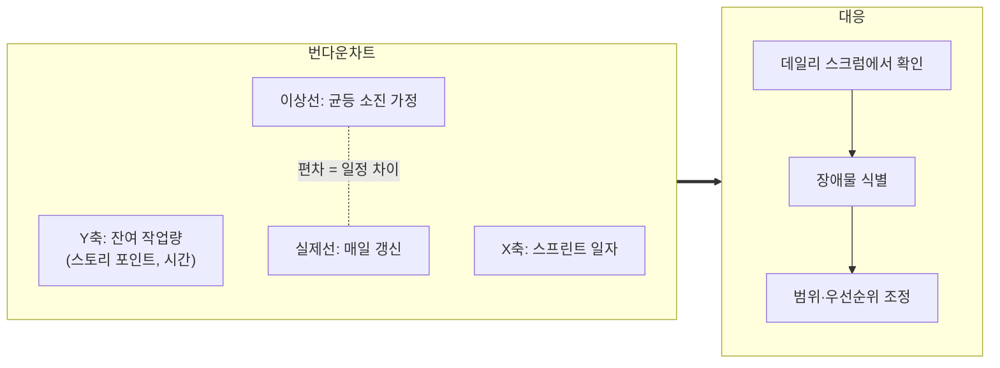

# 번다운차트 (Burn Down Chart)

---

## I. 남은 일을 그래프로, 번다운차트의 개요

### 가. 정의

- 시간 경과에 따른 **잔여 작업량**을 표시해 스프린트·릴리스의 진척과 목표 달성 가능성을 보여주는 애자일 정보 방열기(Information Radiator)

### 나. 필요성 및 특징

| 구분 | 내용 |
| --- | --- |
| 진척 가시화 | 이상선과 실제선 비교로 일정 편차를 한눈에 파악 |
| 조기 경보 | 실제선이 이상선 위에 머물면 지연 위험 |
| 자기 관리 | 팀이 스스로 진척을 확인하고 계획 조정 |
| 투명성 | 스크럼 경험주의(투명성·검사·적응) 지원 |

---

## II. 구조와 구성요소

### 가. 개념도

- 이상선과 실제선의 간격을 매일 확인해 장애물을 제거하거나 범위를 조정

### 나. 구성요소

| 구분 | 요소 | 설명 |
| --- | --- | --- |
| 축 | X축 | 스프린트(1개월 이하) 또는 릴리스 기간 |
| | Y축 | 잔여 작업량 (스토리 포인트, 태스크 시간, 항목 수) |
| 선 | 이상선 | 시작 총량에서 종료일 0까지 균등 소진 가정 |
| | 실제선 | 매일 측정한 실제 잔여량 |
| 해석 | 편차 | 실제선이 위면 지연, 아래면 예정보다 빠름 |
| | 평탄 구간 | 완료 항목 없음, 장애물·과대 항목 의심 |
| | 상승 구간 | 범위 추가 또는 재추정 |
| 유형 | 스프린트 번다운 | 스프린트 백로그 잔여량 |
| | 릴리스 번다운 | 스프린트별 릴리스 잔여 포인트 |

---

## III. 비교 및 동향

### 가. 번다운 vs 번업 차트

| 비교 항목 | 번다운 차트 | 번업 차트 |
| --- | --- | --- |
| 질문 | 얼마나 남았는가 | 얼마나 완료했는가 |
| 형태 | 총량에서 0으로 하강 | 0에서 범위선으로 상승 |
| 범위 변경 | 완료와 범위 증가가 상쇄되어 구분 어려움 | 범위선 변화로 직접 확인 |
| 주 용도 | 스프린트 진척 | 릴리스 진척, 범위 변동 관리 |

### 나. 동향

- **흐름 지표 병행**: 누적 흐름도(CFD), 사이클 타임과 함께 대시보드로 병목·범위 팽창 감시 ([[Kanban (development) 프로세스|칸반]])
- **예측 기능**: ALM 도구가 과거 Velocity로 완료 예상 시점을 자동 표시
- **EVM 연계**: 릴리스 번업 데이터로 Agile EVM 지표 산출 ([[EVM(Earned Value Management, 획득 가치 관리)|EVM]])

---

### 🔗 연관 토픽

- **소속 도메인**: [[00_프로젝트관리_MOC|📋 프로젝트관리]]
- **세부 분류**: `5. 애자일 프로젝트 관리 & 개발 운영 (Agile PM)`
- **핵심 연관 토픽**:
  - [[SCRUM|스크럼 (SCRUM)]]
  - [[Kanban (development) 프로세스]]
  - [[EVM(Earned Value Management, 획득 가치 관리)]]
  - [[Agile]]
  - [[린 방법론|린 (Lean) 방법론]]
