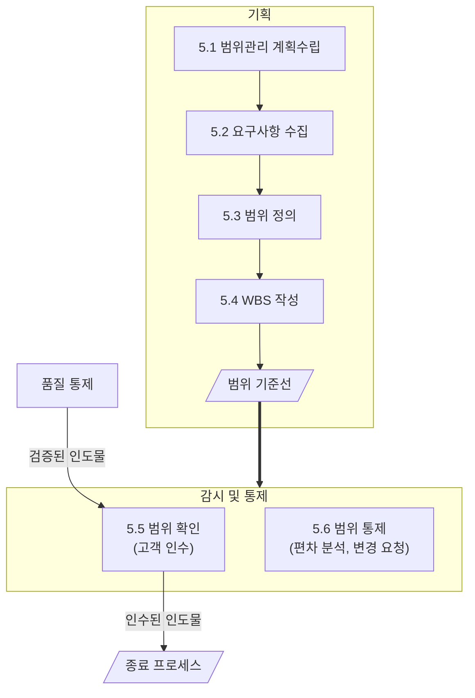

# 범위관리 (Project Scope Management)

---

## I. 해야 할 일만 하도록, 범위관리의 개요

### 가. 정의

- 프로젝트를 완료하는 데 **필요한 모든 작업, 그리고 필요한 작업만** 포함되도록 범위를 정의하고 통제하는 지식 영역 (PMBOK 6판 5장)

### 나. 필요성 및 특징

| 구분 | 내용 |
| --- | --- |
| 산정 기준 | [[WBS]]가 일정·원가·자원 산정의 기준 |
| 범위 이탈 방지 | Scope Creep, Gold-Plating 통제 ([[Scope Creep vs Gold-Plating]]) |
| 인수 기준 합의 | 인도물과 인수 조건을 이해관계자와 사전 합의 |
| 제품 범위 vs 프로젝트 범위 | 제품 범위는 요구사항 대비, 프로젝트 범위는 관리 계획서 대비로 완료 측정 |

---

## II. 프로세스와 구성요소

### 가. 프로세스 흐름

- 기준선 확정 후, 품질 통제를 거친 인도물을 고객이 공식 인수(범위 확인)하고 범위 통제는 기준선 대비 편차를 감시해 변경을 요청

### 나. 구성요소

| 구분 | 요소 | 설명 |
| --- | --- | --- |
| 기준선 | 범위 기준선 | 범위 기술서 + WBS + WBS 사전 |
| | 범위 기술서 | 제품 범위, 인도물, 인수 기준, 제외 사항, 제약·가정 |
| 분할 | WBS | 인도물 중심으로 작업 패키지까지 계층 분해, 100% 규칙 |
| 추적 | 요구사항 추적 매트릭스 (RTM) | 요구사항의 출처~설계·구현·테스트 이행 추적 |
| 수집 | [[요구사항 수집기법]] | 인터뷰, 워크숍, 프로토타입 등 |
| 확인 | 검사 (Inspection) | 인도물이 인수 기준을 충족하는지 고객과 함께 확인 |
| 통제 | 차이·추세 분석 | 기준선 대비 성과 차이 분석 |
| | 통합 변경 통제 (CCB) | 기준선에 영향을 주는 변경 승인·기각 |

---

## III. 비교 및 동향

### 가. 예측형 vs 애자일 범위관리

| 비교 항목 | 예측형 | 애자일 ([[Agile]]) |
| --- | --- | --- |
| 관리 도구 | WBS, 범위 기술서 | 제품 백로그, 사용자 스토리 |
| 확정 시점 | 초기 확정 | 반복마다 점진적 구체화 |
| 변경 태도 | 변경 통제로 억제 | 우선순위 조정으로 수용 |
| 인수 방식 | 단계·최종 인수 | 매 스프린트 리뷰, 완료 정의 |
| 고정 요소 | 범위 고정, 일정·원가 변동 | 일정·원가 고정, 범위 변동 |

### 나. 동향

- **하이브리드 [[테일러링]]**: 예산·일정은 WBS로 통제하고 개발 범위는 백로그로 관리
- **MVP 중심 범위 설정**: 최소 기능 제품([[01_IT Tech/MVP|MVP]])으로 범위를 좁혀 출시 후 학습
- **도구 지원**: ALM 도구가 요구사항~테스트 추적성을 자동 유지

---

### 🔗 연관 토픽

- **소속 도메인**: [[00_프로젝트관리_MOC|📋 프로젝트관리]]
- **세부 분류**: `2. 프로젝트 범위 & 일정 관리 (Scope & Schedule)`
- **핵심 연관 토픽**:
  - [[WBS|WBS (Work Breakdown Structure)]]
  - [[Scope Creep vs Gold-Plating]]
  - [[요구사항 수집기법]]
  - [[테일러링|테일러링 (Tailoring)]]
  - [[01_IT Tech/MVP|MVP]]
