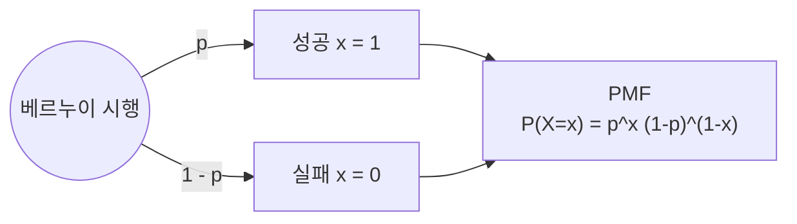

# 베르누이 분포 (Bernoulli Distribution)

---

## I. 성공·실패 한 번의 시행, 베르누이 분포의 개요

### 가. 정의

- **1회 시행 결과가 성공(1) 또는 실패(0) 두 가지뿐인 확률변수**의 이산확률분포, $X \sim Bern(p)$

### 나. 특징

| 구분 | 내용 |
| --- | --- |
| 단일 시행 | 한 번의 시행만 다룸 |
| 이진 결과 | 표본공간 $\{0, 1\}$, 상호배타 |
| 단일 모수 | 성공 확률 $p$ 하나로 분포 결정 |
| 확장성 | 독립 반복 시 [[이항분포]], 첫 성공까지는 [[기하 분포]]로 확장 |

---

## II. 구조 및 주요 통계량

### 가. 개념도

- 한 번의 시행 결과를 0/1로 사상하고 PMF 하나로 두 경우를 표현

### 나. 주요 통계량

| 구분 | 요소 | 설명 |
| --- | --- | --- |
| 기본 | 모수 | $p$ ($0 \le p \le 1$), 실패 확률 $q = 1-p$ |
| | PMF | $P(X=x) = p^x(1-p)^{1-x}$, $x \in \{0,1\}$ |
| 통계량 | 기댓값 | $E(X) = p$ |
| | 분산 | $V(X) = p(1-p)$, $p = 0.5$에서 최대 |
| | 적률생성함수 | $M_X(t) = (1-p) + pe^t$ |
| 전제 | 베르누이 시행 | 반복 시 각 시행이 독립이고 $p$가 일정 |

---

## III. 비교 및 동향

### 가. 관련 이산 분포 비교

| 비교 항목 | 베르누이 | 이항 | 카테고리 |
| --- | --- | --- | --- |
| 시행 횟수 | 1회 | $n$회 | 1회 |
| 결과 수 | 2 | 2 | $K$ |
| 확률변수 | 성공 여부 | 성공 횟수 | 선택된 범주 |
| 모수 | $p$ | $n, p$ | $(p_1, \dots, p_K)$ |
| ML 대응 | 이진 분류 | 성공 횟수 모델링 | 다중 클래스 분류 ([[소프트맥스 정규화\|소프트맥스]]) |

### 나. 동향

- **이진 분류 손실**: [[로지스틱회귀분석|로지스틱 회귀]]·신경망 이진 분류는 레이블이 베르누이 분포를 따른다고 보고 음의 로그 우도(Binary Cross Entropy)를 최소화
- **베르누이 나이브 베이즈**: 단어의 출현 여부(0/1)만으로 문서를 분류하는 스팸 필터 등에 사용
- **[[Dropout]]**: 각 뉴런을 확률 $p$의 베르누이 마스크로 끄고 켜는 방식으로 구현

---

### 🔗 연관 토픽

- **소속 도메인**: [[00_인공지능_MOC|🤖 인공지능]]
- **세부 분류**: `1. 수학 · 통계학 & 데이터 전처리`
- **핵심 연관 토픽**:
  - [[확률분포]]
  - [[이항분포|이항분포 (Binomial Distribution)]]
  - [[기하 분포|기하 분포 (Geometric Distribution)]]
  - [[로지스틱회귀분석]]
  - [[손실함수]]
