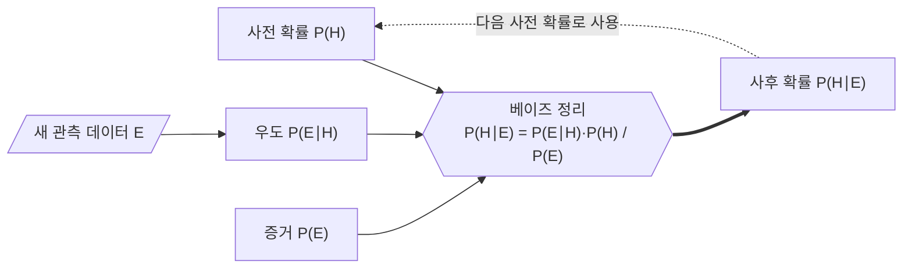

# 베이즈 추론 (Bayesian Inference)

---

## I. 증거로 믿음을 갱신하는, 베이즈 추론의 개요

### 가. 정의

- **사전 확률(Prior)에 관측 데이터의 우도(Likelihood)를 결합해 사후 확률(Posterior)을 구하고**, 데이터가 쌓일 때마다 이를 갱신하는 확률적 추론 방법 ([[베이즈 정리]] 기반)

### 나. 필요성 및 특징

| 구분 | 내용 |
| --- | --- |
| 필요성 | 적은 데이터·노이즈 환경에서 사전 지식 활용, 의료·금융 등에서 예측 불확실성 정량화 |
| 믿음 갱신 | 사후 확률이 다음 관측의 사전 확률이 되는 순차 갱신 |
| 역확률 | 결과(증거)로부터 원인(가설)의 확률 추론 |
| 결과 형태 | 점 추정이 아닌 모수의 분포(사후분포) 전체를 얻음 |

---

## II. 동작 원리 및 핵심 요소

### 가. 개념도

- 사전 확률에 우도를 곱하고 증거로 정규화해 사후 확률을 얻고, 이를 다음 추론의 사전 확률로 반복 사용

### 나. 핵심 요소

| 구분 | 요소 | 설명 |
| --- | --- | --- |
| 구성 | 사전 확률 (Prior) | 데이터 관측 전 가설·모수에 대한 믿음 |
| | 우도 (Likelihood) | 가설이 참일 때 관측 데이터가 나올 확률 |
| | 증거 (Evidence) | 관측 데이터의 주변 확률, 정규화 상수 |
| | 사후 확률 (Posterior) | 관측 후 갱신된 믿음, Prior × Likelihood에 비례 |
| 근사 계산 | MCMC | 사후분포에서 표본을 추출해 적분을 근사 (Metropolis-Hastings, Gibbs, HMC) |
| | 변분 추론 (VI) | 단순 분포족에서 KL 발산을 최소화하는 근사 분포를 최적화로 탐색 |
| | 켤레 사전분포 | 사후분포가 사전분포와 같은 분포족이 되어 닫힌 형태로 계산 (예: 베타-이항) |
| 응용 | 베이지안 네트워크 | 변수 간 조건부 의존을 [[방향성 비순환 그래프]](DAG)로 표현 |
| | [[베이지안 딥러닝]] | 신경망 가중치를 분포로 다뤄 예측 불확실성 추정 |
| | 베이지안 최적화 | 가우시안 프로세스 등 대리 모델로 하이퍼파라미터 탐색 |

---

## III. 비교 및 동향

### 가. 빈도주의 vs 베이지안

| 비교 항목 | 빈도주의 | 베이지안 |
| --- | --- | --- |
| 확률의 의미 | 반복 시행의 장기 빈도 | 믿음의 정도 |
| 모수 | 고정된 미지의 상수 | 분포를 가진 확률변수 |
| 추론 결과 | 점추정(MLE), 신뢰구간, [[유의확률\|p-value]] | 사후분포, 신용구간(Credible Interval), MAP |
| 사전 지식 | 반영하지 않음 | 사전분포로 반영 |
| 주요 활용 | 임상시험, 품질관리, A/B 테스트 | 불확실성 정량화, 하이퍼파라미터 최적화, 순차 의사결정 |

### 나. 동향

- **확률적 프로그래밍**: PyMC, Stan, NumPyro 등으로 모델 정의와 MCMC·VI 추론을 자동화
- **안전 필수 AI의 불확실성 추정**: 의료·[[Smart Car(자율주행)|자율주행]]에서 MC Dropout, 딥 앙상블 등 베이지안 근사로 모델이 모르는 입력을 식별
- **LLM 보정(Calibration)**: LLM 출력 신뢰도를 실제 정답률과 맞추는 보정·불확실성 추정 연구로 [[할루시네이션]] 대응

---

### 🔗 연관 토픽

- **소속 도메인**: [[00_인공지능_MOC|🤖 인공지능]]
- **세부 분류**: `1. 수학 · 통계학 & 데이터 전처리`
- **핵심 연관 토픽**:
  - [[베이즈 정리|베이즈 정리 (이론)]]
  - [[베이지안 모델]]
  - [[베이지안 딥러닝]]
  - [[추정 이론|추정 이론(Estimation Theory)]]
  - [[가설 검정]]
