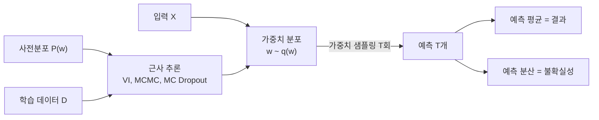

# 베이지안 딥러닝 (Bayesian Deep Learning)

---

## I. 모르는 것을 아는 신경망, 베이지안 딥러닝의 개요

### 가. 정의

- 신경망 가중치를 단일 값(점추정)이 아닌 **확률 분포로 추정해 예측과 함께 불확실성을 산출**하는 [[딥러닝]] 기법

### 나. 등장 배경 및 특징

| 구분 | 내용 |
| --- | --- |
| 배경 | 일반 신경망은 처음 보는 입력에도 높은 확신도를 내는 과신(Overconfidence) 문제 |
| 요구 | 의료·[[Smart Car(자율주행)\|자율주행]] 등 안전 필수 분야에서 예측 신뢰도 필요 |
| 가중치 분포 | 사전분포 $P(w)$와 데이터로 사후분포 $P(w \mid D)$ 추정 |
| 불확실성 분리 | 인식적(Epistemic)·우연적(Aleatoric) 불확실성 구분 |

---

## II. 구조 및 핵심 기술

### 가. 개념도

- 사후분포에서 가중치를 여러 번 샘플링해 예측 분포를 만들고, 그 평균과 분산으로 결과와 불확실성을 함께 제시

### 나. 핵심 요소

| 구분 | 요소 | 설명 |
| --- | --- | --- |
| 불확실성 | 인식적 (Epistemic) | 데이터·지식 부족에서 생김, 데이터가 늘면 감소, OOD 탐지에 활용 |
| | 우연적 (Aleatoric) | 데이터 자체의 잡음에서 생김, 데이터를 늘려도 줄지 않음 |
| 추론 | 변분 추론 (VI) | 근사 분포 $q(w)$와 사후분포의 KL 발산 최소화 (Bayes by Backprop) |
| | MCMC | 사후분포 표본 추출, 정확하나 대형 신경망에는 연산 부담 큼 |
| 실용 근사 | MC [[Dropout]] | 추론 시에도 Dropout을 켜고 여러 번 예측해 평균·분산 계산 |
| | 딥 앙상블 | 서로 다른 초기값으로 학습한 여러 모델의 예측 분산 활용 |
| 목적 함수 | ELBO | 기대 로그 우도 − KL(q‖prior)을 최대화 |
| 평가 | NLL·ECE | 예측 분포의 적합도, 확신도와 실제 정확도의 차이(보정 오차) |

---

## III. 비교 및 동향

### 가. 일반 딥러닝 vs 베이지안 딥러닝

| 비교 항목 | 일반 딥러닝 | 베이지안 딥러닝 |
| --- | --- | --- |
| 가중치 | 점추정 (MLE·MAP) | 확률 분포 |
| 학습 | SGD·Adam 최적화 | VI·MCMC 등 사후분포 근사 |
| 출력 | 단일 예측값 | 예측 분포 (평균·분산) |
| 소량 데이터 | 과적합·과신 위험 | 사전분포가 규제 역할 |
| 비용 | 낮음 | 샘플링으로 추론 비용 증가 |

### 나. 동향

- **OOD 탐지와 제어권 이양**: 자율주행·의료 영상에서 인식적 불확실성이 높으면 사람에게 판단을 넘기는 설계
- **경량 근사 기법**: SWAG, 라플라스 근사, 마지막 층만 베이지안으로 두는 방식 등으로 추론 비용 절감
- **LLM 불확실성 추정**: 다중 샘플 일관성·보정(Calibration)으로 [[할루시네이션]] 위험 답변 식별

---

### 🔗 연관 토픽

- **소속 도메인**: [[00_인공지능_MOC|🤖 인공지능]]
- **세부 분류**: `1. 수학 · 통계학 & 데이터 전처리`
- **핵심 연관 토픽**:
  - [[베이지안 모델]]
  - [[베이즈 추론]]
  - [[Dropout]]
  - [[앙상블 학습|앙상블 학습(Ensemble Learning)]]
  - [[추정 이론|추정 이론(Estimation Theory)]]
