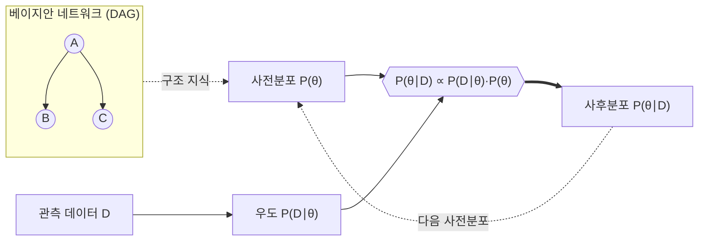

# 베이지안 모델 (Bayesian Model)

---

## I. 모수를 분포로 다루는, 베이지안 모델의 개요

### 가. 정의

- [[베이즈 정리]]를 바탕으로 **모수·변수를 확률 분포로 모델링하고, 사전 지식과 관측 데이터를 결합해 사후분포를 갱신**하는 확률 모델

### 나. 특징

| 구분 | 내용 |
| --- | --- |
| 믿음 갱신 | 데이터가 관측될 때마다 사후분포 갱신 |
| 사전 지식 반영 | 전문가 지식·과거 데이터를 사전분포로 주입 |
| 불확실성 정량화 | 예측값과 함께 신용구간·예측 분포 제공 |
| 소표본 강점 | 데이터가 적어도 사전분포가 규제 역할 |

---

## II. 구조 및 핵심 요소

### 가. 개념도

- 변수 간 의존 구조는 DAG와 조건부 확률표(CPT)로, 모수는 사전분포로 표현하고 데이터로 사후분포를 계산

### 나. 핵심 요소

| 구분 | 요소 | 설명 |
| --- | --- | --- |
| 이론 | 베이즈 정리 | 사후 ∝ 우도 × 사전 |
| 구조 | [[방향성 비순환 그래프]] (DAG) | 노드는 확률변수, 간선은 조건부 의존, 부모가 주어지면 비후손과 조건부 독립 |
| | 조건부 확률표 (CPT) | 부모 노드 상태별 자식 노드 확률 |
| 추론 | 정확 추론 | 변수 소거, 접합 트리(Junction Tree) |
| | MCMC | 사후분포 표본 추출로 근사 |
| | 변분 추론 | KL 발산을 최소화하는 근사 분포 탐색 |
| 대표 모델 | 나이브 베이즈 | 특징 간 조건부 독립 가정 분류기 |
| | 베이지안 네트워크 | 진단·위험 분석의 확률 추론 |
| | 가우시안 프로세스 | 함수에 대한 사전분포, 베이지안 최적화의 대리 모델 |
| | [[베이지안 딥러닝]] | 가중치를 분포로 다루는 신경망 |

---

## III. 비교 및 동향

### 가. 빈도주의 모델 vs 베이지안 모델

| 비교 항목 | 빈도주의 | 베이지안 |
| --- | --- | --- |
| 확률의 의미 | 장기 반복 빈도 | 믿음의 정도 |
| 모수 | 고정된 상수 | 확률변수 |
| 추정 | MLE, 신뢰구간, [[유의확률\|p-value]] | 사후분포, MAP, 신용구간 |
| 소표본 | 과적합 위험 | 사전분포로 안정화 |
| 활용 | A/B 테스트, 품질 관리 | 의료 진단, 위험 분석, 하이퍼파라미터 최적화 |

### 나. 동향

- **인과 추론 결합**: 베이지안 네트워크에 개입(do-연산) 개념을 더한 구조적 인과 모델로 원인 분석에 활용
- **확률적 프로그래밍 확산**: PyMC, Stan, NumPyro로 계층적 베이지안 모델을 손쉽게 구축
- **안전 필수 AI**: 자율주행·의료에서 베이지안 근사 기법으로 OOD 입력 탐지

---

### 🔗 연관 토픽

- **소속 도메인**: [[00_인공지능_MOC|🤖 인공지능]]
- **세부 분류**: `1. 수학 · 통계학 & 데이터 전처리`
- **핵심 연관 토픽**:
  - [[베이즈 정리|베이즈 정리 (이론)]]
  - [[베이즈 추론]]
  - [[베이지안 딥러닝]]
  - [[통계 데이터 마이닝|통계데이터마이닝 (연관규칙 & 베이즈)]]
  - [[방향성 비순환 그래프]]
