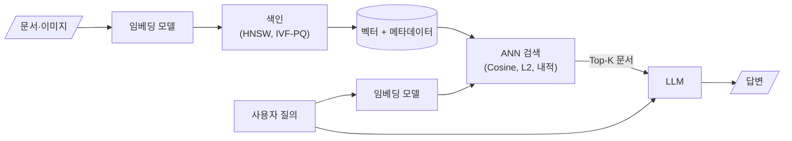

# 벡터 데이터베이스 (Vector Database)

---

## I. 의미로 찾는 저장소, 벡터 데이터베이스의 개요

### 가. 정의

- 비정형 데이터를 임베딩 모델로 변환한 **고차원 벡터를 저장·색인하고, 벡터 간 [[유사도]]로 의미 기반 검색**을 수행하는 [[데이터베이스]]

### 나. 필요성 및 특징

| 구분 | 내용 |
| --- | --- |
| 필요성 | [[RAG (Retrieval Augmented Generation) 검색 증강 생성 AI\|RAG]]에서 LLM에 최신·사내 지식을 제공해 [[할루시네이션]] 완화 |
| 고차원 처리 | 수백~수천 차원 밀집 벡터 저장 |
| 의미 검색 | 단어 일치가 아닌 의미 유사성으로 검색 |
| 근사 검색 | ANN 색인으로 대규모 벡터에서 빠른 Top-K 검색 (정확도와 속도 트레이드오프) |

---

## II. 구조 및 핵심 기술

### 가. 개념도

- 문서와 질의를 같은 임베딩 공간에 넣고, 색인으로 가까운 벡터를 찾아 LLM 컨텍스트로 제공

### 나. 핵심 기술

| 구분 | 요소 | 설명 |
| --- | --- | --- |
| 변환 | 임베딩 | 의미를 보존하는 밀집 벡터로 사상 |
| 색인 | HNSW | 계층형 근접 그래프 탐색, 높은 재현율·속도, 메모리 사용 큼 |
| | IVF·PQ | 클러스터 역색인으로 탐색 범위 축소, 곱 양자화로 벡터 압축 |
| 유사도 | 코사인 유사도 | 벡터 방향 비교, 크기 영향 제거 |
| | 유클리드(L2)·내적 | 거리 또는 내적 기반 비교, 정규화 벡터에서는 코사인과 순위 동일 |
| 검색 | ANN | 정확한 kNN 대신 근사 최근접 이웃으로 비용 절감 |
| | 하이브리드 검색 | BM25(희소) + 벡터(밀집) 결과를 RRF 등으로 결합 |
| | 메타데이터 필터링 | 날짜·권한·카테고리 조건을 검색 전후 적용 |

---

## III. 비교 및 동향

### 가. 벡터 DB vs RDBMS

| 비교 항목 | 벡터 DB | RDBMS |
| --- | --- | --- |
| 데이터 | 고차원 벡터 + 메타데이터 | 행·열 정형 데이터 |
| 검색 | 유사도 기반 Top-K (근사) | 조건 일치 ([[SQL(Structured Query Language)\|SQL]], 정확) |
| 색인 | HNSW, IVF, PQ | B-Tree, Hash |
| 제품 | Pinecone, Milvus, Qdrant, Weaviate, Chroma | Oracle, MySQL, PostgreSQL |
| 활용 | RAG, 이미지 검색, 추천 | 거래 처리, 업무 시스템 |

### 나. 동향

- **전용 DB vs 확장형**: 전용 벡터 DB와 함께 PostgreSQL pgvector, Elasticsearch·OpenSearch, Redis 등 기존 DB의 벡터 검색 기능 확산
- **비용 최적화**: 디스크 기반 색인(DiskANN), 이진·스칼라 양자화로 대규모 벡터 저장 비용 절감
- **지식 구조 결합**: 벡터 검색과 지식그래프를 함께 쓰는 [[GraphRAG (Graph Retrieval-Augmented Generation)|GraphRAG]] 등 하이브리드 검색 확대

---

### 🔗 연관 토픽

- **소속 도메인**: [[00_인공지능_MOC|🤖 인공지능]]
- **세부 분류**: `1. 수학 · 통계학 & 데이터 전처리`
- **핵심 연관 토픽**:
  - [[RAG (Retrieval Augmented Generation) 검색 증강 생성 AI]]
  - [[유사도|유사도(Similarity)]]
  - [[KNN 알고리즘]]
  - [[데이터 유형]]
  - [[GraphRAG (Graph Retrieval-Augmented Generation)]]
