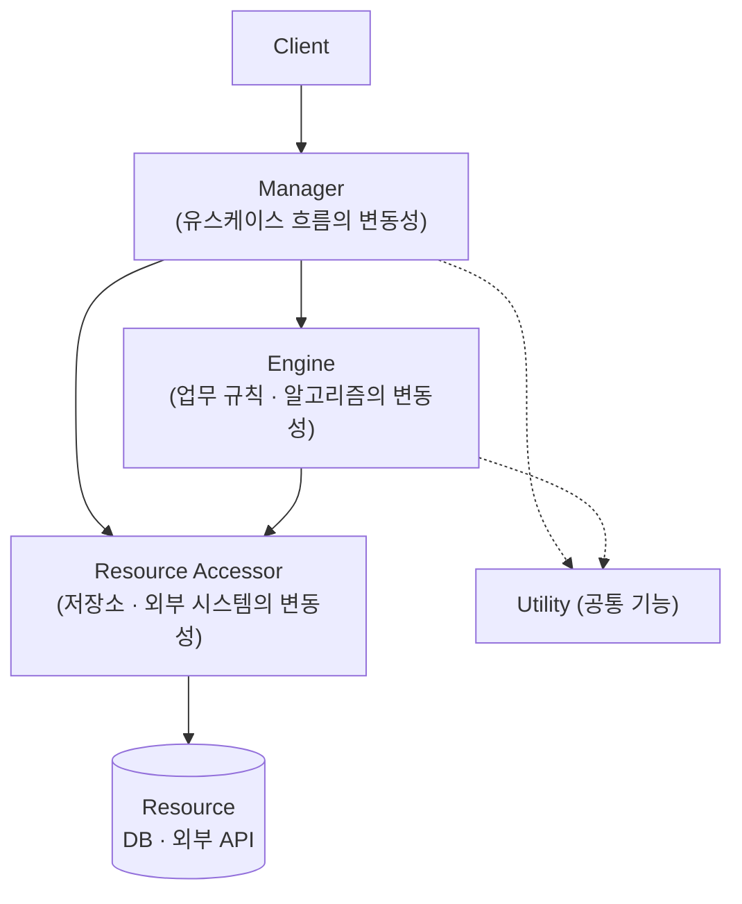

# 변동성 (Volatility)

---

## I. 무엇이 바뀔 것인가로 나누기, 변동성의 개요

### 가. 정의

- 비즈니스 규칙·외부 시스템·기술 환경 등 **시스템 요소가 시간에 따라 변경될 가능성**으로, 이를 기준으로 시스템을 분할하는 설계를 변동성 기반 분할(VBD, Juval Löwy의 IDesign 방법)이라 함

### 나. 필요성 및 특징

| 구분 | 내용 |
| --- | --- |
| 등장 배경 | 기능 중심 분할은 요구 변경 시 여러 모듈로 변경이 파급 (Ripple Effect) |
| 변경 캡슐화 | 바뀔 가능성이 높은 결정을 한 컴포넌트 안에 은닉 ([[정보은닉]], Parnas 1972) |
| 안정 의존 | 안정적인 요소가 불안정한 요소에 의존하지 않도록 배치 |
| 효과 | 변경 영향 국소화로 [[유지보수]] 비용 절감 |

---

## II. 분할 구조 및 구성요소

### 가. IDesign 계층 구조

- 기능이 아니라 바뀔 수 있는 축을 찾아 Manager·Engine·Accessor·Utility에 각각 은닉하므로, 정책이나 DB가 바뀌어도 해당 컴포넌트 안에서 변경이 끝남

### 나. 구성요소

| 구분 | 요소 | 설명 |
| --- | --- | --- |
| 컴포넌트 | Manager | 유스케이스의 흐름(순서)을 조율, 세부 구현은 위임 |
| | Engine | 할인 정책·계산 등 자주 바뀌는 업무 규칙 캡슐화 |
| | Resource Accessor | DB [[스키마]]·외부 PG 등 자원 접근 방식의 변동 격리 |
| | Utility | 로깅·보안 등 도메인 독립 공통 기능 |
| 식별 원칙 | 변동성 축 | 같은 고객의 시간에 따른 변화, 고객 간 차이 등 변경 원인 식별 |
| 설계 원칙 | 정보 은닉 | 변경 가능한 결정을 인터페이스 뒤로 숨김 |
| | 의존성 역전 (DIP) | 구체 구현이 아닌 [[추상화]]에 의존 |
| 측정 | 불안정도 I = Ce / (Ca + Ce) | 유출·유입 결합도로 컴포넌트 안정성 측정 (R. Martin) |
| | 변경 빈도 분석 | Git 커밋 이력의 코드 Churn으로 변경 집중 영역(Hotspot) 식별 |

---

## III. 비교 및 동향

### 가. 기능 분할 vs 변동성 기반 분할

| 비교 항목 | 기능 분할 | 변동성 기반 분할 |
| --- | --- | --- |
| 분할 기준 | 시스템이 하는 일 (기능) | 앞으로 바뀔 수 있는 것 (변동성) |
| 변경 영향 | 여러 모듈로 파급 | 해당 컴포넌트 내부로 한정 |
| 장기 비용 | 변경 누적 시 구조 부패 | 기능 추가에도 골격 유지 |
| 접근 | 요구사항 하향식 분해 | 변동 요소를 인터페이스로 조합 |

### 나. 동향

- 변경 이력 기반 Hotspot 분석(CodeScene 등)으로 리팩토링·분할 대상 선정
- [[MSA (Micro Service Architecture)|MSA]] 서비스 경계 설정 시 [[DDD (Domain Driven Design)|DDD]]의 도메인 경계와 함께 변경 주기를 기준으로 활용

---

### 🔗 연관 토픽

- **소속 도메인**: [[00_소프트웨어공학_MOC|🏗️ 소프트웨어공학]]
- **세부 분류**: `3. 요구사항 공학 & UML 객체지향 분석/설계`
- **핵심 연관 토픽**:
  - [[정보은닉|정보은닉 (Information Hiding)]]
  - [[결합도]]
  - [[모듈화|모듈화 (Modularity)]]
  - [[소프트웨어 설계의 원리]]
  - [[DDD (Domain Driven Design)]]
