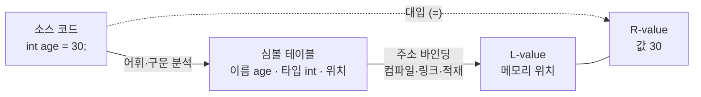

# 변수 (Variable)

---

## I. 이름 붙인 메모리 공간, 변수의 개요

### 가. 정의

- 프로그램 실행 중 **값을 저장·참조·변경하기 위해 이름(식별자)을 붙인 메모리 공간**으로, 메모리 주소를 사람이 읽을 수 있는 이름으로 추상화

### 나. 특징

| 구분 | 내용 |
| --- | --- |
| 가변성 | 실행 중 값 갱신 가능 (불변 변수는 초기화 후 고정) |
| 타입 | [[Data Type]]이 저장 형식과 크기 결정 |
| 유효 범위 (Scope) | 이름을 참조할 수 있는 코드 영역 |
| 수명 (Lifetime) | 메모리가 할당되어 해제될 때까지의 기간 |

---

## II. 구조 및 구성요소

### 가. 선언에서 메모리까지

- 컴파일러가 이름·타입·위치를 심볼 테이블에 기록하고, 실행 시 이름이 메모리 위치(L-value)에 묶여 값(R-value)을 담음

### 나. 구성요소 (변수의 속성)

| 구분 | 요소 | 설명 |
| --- | --- | --- |
| 이름 | 식별자 (Identifier) | 변수를 구별하는 이름, 명명 규칙 적용 |
| 형식 | 자료형 | 값의 종류·크기·허용 연산 결정 |
| 위치 | L-value (주소) | 대입 [[연산자]] 왼쪽에 올 수 있는 메모리 위치 |
| 값 | R-value | 그 위치에 저장된 값, 연산에 사용 |
| 범위 | 스코프 | 전역·지역·블록, 정적(렉시컬)·동적 스코프 |
| 수명 | 저장 클래스 | 정적(데이터 영역), 자동(스택), 동적(힙) |
| 관리 | 심볼 테이블 | 컴파일러가 이름·타입·위치를 관리 (주로 해시 테이블) |
| 결합 | 바인딩 시점 | 컴파일 시(정적) 또는 실행 시(동적)에 타입·주소 결정 |

---

## III. 비교 및 동향

### 가. 가변 변수 vs 불변 변수

| 비교 항목 | 가변 (Mutable) | 불변 (Immutable) |
| --- | --- | --- |
| 개념 | 선언 후 값 변경 가능 | 초기화 후 변경 불가 |
| 키워드 예 | var (Kotlin·Swift), let (JS), let mut (Rust) | val (Kotlin), let (Swift), const (JS), let (Rust) |
| 동시성 | 공유 시 경쟁 상태(Race Condition) 위험 | 상태가 변하지 않아 스레드 안전 |
| 주 패러다임 | 명령형·[[객체지향]] | 함수형·선언형 |

### 나. 동향

- **불변 우선**: Rust는 변수가 기본 불변이고 mut로 가변을 명시, Kotlin·Swift는 val·let 사용을 권장해 부작용과 데이터 경쟁 감소
- **타입 추론**: C++ auto, Java 10+ var, Kotlin·Swift·Rust처럼 정적 타입을 유지하면서 초기값으로 타입을 추론

---

### 🔗 연관 토픽

- **소속 도메인**: [[00_컴퓨터구조_MOC|💻 컴퓨터구조]]
- **세부 분류**: `2. 캐시 & 메모리 계층 구조 · 스토리지`
- **핵심 연관 토픽**:
  - [[Data Type]]
  - [[연산자]]
  - [[Int Type]]
  - [[메모리 관리]]
  - [[객체지향]]
