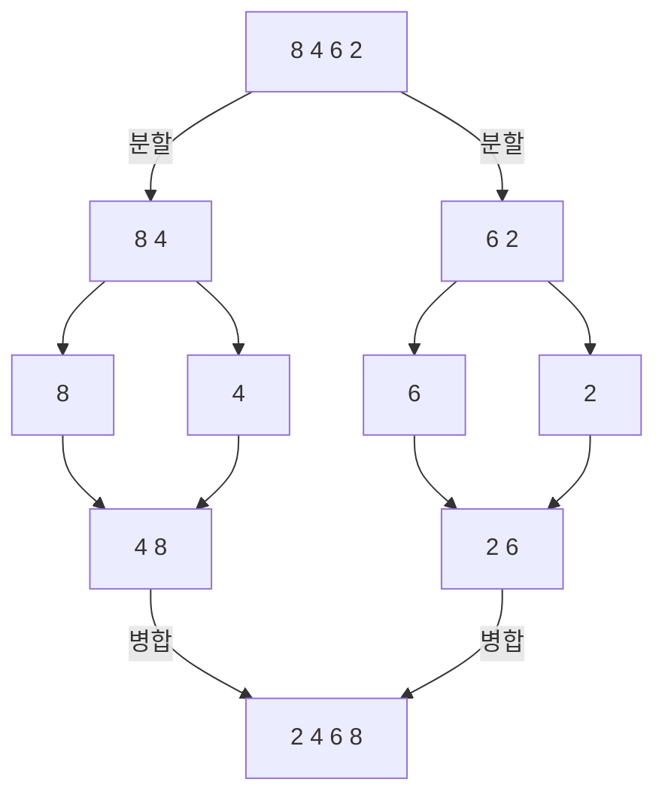

# 병합 정렬 (Merge Sort)

---

## I. 반으로 나누고 합치며 정렬하는, 병합 정렬의 개요

### 가. 정의

- 배열을 **절반씩 나눠 각각 정렬한 뒤, 정렬된 두 부분을 하나로 병합(Merge)**하는 분할 정복 정렬 [[알고리즘]] (J. von Neumann, 1945)

### 나. 특징

| 구분 | 내용 |
| --- | --- |
| 일정한 성능 | 최선·평균·최악 모두 O(n log n) |
| 안정 정렬 | 같은 값은 앞쪽 부분을 먼저 넣어 순서 유지 |
| 추가 메모리 | 배열 병합에 O(n) 보조 공간 필요 |
| 순차 접근 친화 | 병합이 순차 읽기·쓰기라 연결 리스트·외부 정렬에 적합 |

---

## II. 동작 및 구성요소

### 가. 동작 원리

- 크기 1까지 나눈 뒤, 두 정렬된 부분의 앞쪽 원소를 투 포인터로 비교해 작은 것부터 임시 배열에 옮기며 합침

### 나. 구성요소

| 구분 | 요소 | 설명 |
| --- | --- | --- |
| 패러다임 | 분할 정복 | 분할은 단순(중간 인덱스), 일은 병합 단계에 몰림 |
| 구현 | 하향식 (Top-down) | 재귀로 분할 후 병합, 재귀 스택 O(log n) |
| | 상향식 (Bottom-up) | 크기 1, 2, 4… 구간을 반복문으로 병합, 재귀 없음 |
| 핵심 연산 | 2-way 병합 | 두 포인터로 작은 값을 차례로 복사, O(n) |
| 복잡도 | 시간 O(n log n) | 깊이 log n × 레벨당 병합 n |
| | 공간 O(n) | 배열 기준 보조 배열 (연결 리스트는 포인터 변경으로 추가 배열 불필요) |
| 확장 | K-way 병합 | 정렬된 K개 묶음을 [[힙]]으로 병합, 외부 정렬의 핵심 |
| | 병렬 병합 정렬 | 분할된 부분을 여러 스레드에서 동시에 정렬 |

---

## III. 비교 및 동향

### 가. 병합 정렬 vs 퀵 정렬

| 비교 항목 | 병합 정렬 | [[퀵 정렬\|퀵 정렬 (Quick Sort)]] |
| --- | --- | --- |
| 분할 | 중간 위치로 균등 분할 | 피벗 값 기준, 불균등 가능 |
| 일이 몰리는 단계 | 병합 | 분할 |
| 최악 시간 | O(n log n) | O(n²) |
| 추가 공간 | O(n) | O(log n) |
| 안정성 | 안정 | 불안정 |
| 적합 | 연결 리스트, 외부 정렬, 안정성 필요 시 | 메모리 내 배열 정렬 |

### 나. 동향

- **Timsort**: 이미 정렬된 구간(run)을 찾아 작은 run은 [[삽입 정렬]]로 늘리고 run들을 병합, Python sort()·Java 객체 정렬(Collections.sort)·Android 등의 기본 정렬
- **대규모 외부 정렬**: 메모리에 들어가지 않는 데이터를 청크별로 정렬한 뒤 K-way 병합, Hadoop MapReduce의 셔플·DBMS 정렬 연산에 사용

---

### 🔗 연관 토픽

- **소속 도메인**: [[00_컴퓨터구조_MOC|💻 컴퓨터구조]]
- **세부 분류**: `4. 기본 자료구조 (Data Structures)`
- **핵심 연관 토픽**:
  - [[퀵 정렬|퀵 정렬 (Quick Sort)]]
  - [[삽입 정렬|삽입 정렬 (Insertion Sort)]]
  - [[힙|힙 (Heap)]]
  - [[알고리즘 성능평가]]
  - [[링크드 리스트|링크드 리스트(Linked List)]]
