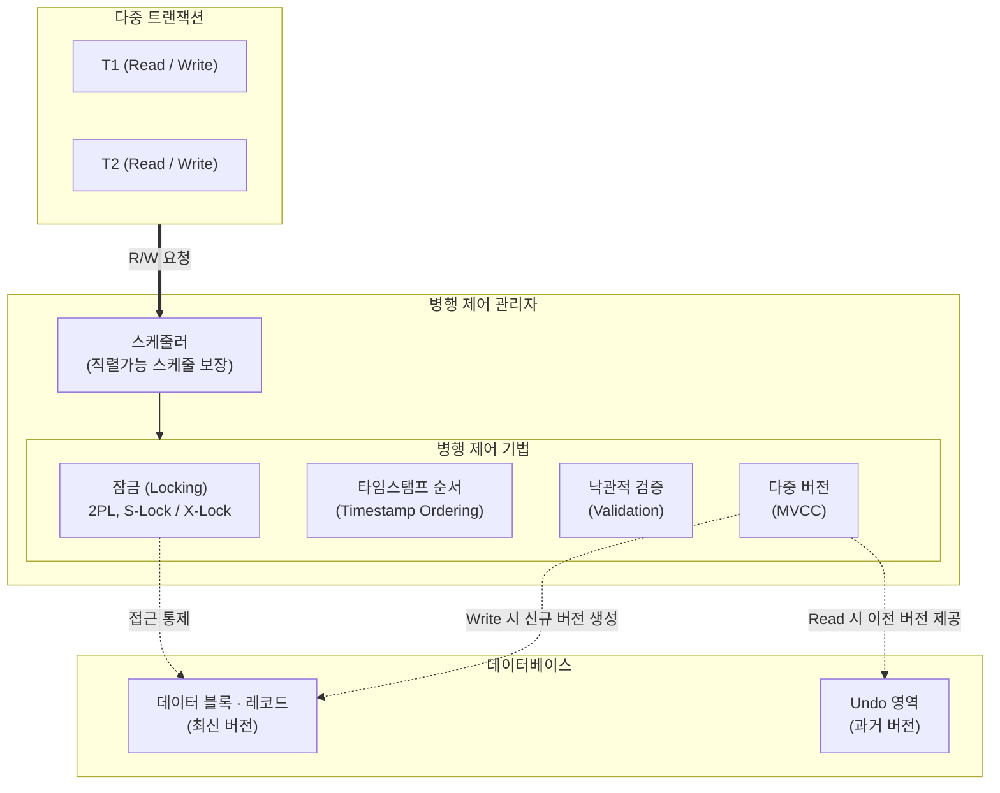

# 병행 제어 (Concurrency Control) / DB 동시성 제어

---

## I. 다중 트랜잭션의 일관성 보장, 병행 제어의 개요

### 가. 정의

- 여러 [[트랜잭션]]이 동시에 같은 데이터에 접근할 때 **실행 순서를 제어해 직렬 실행과 같은 결과(직렬가능성)를 보장**함으로써 [[무결성]]과 일관성을 유지하는 [[DBMS]]의 핵심 기법

### 나. 목적 및 미수행 시 문제점

| 구분 | 내용 |
| --- | --- |
| 목적 | 직렬가능성(Serializability) 보장, ACID 중 고립성(Isolation) 유지, [[처리량]] 극대화 |
| 갱신 분실 (Lost Update) | 두 트랜잭션이 같은 값을 갱신해 한쪽 결과가 사라짐 |
| 모순성 (Inconsistency) | 다른 트랜잭션이 갱신 중인 데이터를 읽어 일관성 없는 결과 발생 |
| 연쇄 복귀 (Cascading Rollback) | 한 트랜잭션의 Rollback이 그 값을 읽은 다른 트랜잭션까지 Rollback 유발 |
| 비완료 의존성 (Uncommitted Dependency) | Commit되지 않은 값을 읽은 뒤 원 트랜잭션이 실패 (Dirty Read) |
| Trade-off | 동시성을 높이면 일관성이 낮아지고, 격리 수준을 높이면 성능 저하 |

---

## II. 병행 제어의 구조 및 핵심 기법

### 가. 병행 제어 구조

- 스케줄러가 트랜잭션의 R/W 요청을 받아 잠금·타임스탬프·검증·다중 버전 기법으로 충돌을 막고 직렬가능 스케줄로 변환

### 나. 핵심 기법

| 구분 | 기법 | 설명 |
| --- | --- | --- |
| 잠금 ([[Locking]]) | S-Lock / X-Lock | 읽기는 공유 잠금, 쓰기는 배타 잠금으로 간섭 차단 |
| | [[2PL]] (2단계 잠금) | 잠금 획득(확장)과 해제(수축) 단계를 분리해 직렬가능성 보장, 교착상태는 별도 처리 필요 |
| | 잠금 단위 (Granularity) | DB·테이블·페이지·행 단위, 클수록 동시성 저하, 작을수록 관리 오버헤드 증가 |
| 순서 제어 | [[타임스탬프 순서 기법\|타임스탬프 순서 (TO)]] | 진입 시각 순서대로 R/W를 허용, 순서 위반 시 Rollback (교착상태 없음) |
| 낙관적 기법 | 검증 기법 (OCC) | 판독 → 검증 → 기록 3단계, 실행 중에는 검사 없이 Commit 시점에 충돌 검증 |
| 다중 버전 | MVCC | 갱신 시 이전 버전을 보관해 읽기와 쓰기 간 대기 제거 |
| 격리 수준 | [[Isolation Level (격리 레벨고립성 수준)\|Isolation Level]] | Read Uncommitted ~ Serializable 4단계로 동시성과 정합성 수준 선택 |
| 교착상태 대응 | Wait-Die / Wound-Wait | 타임스탬프 우선순위로 [[교착상태]]를 예방 |

---

## III. 기법 비교 및 동향

### 가. 비관적 vs 낙관적 vs MVCC

| 비교 항목 | 비관적 (Locking / 2PL) | 낙관적 (OCC) | MVCC |
| --- | --- | --- | --- |
| 기본 가정 | 충돌이 잦음 | 충돌이 드묾 | 읽기·쓰기 충돌을 구조적으로 분리 |
| 제어 시점 | 접근 전 Lock 획득 | Commit 시 검증 | 갱신 시 버전 생성 |
| 대기 | Lock 경합 시 대기 | 대기 없음, 충돌 시 Rollback | Reader·Writer 간 대기 없음 |
| 단점 | 교착상태, 동시성 저하 | 충돌 많으면 재수행 비용 증가 | 버전 정리(Vacuum, Undo Retention) 오버헤드 |
| 활용 | 재고·예약 등 경합이 큰 업무 | 읽기 위주, 인메모리 DB | Oracle, PostgreSQL, MySQL InnoDB |

### 나. 동향

- **분산 DB의 직렬가능성**: Google Spanner의 TrueTime(원자시계·GPS), [[CockroachDB]]의 HLC(Hybrid Logical Clock)처럼 물리·논리 시간을 결합해 글로벌 환경에서 Strict Serializability 보장 ([[New SQL\|NewSQL]])
- **인메모리 낙관적 제어**: SAP HANA 등은 무거운 2PL 대신 OCC와 경량 래치를 결합해 처리량 극대화
- **하드웨어·AI 활용**: HTM(Hardware Transactional Memory)으로 [[CPU]] 캐시 수준에서 충돌을 감지하고, 워크로드 학습으로 잠금 단위를 자동 조정하는 연구

---

### 🔗 연관 토픽

- **소속 도메인**: [[00_데이터베이스_MOC|🗄️ 데이터베이스]]
- **세부 분류**: `2. 트랜잭션 & 동시성 제어 (Concurrency)`
- **핵심 연관 토픽**:
  - [[2PL|2PL (Two-Phase Locking Protocol)]]
  - [[타임스탬프 순서 기법]]
  - [[Isolation Level (격리 레벨고립성 수준)|Isolation Level]]
  - [[트랜잭션]]
  - [[교착상태]]
