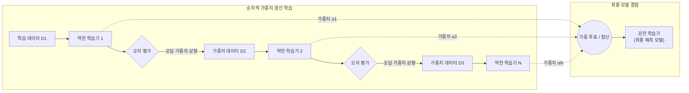

# 부스팅 (Boosting)

---

## I. 약한 학습기의 순차 결합을 통한 성능 극대화, 부스팅의 개요

### 가. 정의

- 이전 단계 모델의 오분류 데이터나 잔차(Residual)에 가중치를 부여하여 순차적으로 학습함으로써, **여러 개의 약한 학습기(Weak Learner)를 결합해 고성능의 강한 학습기(Strong Learner)를 구축하는 앙상블 기법**

### 나. 특징 및 필요성

| 구분 | 내용 |
| --- | --- |
| 편향(Bias) 감소 | 약한 모델의 과소적합(Underfitting) 문제를 단계별 잔차 보정으로 해결하여 예측 정확도 극대화 |
| 순차적 학습 | 이전 모델의 오차(오답) 정보를 다음 모델의 학습 데이터 가중치에 직접 반영하는 종속적 구조 |
| 잔차 학습 | Gradient Boosting 계열은 손실 함수의 음의 그래디언트(잔차)를 타깃으로 회귀 트리를 연속 학습 |
| 정형 데이터 최강 | 캐글 등 머신러닝 경진대회 및 금융/마케팅 정형 데이터(Tabular Data) 분석에서 사실상 표준으로 활용 |

---

## II. 개념도 및 핵심 구성요소

### 가. 개념도 (순차적 가중치 갱신 및 결합)

- 이전 약한 학습기가 틀린 데이터 샘플에 높은 가중치를 주어 다음 모델이 어려운 패턴 학습에 집중하도록 유도하고, 최종적으로 각 모델의 정확도에 비례한 가중합으로 결합

### 나. 핵심 기술 요소 및 대표 알고리즘

| 구분 | 요소 | 설명 |
| --- | --- | --- |
| 학습 원리 | 순차적 학습 (Sequential) | 병렬 독립 학습인 배깅과 달리 이전 학습기의 결과가 다음 학습기 입력에 직접 종속 |
| 최적화 기법 | 오답 가중치 갱신 | 오분류된 표본의 샘플링 확률을 높여 후속 트리가 오차를 집중 보정 (AdaBoost) |
| | 경사하강법 (Gradient) | 손실 함수(Loss)의 음의 기울기(잔차)를 예측하는 트리를 순차 결합 (GBM) |
| 결합 방식 | 가중 투표 (Weighted Voting) | 성능이 우수한 학습기일수록 더 큰 가중치($\alpha$)를 부여하여 최종 의사결정 |
| 대표 알고리즘 | AdaBoost | 오분류 데이터 자체에 가중치를 재할당하는 전통적 부스팅 모델 |
| | Gradient Boosting (GBM) | 회귀 잔차를 지속 적합하는 방식으로 성능을 높였으나 학습 속도가 느린 단점 |
| | XGBoost | 2차 테일러 전개(헤시안), L1/L2 정규화, 칼럼 서브샘플링, CPU 병렬 연산 지원으로 속도·과적합 개선 |
| | LightGBM | 리프 중심(Leaf-wise) 트리 분할 및 히스토그램 기반 고속 분할로 대용량 데이터 초고속 처리 |
| | CatBoost | 범주형 변수의 통계적 인코딩 및 순서형 부스팅으로 타깃 누수 방지 |

---

## III. 앙상블 기법 비교 및 동향

### 가. 부스팅(Boosting) vs 배깅(Bagging)

| 비교 항목 | 부스팅 (Boosting) | 배깅 (Bagging) |
| --- | --- | --- |
| 학습 방식 | **순차적 학습** (Sequential, 이전 모델에 의존) | **병렬 독립 학습** (Parallel, 모델 간 무관) |
| 데이터 샘플링 | 오차 기반 가중치 재분배 샘플링 | 복원 추출 무작위 샘플링 (부트스트랩) |
| 주 목적 | **편향(Bias) 감소** (예측 정확도 향상) | **분산(Variance) 감소** (과적합 방지 및 안정화) |
| 기본 모델 | 단순한 약한 학습기 (얕은 결정 트리) | 복잡한 고분산 학습기 (깊은 결정 트리) |
| 최종 결합 | 모델별 가중 투표 및 가중 합산 | 단순 다수결(투표) 또는 단순 산술 평균 |
| 과적합 위험 | 반복 수가 과도하면 이상치에 과적합 가능 | 트리가 늘어나도 과적합 위험이 적음 |
| 대표 알고리즘 | XGBoost, LightGBM, CatBoost | [[랜덤 포레스트]], BaggingClassifier |

### 나. 동향

- **정형 데이터(Tabular Data)의 표준 모델**: 비정형 영역에서 딥러닝이 우세한 반면, 정형 테이블 데이터에서는 XGBoost/LightGBM이 계산 효율과 정확도 측면에서 여전히 벤치마크 표준으로 군림
- **과적합 제어 및 조기 종료(Early Stopping)**: 부스팅의 과적합 위험을 방지하기 위해 검증 손실이 정체될 때 훈련을 자동 중단하는 조기 종료 및 하이퍼파라미터 튜닝(Optuna 등) 자동화 보편화
- **CPU/GPU 이기종 가속**: 대규모 피처셋에 대해 GPU 메모리에서 히스토그램을 직접 구성하고 트리를 분할하여 훈련 시간을 수십 배 단축

---

### 🔗 연관 토픽

- **소속 도메인**: [[00_데이터베이스_MOC|🗄️ 데이터베이스]]
- **세부 분류**: `6. SQL 표준 문법 & 쿼리 성능 튜닝`
- **핵심 연관 토픽**:
  - [[배깅]]
  - [[랜덤 포레스트]]
  - [[분류화]]
  - [[경사하강법]]
  - [[이상치]]
