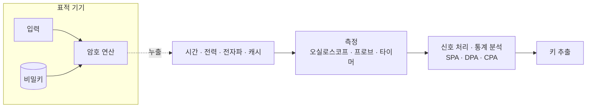

# 부채널 공격 (Side Channel Attack)

---

## I. 수학이 아닌 구현을 노리는, 부채널 공격의 개요

### 가. 정의

- 암호 알고리즘의 수학적 약점이 아니라 **연산 중 새어 나오는 시간·전력·전자파·캐시 접근 패턴 등 물리적 정보를 측정·분석하여 비밀키를 추출**하는 공격

### 나. 특징

| 구분 | 내용 |
| --- | --- |
| 구현 공격 | [[AES]]·[[RSA (Rivest Shamir Adleman)\|RSA]]처럼 수학적으로 안전한 알고리즘도 구현 방식에 따라 노출 |
| 물리 접근 | 스마트카드·IoT처럼 공격자가 기기를 손에 넣을 수 있는 환경에서 위협 큼 |
| 원격 가능 | 타이밍·캐시 공격은 네트워크·공유 클라우드에서도 가능 |
| 통계 분석 | 다수 측정값을 상관 분석해 잡음 속 신호 추출 |

---

## II. 공격 구조 및 구성요소

### 가. 공격 구조

- 연산 중 누출 신호를 수집하고, 키 가설별 예측값과 실제 측정값의 상관관계로 키를 한 부분씩 추정

### 나. 공격·방어 요소

| 구분 | 요소 | 설명 |
| --- | --- | --- |
| 공격 | 타이밍 공격 | 키 비트에 따라 달라지는 실행 시간 측정 |
| | 단순 전력 분석 (SPA) | 단일 파형에서 연산 패턴(제곱·곱셈 등) 식별 |
| | 차분·상관 전력 분석 (DPA·CPA) | 다수 파형을 통계 처리해 키 추정 |
| | 전자파 분석 (EMA) | 칩 주변 전자파 측정 |
| | 캐시 공격 | Flush+Reload, Prime+Probe로 공유 캐시 접근 시간 차이 이용 |
| | 오류 주입 | 전압·클럭 글리치, 레이저로 오류를 유발해 키 유도 |
| 방어 | 상수 시간 구현 | 비밀값에 따른 분기·메모리 접근 제거 |
| | 마스킹 | 중간값에 난수를 섞어 누출과 키의 상관 제거 |
| | 블라인딩 | RSA 입력·지수에 난수를 곱해 연산 대상을 매번 바꿈 |
| | 하드웨어 대책 | 차폐, 노이즈·지터 주입, 이중 연산 검증 |

---

## III. 비교 및 동향

### 가. 암호 분석 공격 vs 부채널 공격

| 비교 항목 | [[암호 분석 공격 기법\|암호 분석 공격]] | 부채널 공격 |
| --- | --- | --- |
| 대상 | 알고리즘의 수학적 구조 | 구현체의 물리적·마이크로아키텍처 특성 |
| 방법 | 전수조사, 차분·선형 분석 | 신호 측정과 통계 분석 |
| 요구 조건 | 대량 평문·암호문, 연산 자원 | 측정 장비 또는 같은 하드웨어 공유 |
| 대응 | 키 길이·알고리즘 교체 | 구현 보완 (상수 시간, 마스킹, 차폐) |

### 나. 동향

- **추측 실행 공격**: Spectre·Meltdown 이후 계속되는 CPU 마이크로아키텍처 취약점과 마이크로코드·격리 대책
- **PQC 구현 보안**: ML-KEM·ML-DSA 구현의 타이밍 누출(예: KyberSlash) 대응 및 마스킹 구현 연구
- **인증 기준**: FIPS 140-3·CC 평가에서 비침투 공격 내성 시험(ISO/IEC 17825) 반영

---

### 🔗 연관 토픽

- **소속 도메인**: [[00_보안_MOC|🛡️ 보안]]
- **세부 분류**: `2. 현대 암호학 & 키 관리 · 전자서명`
- **핵심 연관 토픽**:
  - [[암호 분석 공격 기법|암호 분석 공격(Cryptanalysis Attacks) 기법]]
  - [[전자기파 이용 공격|전자기파 이용 공격 (EMP & TEMPEST)]]
  - [[TPM|TPM (Trusted Platform Module)]]
  - [[FIPS (Federal Information Processing Standards)]]
  - [[IoT 보안 위협]]
