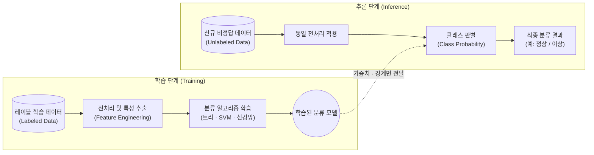

# 분류화 (Classification)

---

## I. 범주형 목표 변수 예측, 분류화의 개요

### 가. 정의

- 사전에 정답 레이블(Label)이 주어진 학습 데이터를 바탕으로 특성(Feature)과 범주 간의 패턴 관계를 모델링하여, **새로운 데이터가 속할 클래스(Class)를 예측하는 지도 학습(Supervised Learning) 기법**

### 나. 특징 및 필요성

| 구분 | 내용 |
| --- | --- |
| 지도 학습 기반 | 정답 타깃 변수가 존재하는 훈련셋을 통해 오차를 최소화하는 방향으로 의사결정 경계(Decision Boundary) 학습 |
| 이산형 출력 | 예측 결과가 연속 수치가 아닌 특정 이산 범주(Binary: 스팸/정상, Multi-class: 차종, Multi-label: 복수 태그)로 도출 |
| 핵심 적용 분야 | 이메일 스팸 필터링, 신용카드 이상 거래(FDS), 의료 질병 진단, 고객 이탈 예측, 이미지 객체 인식 |
| 불균형 데이터 과제 | 소수 클래스(사기 거래, 희귀 질환 등)의 데이터 부족 시 SMOTE 오버샘플링 및 비용 민감 학습(Cost-Sensitive) 필수 |

---

## II. 개념도 및 핵심 구성요소

### 가. 개념도 (학습 및 추론 단계)

- 학습 단계에서 알고리즘 최적화를 통해 분류 경계면을 형성하고, 추론 단계에서 신규 데이터의 입력 특성을 모델에 전달하여 소속 확률이 가장 높은 클래스로 매핑

### 나. 핵심 기술 요소 및 평가 지표

| 구분 | 요소 | 설명 |
| --- | --- | --- |
| 대표 알고리즘 | 로지스틱 회귀 | 시그모이드(Sigmoid) 함수를 통해 입력값이 특정 클래스에 속할 확률(0~1)을 계산하는 선형 분류기 |
| | 서포트 벡터 머신 (SVM) | 클래스 간 여백(Margin)을 최대화하는 최적의 결정 초평면(Hyperplane)을 탐색 |
| | 의사결정나무 / 앙상블 | 정보 획득량(지니 계수 등)으로 분기하는 단일 트리 및 [[배깅]](Random Forest), [[부스팅]](XGBoost) |
| | 인공신경망 (MLP/CNN) | 다층 퍼셉트론 및 합성곱 신경망을 통해 비선형 고차원 특징을 자동 추출하여 분류 |
| 평가 지표 | 혼동 행렬 (Confusion Matrix) | 실제 정답과 예측값의 교차표로 TP, FP, FN, TN을 정리하여 정밀도·재현율 산출 기반 제공 |
| | 정확도 (Accuracy) | 전체 샘플 중 맞게 예측한 비율 ($(TP+TN)/(TP+TN+FP+FN)$). 클래스 불균형 시 왜곡 위험 |
| | 정밀도 vs 재현율 | 모델이 참이라 한 것 중 실제 참(Precision) vs 실제 참 중 모델이 맞춘 비율(Recall) |
| | F1-Score | 정밀도와 재현율의 조화평균 ($2 \cdot \frac{Precision \cdot Recall}{Precision + Recall}$), 불균형 데이터 핵심 지표 |
| | ROC-AUC | 임계값 변화에 따른 FPR 대비 TPR 곡선의 하부 면적(AUC). 1에 가까울수록 변별력 우수 |

---

## III. 기법 비교 및 동향

### 가. 분류화(Classification) vs 회귀분석(Regression)

| 비교 항목 | 분류화 (Classification) | 회귀분석 (Regression) |
| --- | --- | --- |
| 예측 대상 (Target) | **범주형 (Categorical) 변수** | **연속형 (Continuous) 수치 변수** |
| 결과값 형태 | 이산값 (Discrete, 예: 0/1, A/B/C) | 연속 수치 (예: 매출액, 주가, 기온) |
| 결정 경계 | 클래스 간을 가르는 결정 초평면/경계면 | 데이터 추세를 설명하는 최적 적합선/곡선 |
| 주요 알고리즘 | 로지스틱 회귀, SVM, 결정 트리, 랜덤 포레스트 | 선형 회귀, 릿지/라쏘, 다항 회귀, SVR |
| 핵심 평가 지표 | 혼동 행렬, 정확도, F1-Score, ROC-AUC | MSE, RMSE, MAE, 결정계수($R^2$) |

### 나. 동향

- **초거대 언어 모델([[초거대 언어 모델|LLM]]) 기반 제로샷/퓨샷 분류**: 수만 건의 훈련 데이터 레이블링 없이 프롬프트 명령과 소수 예시(Few-shot)만으로 텍스트 감성, 문서 카테고리, 의도를 즉시 분류하는 방식 확산
- **설명 가능한 인공지능([[XAI]]) 결합**: 금융 대출 심사나 의료 진단 등 고위험 분류 모델에서 SHAP, [[LIME]] 등을 통해 특정 클래스로 판정된 주요 피처 기여도를 투명하게 설명
- **정형 딥러닝(Tabular DL) 모델 발전**: 전통적인 트리 앙상블 외에 어텐션 메커니즘을 적용한 TabNet, FT-Transformer 등을 활용해 정형 데이터 분류 성능을 고도화

---

### 🔗 연관 토픽

- **소속 도메인**: [[00_데이터베이스_MOC|🗄️ 데이터베이스]]
- **세부 분류**: `6. SQL 표준 문법 & 쿼리 성능 튜닝`
- **핵심 연관 토픽**:
  - [[부스팅]]
  - [[배깅]]
  - [[의사결정나무]]
  - [[회귀분석]]
  - [[XAI]]
