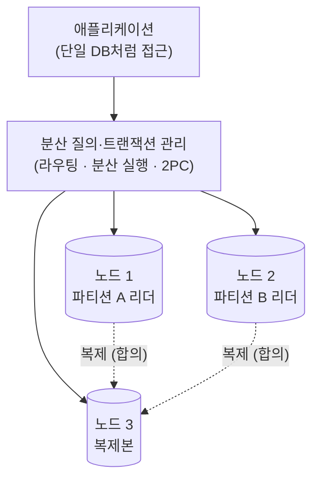

# 분산 데이터베이스 (Distributed Database)

---

## I. 하나처럼 보이는 여러 DB, 분산 데이터베이스의 개요

### 가. 정의

- 논리적으로는 하나의 DB지만 **물리적으로는 네트워크로 연결된 여러 사이트(노드)에 데이터를 분할·복제해 저장하고, 사용자에게는 분산 사실을 숨기는(투명성) 데이터베이스**

### 나. 특징

| 구분 | 내용 |
| --- | --- |
| 투명성 | 분할·위치·지역사상·중복·병행·장애 투명성 |
| 확장성 | 노드 추가로 수평 확장 |
| 가용성 | 복제로 단일 장애점 제거 |
| 복잡성 | 분산 트랜잭션·동시성 제어·설계 비용 증가 |

---

## II. 구조 및 구성요소

### 가. 분산 DB 구조

- 데이터를 단편으로 나눠 노드에 할당하고, 복제본은 합의 알고리즘으로 동기화하며, 여러 노드에 걸친 트랜잭션은 분산 커밋으로 처리

### 나. 구성요소

| 구분 | 요소 | 설명 |
| --- | --- | --- |
| 목표 | 6대 투명성 | 분할, 위치, 지역사상, 중복, 병행, 장애 투명성 |
| 설계 | 단편화 (Fragmentation) | 수평(행)·수직(열)·혼합 분할 ([[샤딩]], [[파티셔닝]]) |
| | 할당·복제 | 단편을 어느 노드에 몇 개 둘지 결정 |
| 일관성 | 합의 알고리즘 | Raft·Paxos로 복제본 동기화·리더 선출 ([[합의 알고리즘]]) |
| 트랜잭션 | 2PC | 준비–커밋 2단계로 분산 원자성 보장, 코디네이터 장애 시 블로킹 |
| 시간 | 전역 타임스탬프 | TrueTime(GPS·원자시계), HLC(물리+논리 시계) |
| 동시성 | 분산 잠금·MVCC | 전역 타임스탬프 기반 스냅샷 읽기 |
| 질의 | 분산 질의 최적화 | 반조인(Semi-join), 연산 푸시다운으로 네트워크 전송 최소화 |
| 이론 | CAP·[[PACELC]] | 분할·평상시 일관성–가용성·지연 트레이드오프 |

---

## III. 비교 및 동향

### 가. RDBMS vs NoSQL vs NewSQL

| 비교 항목 | 전통 RDBMS | [[NoSQL (CAP 이론 BASE 속성)\|NoSQL]] | [[New SQL\|NewSQL]] |
| --- | --- | --- | --- |
| 목적 | 무결성, 복잡한 트랜잭션 | 대용량·가용성 | 확장성 + ACID |
| 확장 | Scale-Up | Scale-Out | Scale-Out |
| 일관성 | 강한 일관성 | 최종 일관성 중심 | 합의 기반 강한 일관성 |
| 예 | Oracle, PostgreSQL | MongoDB, Cassandra | Spanner, [[CockroachDB]], TiDB |

### 나. 동향

- **HTAP 분산 DB**: TiDB(TiKV + TiFlash)처럼 같은 클러스터에서 [[OLTP]]·[[OLAP]] 처리
- **쿠버네티스 운영**: 오퍼레이터 기반 자동 확장·복구, 서버리스 분산 DB 서비스 확산
- **데이터 주권 대응**: 지역별 데이터 배치(Geo-partitioning)로 규제 준수

---

### 🔗 연관 토픽

- **소속 도메인**: [[00_데이터베이스_MOC|🗄️ 데이터베이스]]
- **세부 분류**: `4. 물리 저장 구조 & 인덱스 최적화`
- **핵심 연관 토픽**:
  - [[샤딩]]
  - [[New SQL]]
  - [[PACELC]]
  - [[합의 알고리즘]]
  - [[트랜잭션]]
