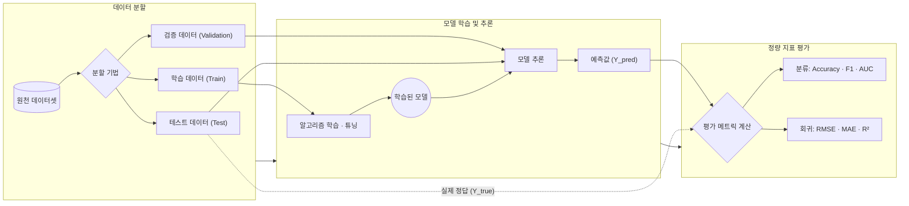

# 분석 모델 평가 방법 (Model Evaluation)

---

## I. 최적 알고리즘 선정과 일반화 성능 검증, 모델 평가의 개요

### 가. 정의

- 기계학습 및 통계 분석으로 구축된 예측/분류 모델이 **미지의 데이터(Unseen Data)에 대해 얼마나 신뢰성 있고 정확하게 동작하는지 정량적 지표와 검증 기법으로 측정하는 절차**

### 나. 특징 및 필요성

| 구분 | 내용 |
| --- | --- |
| 과적합(Overfitting) 방지 | 훈련 데이터에만 편향되어 실전 추론 시 성능이 급락하는 현상을 방지하고 [[일반화]] 성능 보장 |
| 비즈니스 최적화 | 단순 정확도 외에 오분류 비용(Cost), 지연 시간(Latency) 등 비즈니스 목표에 가장 부합하는 모델 채택 |
| 문제 유형별 메트릭 | 분류(혼동행렬/F1), 회귀(RMSE/$R^2$), 군집(실루엣 계수) 등 데이터 특성에 맞는 적합 지표 적용 |
| 신뢰성 검증 | K-Fold 교차 검증, 부트스트랩 등을 통해 표본 편향에 의한 성능 왜곡 최소화 |

---

## II. 개념도 및 핵심 구성요소

### 가. 개념도 (평가 프로세스)

- 원천 데이터를 분할하여 모델을 학습시킨 후 미지의 테스트셋에 대해 예측을 수행하고, 실제 정답과 비교하여 과적합 여부 및 정량적 평가지표 산출

### 나. 핵심 기술 요소 및 평가지표

| 구분 | 요소 | 설명 |
| --- | --- | --- |
| 검증 기법 | K-Fold 교차 검증 | 데이터를 K개로 분할하여 K번 순환 학습·검증 후 평균 성능 산출 (데이터 부족 및 과적합 완화) |
| | 홀드 아웃 (Hold-out) | Train(60~70%), Validation(15~20%), Test(15~20%)로 고정 분할하여 단계적 평가 |
| | 계층적 K-Fold | 불균형 데이터에서 각 폴드마다 클래스 비율을 동일하게 유지하여 분할 |
| 분류 지표 | 혼동 행렬 (Confusion Matrix) | 실제값과 예측값의 일치 여부를 TP, FP, FN, TN으로 세분화한 교차표 |
| | F1-Score | 정밀도(Precision)와 재현율(Recall)의 조화평균 ($2 \cdot \frac{P \cdot R}{P + R}$) |
| | ROC-AUC | 위양성률(FPR) 대비 참양성률(TPR)의 곡선 하부 면적 (이진 분류 판별력 척도) |
| 회귀 지표 | RMSE | 오차 제곱의 평균에 제곱근을 취한 지표로, 이상치에 민감하게 페널티 부여 |
| | 결정계수 ($R^2$) | 전체 분산 중 회귀 모델이 설명하는 분산 비율 (1에 가까울수록 적합도 우수) |
| 군집 지표 | 실루엣 계수 | 군집 내 응집도와 타 군집 간 분리도를 측정하여 -1~1 사이로 평가 |

---

## III. 태스크별 평가 방법 비교 및 동향

### 가. 분류 모델 평가 vs 회귀 모델 평가

| 비교 항목 | 분류 모델 평가 (Classification) | 회귀 모델 평가 (Regression) |
| --- | --- | --- |
| 타깃 변수 | 범주형 이산값 (예: 스팸 여부, 질병 유무) | 연속형 수치값 (예: 주택 가격, 전력 수요) |
| 평가 관점 | 정답 클래스를 얼마나 **정확히 적중했는가** | 실제 수치와 예측치 간의 **오차가 얼마나 작은가** |
| 대표 지표 | 정확도(Accuracy), F1-Score, ROC-AUC | MAE, MSE, RMSE, MAPE, 결정계수($R^2$) |
| 극단치 민감도 | 임계값(Threshold) 설정에 따른 클래스 이동 | 이상치(Outlier)에 따른 오차 제곱 폭증 |
| 주 활용 분야 | 이상 탐지, 이탈 예측, 감성 분석, 의료 진단 | 시계열 수요 예측, 부동산 시세 산정, 센서 수치 추정 |

### 나. 동향

- **LLM 맞춤형 생성 평가(LLM-as-a-Judge)**: 정형 메트릭 외에 생성형 텍스트 품질을 평가하기 위해 상위 모델(GPT-4 등)을 판정관으로 두어 충실도(Faithfulness)와 문맥 관련성(Relevance)을 자동 채점
- **MLOps 기반 드리프트(Drift) 지속 감시**: 배포된 모델의 입력 데이터 분포 변화(Data Drift) 및 타깃 관계 변화(Concept Drift)를 실시간 추적하여 성능 저하 시 자동 재학습 파이프라인 트리거
- **공정성 및 책임성(Fairness & Bias) 평가**: 인종, 성별 등 민감 속성에 대한 통계적 동등성(Disparate Impact) 지표를 검증하는 윤리적 AI 감사 기준 강화

---

### 🔗 연관 토픽

- **소속 도메인**: [[00_데이터베이스_MOC|🗄️ 데이터베이스]]
- **세부 분류**: `6. SQL 표준 문법 & 쿼리 성능 튜닝`
- **핵심 연관 토픽**:
  - [[일반화]]
  - [[분류화]]
  - [[회귀분석]]
  - [[MLOps]]
  - [[데이터 분석 거버넌스]]
