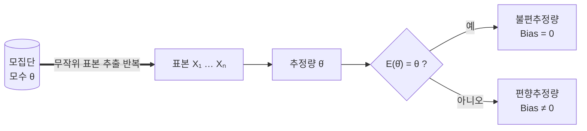

# 불편추정량 (Unbiased Estimator)

---

## I. 평균적으로 모수를 맞히는 추정량, 불편추정량의 개요

### 가. 정의

- **기댓값이 추정하려는 모수와 같은 추정량**, $E(\hat{\theta}) = \theta$ (편향 $= 0$)

### 나. 특징

| 구분 | 내용 |
| --- | --- |
| 체계적 오차 없음 | 반복 추출 시 추정값의 평균이 참값과 일치 |
| 베셀 보정 | 표본분산을 $n$이 아닌 $n-1$로 나누어야 모분산의 불편추정량 |
| 한계 | 불편이라도 분산이 크면 개별 추정은 부정확할 수 있음 → 효율성·MSE 함께 평가 |
| ML 연관 | 미니배치 기울기는 전체 기울기의 불편추정량 (SGD의 근거, 단 전역 최적 보장은 아님) |

---

## II. 개념 및 구성요소

### 가. 개념도

- 같은 크기의 표본을 반복 추출했을 때 추정량 분포의 중심이 모수와 일치하면 불편

### 나. 구성요소

| 구분 | 요소 | 설명 |
| --- | --- | --- |
| 기본 | 모수 $\theta$ | 모집단의 참값 (예: $\mu$, $\sigma^2$) |
| | 추정량 $\hat{\theta}$ | 표본으로 계산하는 통계량 (함수) |
| 평가 | 편향 | $Bias = E(\hat{\theta}) - \theta$ |
| | 평균제곱오차 (MSE) | $MSE = Var(\hat{\theta}) + Bias^2$ |
| | 효율성 (MVUE) | 불편추정량 중 분산 최소, 하한은 크래머-라오 하한 |
| | 일치성 | $n \to \infty$일 때 $\hat{\theta} \to \theta$ (확률 수렴) |
| 대표 예 | 표본평균 | $E(\bar{X}) = \mu$ |
| | 표본분산 | $S^2 = \frac{1}{n-1}\sum (X_i - \bar{X})^2$, $E(S^2) = \sigma^2$ |

---

## III. 비교 및 동향

### 가. 불편추정량 vs 편향추정량

| 비교 항목 | 불편추정량 | 편향추정량 |
| --- | --- | --- |
| 조건 | $E(\hat{\theta}) = \theta$ | $E(\hat{\theta}) \neq \theta$ |
| 표본분산 예 | $n-1$로 나눔 | $n$으로 나눔 (MLE) |
| 장점 | 평균적으로 정확 | 분산을 줄여 MSE가 더 작을 수 있음 |
| 예 | 표본평균, $S^2$ | Ridge·Lasso 추정량, 축소 추정 |

### 나. 동향

- **편향-분산 트레이드오프**: 머신러닝은 불편성보다 일반화 오차(MSE)를 중시해 L1/L2 정규화로 약간의 편향을 허용하고 분산을 줄임 ([[정규화, 규제화, 표준화]])
- **강화학습 가치 추정**: 몬테카를로 리턴은 불편이나 분산이 크고 TD는 편향이 있으나 분산이 작아, PPO·A2C 등은 둘을 절충한 GAE(Generalized Advantage Estimation) 사용

---

### 🔗 연관 토픽

- **소속 도메인**: [[00_인공지능_MOC|🤖 인공지능]]
- **세부 분류**: `1. 수학 · 통계학 & 데이터 전처리`
- **핵심 연관 토픽**:
  - [[추정 이론|추정 이론(Estimation Theory)]]
  - [[중심극한정리|중심극한정리 (Central Limit Theorem)]]
  - [[편향]]
  - [[표본 추출]]
  - [[경사하강법|경사하강법 (Gradient Descent Algorithm)]]
