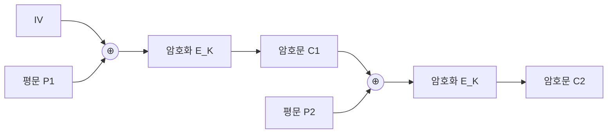

# 블록 암호화 (Block Cipher)

---

## I. 고정 길이 단위로 섞고 바꾸는, 블록 암호의 개요

### 가. 정의

- 평문을 **고정 크기 블록(64비트, 128비트 등) 단위로 나누고 비밀키로 라운드 함수를 반복 적용**하여 암호화하는 [[대칭키 암호화|대칭키]] 암호

### 나. 특징

| 구분 | 내용 |
| --- | --- |
| 설계 원리 | Shannon의 혼돈(Confusion)·확산(Diffusion)을 여러 라운드 반복 |
| 구조 | Feistel([[DES]], SEED)과 SPN([[AES]], ARIA) |
| 운용 모드 | 여러 블록 처리 방식(ECB, CBC, CTR, GCM 등)을 별도로 선택 |
| 패딩 | 평문 길이가 블록 배수가 아니면 PKCS#7 등으로 채움 (CTR·GCM은 불필요) |

---

## II. 동작 구조 및 구성요소

### 가. CBC 모드 동작

- 이전 암호문 블록을 다음 평문과 XOR한 뒤 암호화(체이닝)하여, 같은 평문 블록도 다른 암호문이 되도록 함

### 나. 구성요소

| 구분 | 요소 | 설명 |
| --- | --- | --- |
| 설계 원리 | 혼돈 | 키와 암호문의 관계를 복잡하게 함 (S-Box, 비선형 치환) |
| | 확산 | 평문 1비트 변화가 암호문 전체에 퍼지도록 함 (P-Box, 선형 변환) |
| 구조 | Feistel | 블록을 좌우로 나눠 라운드 함수 F 적용 후 교환, 복호화에 F의 역함수 불필요 |
| | SPN | 블록 전체에 치환·전치 적용, 병렬성 높음, 복호화에 역연산 필요 |
| 운용 모드 | ECB | 블록 독립 암호화, 같은 평문은 같은 암호문 (패턴 노출) |
| | CBC | 체이닝, 암호화는 순차·복호화는 병렬 가능 |
| | CTR | 카운터를 암호화해 키스트림 생성, 병렬 처리 |
| | GCM | CTR + GHASH 인증, 기밀성·[[무결성]] 동시 제공 (AEAD) |
| 부품 | 키 스케줄 | 마스터 키로부터 라운드 키 생성 |
| 성능 | AES-NI | CPU 전용 명령어로 AES 가속 |

---

## III. 비교 및 동향

### 가. 블록 암호 vs 스트림 암호

| 비교 항목 | 블록 암호 | 스트림 암호 |
| --- | --- | --- |
| 처리 단위 | 고정 크기 블록 | 비트·바이트 단위 (키스트림 XOR) |
| 속도 | 상대적으로 느림 | 빠름, 경량 구현 용이 |
| 오류 전파 | 모드에 따라 다름 (CBC는 다음 블록까지) | 해당 비트에 국한 (동기식) |
| 활용 | 파일·DB 암호화, TLS | 무선 통신, 실시간 스트리밍 |
| 대표 알고리즘 | AES, ARIA, SEED, DES | ChaCha20, A5/1, RC4(폐기) |

### 나. 동향

- **AEAD 기본화**: TLS 1.3은 AES-GCM, ChaCha20-Poly1305 등 AEAD만 허용
- **양자 대비**: Grover 알고리즘으로 실효 강도가 절반이 되므로 장기 보호 데이터는 AES-256 권고
- **경량 암호**: NIST 경량 암호 표준 Ascon(SP 800-232), 국내 LEA를 IoT에 적용

---

### 🔗 연관 토픽

- **소속 도메인**: [[00_보안_MOC|🛡️ 보안]]
- **세부 분류**: `1. 정보보안 원칙 & 거버넌스 · 인증`
- **핵심 연관 토픽**:
  - [[대칭키 암호화]]
  - [[AES]]
  - [[DES]]
  - [[Shannon의 암호 설계 원칙]]
  - [[암호 알고리즘]]
