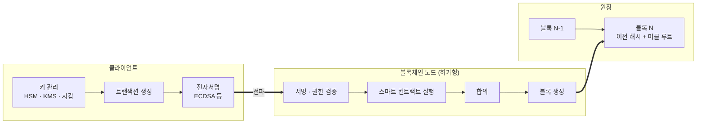

# 블록체인 암호기술 가이드라인

---

## I. 블록체인 도입의 암호 기준, 블록체인 암호기술 가이드라인의 개요

### 가. 정의

- 공공·금융 분야가 [[01_IT Tech/블록체인|블록체인]] 시스템을 도입할 때 **해시·전자서명·키 관리·난수·프라이버시 기술 등 기반 암호기술의 선택과 적용 기준**을 제시하는 보안 지침

### 나. 필요성 및 특징

| 구분 | 내용 |
| --- | --- |
| 기준 부재 | 플랫폼마다 다른 알고리즘·키 관리 방식으로 안전성 편차 |
| 키 의존성 | 개인키 유출이 곧 자산·권한 탈취로 이어짐 |
| 난수 위험 | 서명 난수 재사용 시 개인키 노출 (ECDSA) |
| 불변성 | 기록 후 수정 불가하여 암호 선택 실수가 장기화 |
| 범위 | 허가형 블록체인 중심, 원장·트랜잭션·스마트 컨트랙트 계층 |

---

## II. 적용 구조 및 구성요소

### 가. 암호기술 적용 흐름

- 클라이언트의 키 관리·서명부터 노드의 서명 검증, 원장의 해시 체이닝까지 각 단계의 암호 요구사항을 정의

### 나. 구성요소

| 구분 | 요소 | 설명 |
| --- | --- | --- |
| 무결성 | 해시 함수 | SHA-256 등 충돌·역상 저항성을 갖춘 알고리즘으로 블록 연결 |
| | 머클 트리 | 트랜잭션 집합을 머클 루트로 요약, 포함 증명 |
| 인증 | 전자서명 | ECDSA·EdDSA 등으로 트랜잭션 서명 |
| 접근 제어 | 허가형 멤버십 | CA 인증서로 노드·사용자 권한 부여 (Fabric MSP 등) |
| 난수 | 안전한 난수 생성기 | 키·서명 난수의 예측·재사용 방지 (RFC 6979 결정적 서명) |
| 키 관리 | HSM·[[KMS]] | 개인키 생성·보관·폐기를 분리된 보안 영역에서 수행 |
| 프라이버시 | [[영지식증명]] | 거래 내용 공개 없이 유효성 증명 |
| 실행 무결성 | 스마트 컨트랙트 검증 | 정적 분석, 정형 검증, 외부 감사 |

---

## III. 비교 및 동향

### 가. 전통 시스템 vs 블록체인의 암호 활용

| 비교 항목 | 전통 시스템 | 블록체인 |
| --- | --- | --- |
| 주요 목적 | 저장·전송 데이터의 [[기밀성]] | 원장 [[무결성]]과 부인방지 |
| 키 관리 | 중앙 KMS | 사용자·노드별 개인키 분산 관리 |
| 데이터 연결 | 레코드별 독립 암호화 | 해시 체인으로 상호 의존 |
| 신뢰 기반 | 신뢰할 수 있는 제3자 | 합의와 다자 검증 |

### 나. 동향

- **PQC 전환 대비**: Shor 알고리즘에 취약한 ECDSA 서명을 양자내성 서명으로 바꾸기 위한 주소·서명 체계 연구
- **개인정보 삭제권 대응**: 개인정보는 오프체인에 두고 원장에는 해시·참조만 기록, 키 폐기(Crypto-shredding)로 삭제 효과 확보
- **MPC 지갑**: 개인키를 분할 보관하는 MPC·[[다중서명]] 기반 기관 커스터디 확산

---

### 🔗 연관 토픽

- **소속 도메인**: [[00_보안_MOC|🛡️ 보안]]
- **세부 분류**: `2. 현대 암호학 & 키 관리 · 전자서명`
- **핵심 연관 토픽**:
  - [[블록체인 플랫폼|블록체인 (Block Chain) 플랫폼]]
  - [[다중서명]]
  - [[ECC|ECC(Elliptic Curve Cryptography)]]
  - [[해시함수|해시함수(알고리즘 측면)]]
  - [[영지식증명|영지식증명(Zero Knowledge Proof)]]
