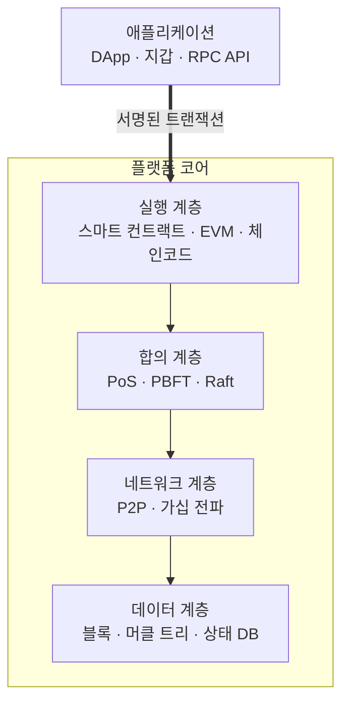

# 블록체인 (Block Chain) 플랫폼

---

## I. 탈중앙 신뢰 인프라, 블록체인 플랫폼의 개요

### 가. 정의

- 분산 원장·[[합의 알고리즘]]·암호 기술·스마트 컨트랙트 실행 환경을 제공하여 **탈중앙화 애플리케이션(DApp)과 기업 간 공유 원장 서비스를 구축·운영하는 기반 소프트웨어** ([[01_IT Tech/블록체인|블록체인]])

### 나. 특징

| 구분 | 내용 |
| --- | --- |
| 탈중앙화 | P2P 노드가 원장을 공동 보관, 단일 장애점 제거 |
| 위변조 저항 | 해시 체인·머클 트리로 기록 변경 탐지 |
| 자동 실행 | 스마트 컨트랙트로 조건 충족 시 거래 자동 처리 |
| 투명성 | 참여자 간 동일한 거래 이력 공유 |
| 트릴레마 | 탈중앙성·보안성·확장성을 동시에 높이기 어려움 |

---

## II. 계층 구조 및 구성요소

### 가. 플랫폼 계층

- 서명된 [[트랜잭션]]이 실행·합의를 거쳐 전파되고 블록과 상태 DB에 기록

### 나. 구성요소

| 구분 | 요소 | 설명 |
| --- | --- | --- |
| 네트워크 | P2P·가십 프로토콜 | 트랜잭션·블록을 노드 간 전파 |
| 데이터 | 해시 체인·머클 트리 | 이전 블록 해시 연결, 거래 집합 요약 |
| | 상태 DB | 계정·자산 최신 상태 (LevelDB, CouchDB 등) |
| 인증 | 전자서명 | 개인키 서명으로 거래 출처·부인방지 |
| 합의 | PoW·PoS | 퍼블릭 체인의 블록 생성 권한 결정 |
| | PBFT·Raft | 허가형 체인의 합의 (PBFT는 비잔틴 장애, Raft는 단순 장애 허용) |
| 실행 | 스마트 컨트랙트 | 가상머신(EVM 등) 위 자동 실행 코드 |
| 확장성 | 레이어2·모듈러 구조 | 롤업, 데이터 가용성(DA) 계층 분리 |
| 프라이버시 | [[영지식증명]] | 내용 공개 없이 거래 유효성 증명 |

---

## III. 비교 및 동향

### 가. 퍼블릭 vs 프라이빗·컨소시엄

| 비교 항목 | 퍼블릭 | 프라이빗·컨소시엄 |
| --- | --- | --- |
| 참여 | 누구나 (비허가형) | 승인된 노드 (허가형) |
| 합의 | PoW, PoS | PBFT, Raft |
| 성능 | 레이어1은 수십~수천 TPS | 수천 TPS 수준 |
| 토큰 | 노드 보상에 필수 | 선택 |
| 대표 | Ethereum, Solana | Hyperledger Fabric, R3 Corda, Besu(허가형) |

### 나. 동향

- **모듈러 블록체인**: 실행·합의·데이터 가용성 분리와 롤업 중심 확장 (Celestia, 이더리움 롤업)
- **실물자산 토큰화(RWA)**: 채권·펀드 토큰화와 증권형 토큰 제도화 논의
- **CBDC·예금 토큰 실험**: 한국은행 프로젝트 한강 등 중앙은행·상업은행 실증

---

### 🔗 연관 토픽

- **소속 도메인**: [[00_보안_MOC|🛡️ 보안]]
- **세부 분류**: `2. 현대 암호학 & 키 관리 · 전자서명`
- **핵심 연관 토픽**:
  - [[01_IT Tech/블록체인|블록체인 (Block Chain)]]
  - [[블록체인 암호기술 가이드라인]]
  - [[합의 알고리즘]]
  - [[영지식증명|영지식증명(Zero Knowledge Proof)]]
  - [[다중서명]]
