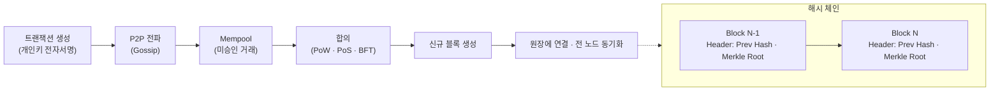

# 블록체인 (Block Chain)

---

## I. 중개자 없는 신뢰, 블록체인의 개요

### 가. 정의

- P2P 네트워크의 참여 노드가 **[[합의 알고리즘]]으로 [[트랜잭션]]을 검증하고, 해시로 연결된 블록 형태의 원장을 공동 보관**하는 분산 원장 기술(DLT)

### 나. 특징

| 구분 | 내용 |
| --- | --- |
| 필요성 | 중앙 기관 의존·단일 장애점(SPOF) 해소, 중개 비용 절감 |
| 탈중앙화 | 중앙 관리자 없이 노드 간 합의로 운영 |
| 불변성 | 이전 블록 해시를 포함하는 체인 구조로 위변조가 사실상 어려움 |
| 투명성 · 추적성 | 거래 내역 공유·추적 가능 (퍼블릭 기준) |
| 한계 | 확장성·보안성·탈중앙성을 동시에 만족하기 어려움 (블록체인 트릴레마) |

---

## II. 구조 및 핵심 기술

### 가. 동작 구조

- 서명된 거래가 P2P로 전파되고, 합의를 거쳐 블록으로 묶여 이전 블록 해시와 연결된 뒤 모든 노드에 동기화

### 나. 핵심 기술

| 구분 | 요소 | 설명 |
| --- | --- | --- |
| 네트워크 | P2P · Gossip | 중앙 서버 없이 노드 간 직접 전파·동기화 |
| 암호 | [[해시함수]] | SHA-256(비트코인), Keccak-256(이더리움)으로 블록 연결·[[무결성]] 검증 |
| | [[전자 서명]] | 개인키 서명·공개키 검증으로 소유권 증명·부인 방지 (ECDSA) |
| 자료구조 | 머클 트리 | 거래 해시를 트리로 집약, 블록 헤더의 Merkle Root로 포함 여부를 빠르게 검증 |
| 합의 | [[합의 알고리즘]] | PoW, PoS, DPoS, PBFT 등 |
| 응용 | 스마트 컨트랙트 | 조건 충족 시 자동 실행되는 온체인 코드 |
| | EVM (Ethereum Virtual Machine) | 스마트 컨트랙트를 실행하는 튜링 완전 가상 머신 |
| 확장성 | Layer 2 (Rollup) | 오프체인에서 실행하고 결과·증명만 L1에 기록 (Optimistic, ZK) |

---

## III. 비교 및 동향

### 가. 퍼블릭 vs 프라이빗(컨소시엄) 블록체인

| 비교 항목 | 퍼블릭 | 프라이빗 / 컨소시엄 |
| --- | --- | --- |
| 참여 | 누구나 참여·검증 (Permissionless) | 승인된 노드만 (Permissioned) |
| 처리 속도 | 낮음 (수~수천 TPS, 체인별 상이) | 높음 (소수 노드 합의) |
| 운영 주체 | 커뮤니티 | 기업·컨소시엄 |
| 암호화폐 보상 | 필요 (참여 인센티브) | 불필요 |
| 합의 | PoW, PoS | PBFT, Raft |
| 사례 | Bitcoin, Ethereum, Solana | Hyperledger Fabric, R3 Corda |

### 나. 동향

- **모듈러 블록체인**: 실행·합의·데이터 가용성(DA) 계층을 분리해 확장성 확보 (Ethereum Rollup 중심 로드맵, Celestia)
- **실물자산 토큰화(RWA)**: 채권·펀드·부동산을 토큰으로 발행, 국내는 토큰증권(STO) 제도화 추진
- **영지식 증명**: [[영지식증명|ZKP]] 기반 ZK-Rollup과 DID 등 프라이버시 보호 응용 확대

---

### 🔗 연관 토픽

- **소속 도메인**: [[00_디지털서비스_MOC|🚀 디지털서비스]]
- **세부 분류**: `2. 블록체인 & 분산원장 · Web3`
- **핵심 연관 토픽**:
  - [[합의 알고리즘|합의 알고리즘 (Consensus Algorithm)]]
  - [[블록체인 플랫폼|블록체인 (Block Chain) 플랫폼]]
  - [[해시함수]]
  - [[영지식증명|영지식증명(Zero Knowledge Proof)]]
  - [[Web 3.0]]
